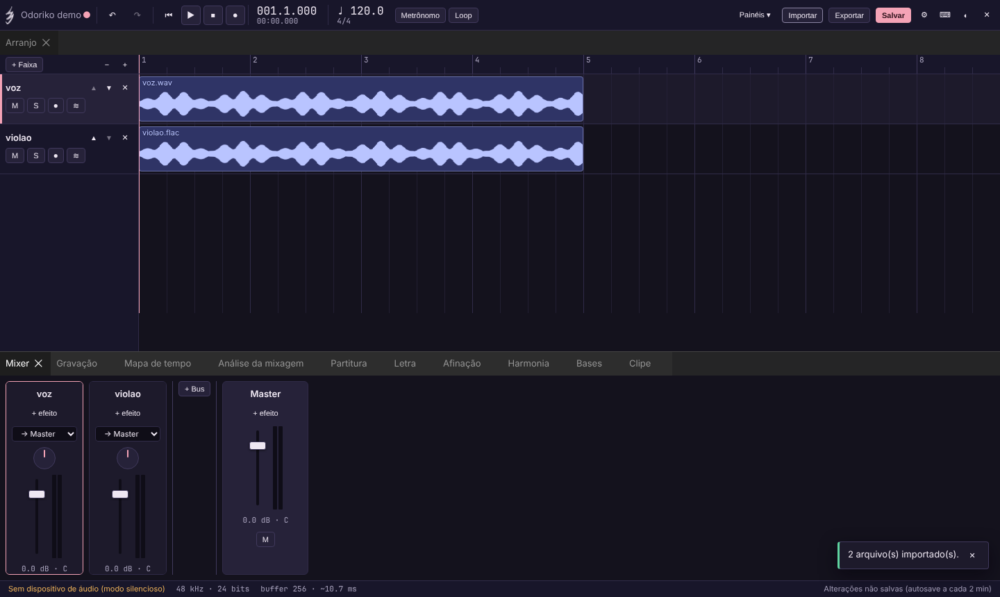
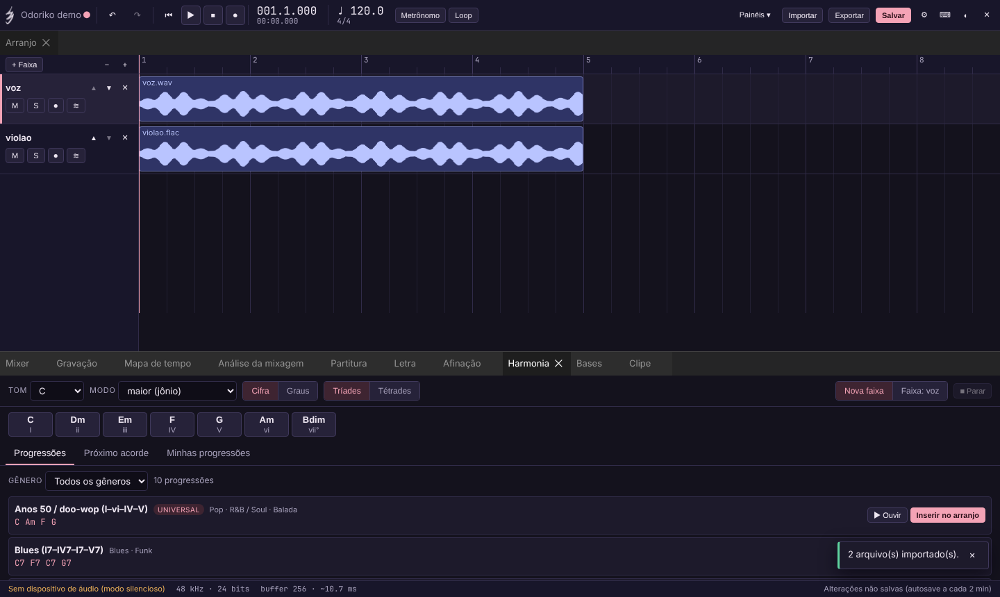
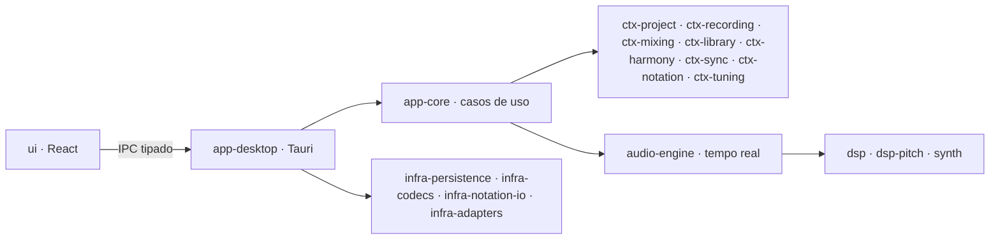

<p align="center">
  
</p>

<h1 align="center">Ebiki Studio</h1>

<p align="center">
  Estúdio musical para computador — gravar, mixar, editar, compor, escrever partitura e afinar,
  num app só, <b>offline</b> e sem coletar dados.
</p>

<p align="center">
  <a href="https://github.com/TokumoH/Ebiki-Studio/actions/workflows/ci.yml"></a>
  <a href="LICENSE"></a>
  
</p>



## O que ele faz

| Área | Recursos |
|---|---|
| **Gravação** | Mono/estéreo, várias entradas ao mesmo tempo, punch-in/out, takes, metrônomo com contagem, baixa latência (APIs nativas) |
| **Mixagem** | EQ paramétrico, compressor, gate, saturação, chorus, delay, reverb, limiter; buses e envios; medidores pico/RMS/LUFS/correlação e conselhos por regras |
| **Edição** | Não destrutiva: dividir, aparar, fades e crossfades, normalizar, inverter fase, reverter, ganho de clipe, espectrograma; desfazer ilimitado |
| **Composição** | Campos harmônicos (maior, menores, modos gregos), progressões por gênero, próximo acorde, ouvir e arrastar para o arranjo |
| **Bases** | Bases iniciais geradas pelo app, bases suas e suporte a pacotes CC0, com BPM, tom e gênero |
| **Partitura** | Partitura e tablatura com editor completo, reprodução por SoundFont, MusicXML/MIDI/Guitar Pro, impressão em PDF |
| **Letra** | Sincronização por sílaba, exportação LRC e SRT |
| **Afinação** | Afinador em tempo real, correção de afinação ao vivo e offline, edição nota a nota, time-stretch |
| **Formatos** | Importa WAV, AIFF, FLAC, MP3, OGG, M4A; exporta WAV, FLAC, AIFF, MP3, OGG e stems |

Interface em português do Brasil, tema escuro "Odoriko" e claro "Agridoce".



## Começar

**Instaladores prontos** (Windows, macOS e Linux): página de
[Releases](https://github.com/TokumoH/Ebiki-Studio/releases/latest) — veja as notas da versão para
abrir um app não assinado.

Para compilar a partir do código:
Guia passo a passo para Windows, macOS e Linux (pré-requisitos, execução, instaladores, roteiro de
teste e problemas comuns): **[docs/manual/guia-instalacao-local.md](docs/manual/guia-instalacao-local.md)**.

Resumo, com Node 22 e Rust ([rustup](https://rustup.rs)) instalados:

```bash
git clone --branch branchTrabalho https://github.com/TokumoH/Ebiki-Studio.git
```

```bash
cd Ebiki-Studio
```

```bash
npm --prefix ui ci
```

```bash
npm run dev
```

Só a interface no navegador, com núcleo simulado (sem áudio): `npm run ui` → <http://localhost:5173>.

Manual de uso completo: [docs/manual/README.md](docs/manual/README.md).

## Arquitetura

DDD com um crate Rust por contexto (`crates/ctx-*`), serviços técnicos isolados (GRASP Pure
Fabrication: `audio-engine`, `dsp`, `dsp-pitch`, `synth`, `infra-*`), camada de aplicação testável
sem interface (`app-core`), Tauri como adaptador (`app-desktop`) e interface React por componentes (`ui/`).



| Documento | Onde |
|---|---|
| Requisitos | [docs/requisitos/](docs/requisitos/) |
| Arquitetura | [docs/arquitetura/](docs/arquitetura/) |
| Decisões (ADRs) | [docs/adr/](docs/adr/README.md) |
| Especificações por fase | [docs/specs/](docs/specs/) |
| Processo (espiral, convenções, varredura) | [docs/processo/](docs/processo/) |
| Relatórios | [docs/relatorios/](docs/relatorios/) |

## Qualidade

Desenvolvimento orientado a testes: testes de domínio, integração, simulação offline da engine,
verificação de "nenhuma alocação" na thread de áudio, testes de propriedade, contrato IPC entre Rust
e TypeScript, testes de interface e de ponta a ponta (Playwright). A CI roda tudo em Windows, macOS
e Linux a cada envio, mais CodeQL e auditoria de dependências.

Para rodar localmente as mesmas verificações da CI:

```bash
scripts/ci-local.sh
```

## Privacidade e segurança

- Sem telemetria, sem contas, sem conexões de rede — veja [PRIVACY.md](PRIVACY.md).
- Para reportar vulnerabilidades, siga o [SECURITY.md](SECURITY.md) (reporte privado, não use issues).

## Licença

O código é distribuído sob a **GNU General Public License v3.0 ou posterior** — veja [LICENSE](LICENSE).

O nome **Ebiki Studio** e a **logo** não fazem parte da licença do código: todos os direitos
reservados ([assets/brand/LICENSE.md](assets/brand/LICENSE.md)). Versões modificadas devem usar
outro nome e outros ícones.

Componentes de terceiros mantêm suas licenças (todas compatíveis com a GPL-3.0: MIT, Apache-2.0,
BSD, MPL-2.0, LGPL).
