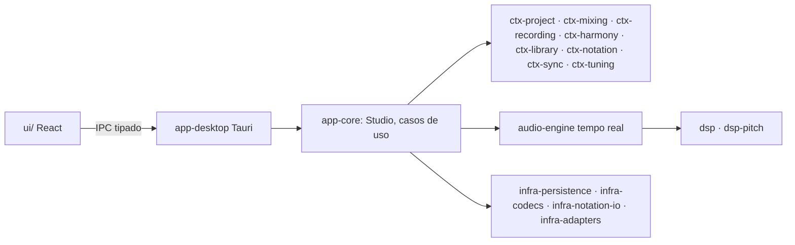

# Ebiki Studio

Estúdio musical pessoal para computador (Windows, macOS, Linux): gravação com retorno de baixa
latência, mixagem com efeitos e auxílio por regras, edição não destrutiva, bases instrumentais,
harmonia e sugestão de progressões, partitura/tablatura, letra sincronizada e afinação.

- **Manual de uso:** [`docs/manual/README.md`](docs/manual/README.md)
- **Requisitos:** [`docs/requisitos/`](docs/requisitos/)
- **Arquitetura:** [`docs/arquitetura/`](docs/arquitetura/) · decisões em [`docs/adr/`](docs/adr/README.md)
- **Especificações por fase:** [`docs/specs/`](docs/specs/)
- **Processo (espiral, convenções, varredura):** [`docs/processo/`](docs/processo/)
- **Relatórios de varredura:** [`docs/relatorios/`](docs/relatorios/)

## Arquitetura em uma linha
DDD com um crate Rust por bounded context (`crates/ctx-*`), serviços técnicos isolados
(GRASP Pure Fabrication: `audio-engine`, `dsp`, `dsp-pitch`, `synth`, `infra-*`), camada de
aplicação testável sem UI (`app-core`), Tauri como adaptador de entrada (`app-desktop`) e UI React
por componentes (`ui/`).



## Desenvolvimento

```bash
npm --prefix ui ci
```

```bash
npm run dev
```

```bash
npm test
```

A CI (GitHub Actions) roda formatação, clippy e todos os testes Rust nos três sistemas, e na UI:
tipos, Vitest, build e Playwright.
