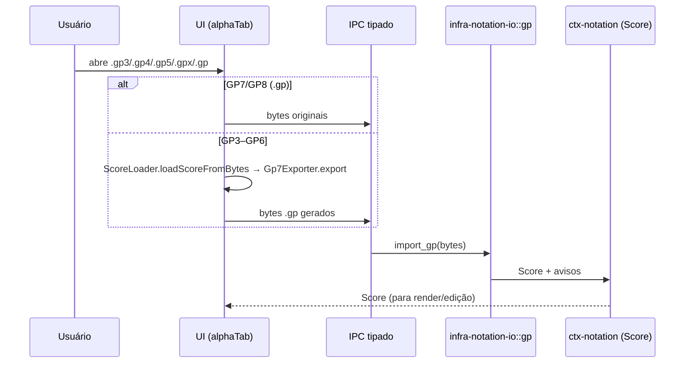

# ADR-0020: Importação de Guitar Pro via alphaTab (GP3–GP6 → GP7) + leitor GPIF em Rust

- **Data:** 2026-11-05
- **Status:** Aceita

## Contexto
O RF-9.1 pede a importação de Guitar Pro. O formato é proprietário e tem três gerações:
- **GP3/GP4/GP5**: binários sequenciais;
- **GP6 (`.gpx`)**: contêiner próprio ("BCFS"/"BCFZ") com XML GPIF dentro;
- **GP7/GP8 (`.gp`)**: zip padrão com `Content/score.gpif` (XML GPIF).

O alphaTab (ADR-0010) já está na UI. Pesquisa feita em 2026-11-05 na documentação oficial:
- o importador do alphaTab lê **Guitar Pro 3 a 8**, MusicXML, Capella e alphaTex;
- os exportadores disponíveis são **Guitar Pro 7** (`alphaTab.exporter.Gp7Exporter`, desde 1.2.0) e
  **alphaTex** (desde 1.7.0). O alphaTab **não** exporta MusicXML;
- desde a 1.9.0 o `Gp7Exporter` preenche corda/traste também em pautas sem afinação, corrigindo
  arquivos GP7 quebrados para partes de piano (issue #2827).

Fontes: <https://www.alphatab.net/docs/features/export/export-to-guitar-pro-7>,
<https://www.alphatab.net/docs/features/import-load/>, <https://alphatab.net/docs/guides/exporter>,
<https://github.com/CoderLine/alphaTab/issues/2827>.

## Decisão
1. **Rust lê só GPIF** (`infra-notation-io::gp`): `.gp` (zip) e o XML GPIF bruto, mapeando o
   subconjunto central para o agregado `Score` (faixas, pautas com afinação/capotraste, compassos
   mestres com fórmula/armadura/repetição, vozes, batidas, ritmos com pontos e quiálteras, dinâmicas,
   apojaturas, notas com corda/traste, ligadura, acentos e técnicas, andamento).
2. **GP3–GP6 são convertidos na UI**: o adaptador de notação carrega o arquivo com o `ScoreLoader` do
   alphaTab, exporta com `Gp7Exporter` (versão ≥ 1.9.0) e envia os bytes `.gp` ao núcleo pelo IPC
   tipado (comando `notation.import_guitar_pro`). O núcleo nunca executa o parser binário.
3. O comando de IPC recebe bytes com o mesmo limite de 32 MiB e passa por `gp::import_gp`.

## Consequências
- O núcleo Rust continua com um parser só (XML), coberto por testes e fuzz; nenhum parser binário
  proprietário no núcleo.
- A importação de GP3–GP6 depende da UI (alphaTab). Para importar sem UI (ex.: linha de comando),
  seria preciso um parser binário em Rust — fora do escopo atual.
- A exportação para Guitar Pro, se pedida, também pode passar pelo `Gp7Exporter` (a UI converte o
  `Score` para o modelo do alphaTab via MusicXML ou alphaTex). A exportação oficial do núcleo é MusicXML.
- Convenções GPIF assumidas (conferidas no `GpifParser` do alphaTab): afinação da corda grave para a
  aguda, `String` 0 = corda mais grave, bend em 1/100 de tom, acentos em bits (1, 4, 8, 16).

## Alternativas consideradas
- **Parser binário GP3–GP5 em Rust** (ex.: crate `guitarpro`): esforço e risco altos, cobertura
  incompleta, nova superfície de ataque em formato binário.
- **alphaTab → MusicXML → Rust**: inviável, o alphaTab não exporta MusicXML.
- **alphaTab → alphaTex → Rust**: exigiria um parser de alphaTex em Rust; o GPIF é mais estável e
  documentado pela própria implementação do alphaTab.
