# AppMusica — Arquitetura Geral

- **Data:** 2026-11-05
- **Status:** Aprovada (seções 1 a 4)
- **Requisitos:** [`../requisitos/2026-11-05-levantamento-requisitos.md`](../requisitos/2026-11-05-levantamento-requisitos.md)
- **Decisões:** [`../adr/`](../adr/)

---

## 1. Visão de Contexto (C4 — Nível 1)

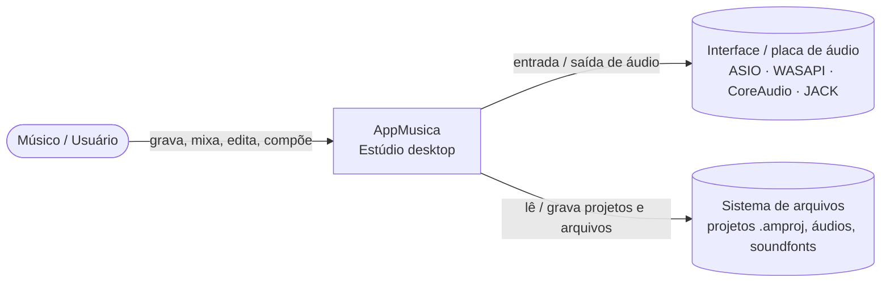

## 2. Camadas (arquitetura hexagonal + DDD)

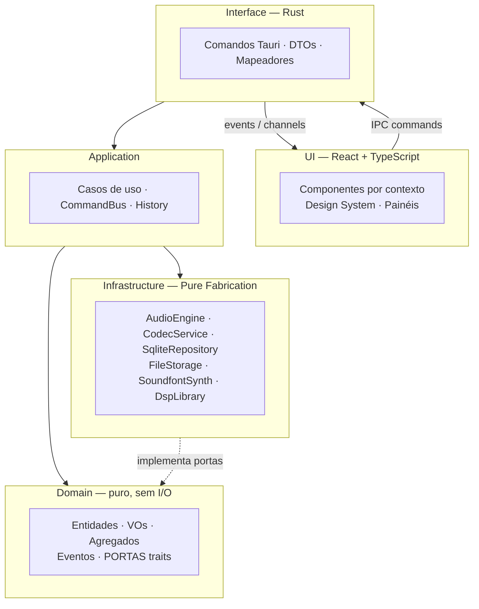

**Regra de dependência:** todas as dependências apontam para o domínio; o domínio não depende de nenhuma outra camada.

## 3. Bounded Contexts

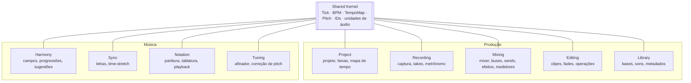

| Contexto | Responsabilidade | Agregados principais (preliminar) |
|---|---|---|
| Project | Projeto, faixas, mapa de tempo, fontes de áudio | `Project`, `Track`, `TempoMap` |
| Recording | Gravação, takes, punch, metrônomo | `RecordingSession`, `TakeLane` |
| Mixing | Mixer, roteamento, efeitos, medição | `MixerGraph`, `EffectChain` |
| Editing | Clipes, fades, operações não destrutivas | `ClipArrangement` |
| Library | Bases instrumentais e metadados | `Base`, `Catalog` |
| Harmony | Campos harmônicos, progressões, sugestões | `HarmonicField`, `Progression` |
| Sync | Letra sincronizada, alinhamento, time-stretch | `LyricTrack`, `WarpMap` |
| Notation | Partitura/tablatura, edição, reprodução | `Score` |
| Tuning | Afinação e correção de pitch | `PitchCorrectionMap` |

**Comunicação entre contextos:** somente por **eventos de domínio** e **IDs**; nunca referência direta a agregados de outro contexto. Import/Export é **infraestrutura** (`CodecService`), não contexto.

### Pontos de extensão (portas)

| Porta (trait) | Implementação inicial | Extensão futura |
|---|---|---|
| `SuggestionProvider` | `RuleBasedHarmonySuggester` | IA de composição |
| `MixAdvisor` | `RuleBasedMixAdvisor` | IA de mixagem |
| `EffectProcessor` | Efeitos nativos | Host VST3 / CLAP |
| `ParameterSource` | Valor constante | Curvas de automação |
| `PitchDetector` | YIN / MPM | Modelo de IA |
| `AudioBackend` | `cpal` | Bindings diretos por SO |

## 4. Organização do Repositório

```
AppMusica/
├── crates/                     # Cargo workspace
│   ├── shared-kernel/
│   ├── ctx-project/            # domain + application de cada contexto
│   ├── ctx-<contexto>/         # criados conforme as fases
│   ├── audio-engine/           # Pure Fabrication: engine em tempo real
│   ├── infra-persistence/      # SQLite, repositórios, migrações
│   ├── infra-codecs/           # import / export
│   └── app-desktop/            # Tauri: comandos, composition root
├── ui/src/{shared,contexts,panels,app,ipc}
├── docs/{requisitos,arquitetura,adr,specs,diagramas,manual}
└── .github/workflows/
```

Um crate por contexto faz o **compilador** garantir a independência entre contextos.

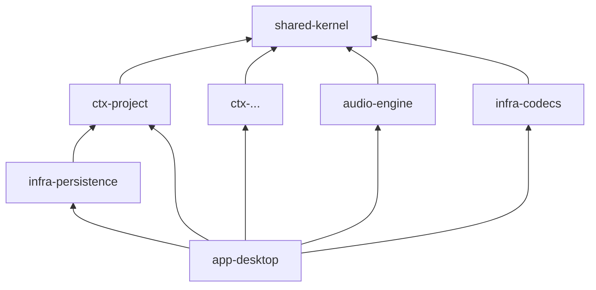

---

## 5. Engine de Áudio

### 5.1 Modelo de Threads

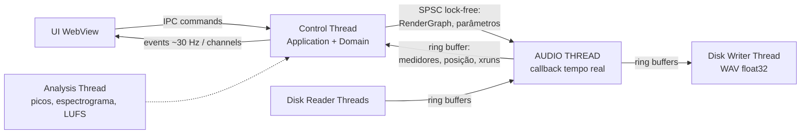

**Regra de ouro da Audio Thread:** sem alocação, sem `lock`, sem I/O, sem log, sem `panic`. Verificado em CI (`assert_no_alloc`).

### 5.2 Grafo de Áudio

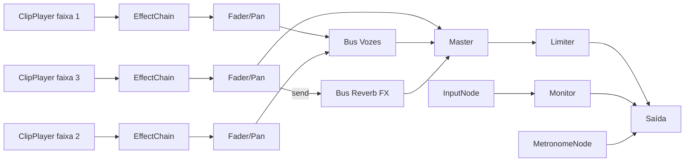

- Domínio descreve a mixagem → Control Thread **compila** um `RenderGraph` plano (ordem topológica).
- Troca **atômica** do grafo na Audio Thread; grafo antigo devolvido para desalocação fora do tempo real.
- Parâmetros via atômicos com suavização (sem recompilar o grafo).
- Todo nó implementa `AudioNode::process(&mut self, ctx, buffers)`.

### 5.3 Backends

| SO | API | Biblioteca |
|---|---|---|
| Windows | ASIO (preferencial), WASAPI exclusivo | `cpal` (feature `asio`) |
| macOS | CoreAudio | `cpal` |
| Linux | JACK / PipeWire, ALSA | `cpal` |

- Buffer 64 amostras @ 48 kHz = 1,33 ms por bloco; ida e volta estimada 5–10 ms (ASIO/CoreAudio).
- **Buffer adaptativo:** detecção de xruns → sugere/aumenta (64 → 128 → 256). Perfis "Gravação" (mínimo) e "Mixagem" (maior).
- **Compensação de latência:** medição de ida e volta para alinhar gravações; PDC preparado.

### 5.4 Formatos Internos

- Áudio `f32` não intercalado; posição em amostras `u64`.
- Tempo musical em `Tick` (960 PPQ); conversão via `TempoMap` (BPM e compasso variáveis).
- Import: decodificação `symphonia`, conversão de taxa `rubato`; original preservado.

### 5.5 Máquina de Estados do Transporte

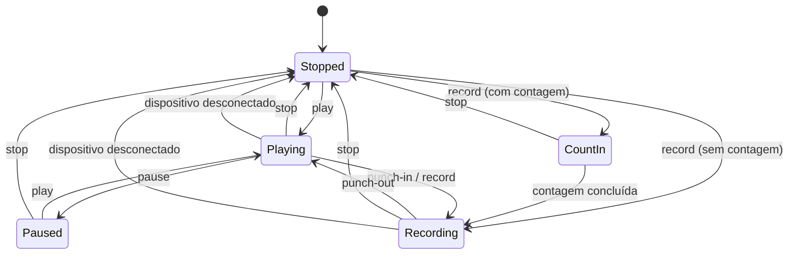

### 5.6 Testabilidade

- **Modo offline:** engine processa sem dispositivo; testes determinísticos amostra a amostra.
- `assert_no_alloc` no callback em CI.
- Benchmarks `criterion` (custo por bloco com 32 faixas).

---

## 6. Persistência

### 6.1 Bancos

| Banco | Local | Conteúdo |
|---|---|---|
| `project.db` | Pasta do projeto | Faixas, clipes, mapa de tempo, mixer, takes, letras, partituras |
| `library.db` | Dados do usuário no SO | Harmonia, catálogo de bases, presets, preferências, atalhos, recentes |

### 6.2 Pasta do Projeto

```
MinhaMusica.amproj/
├── project.db                  # SQLite WAL
├── audio/imported/<sha256>.<ext>
├── audio/recorded/<uuid>.wav
├── cache/                      # regenerável
└── backups/                    # autosave rotativo
```

### 6.3 Normalização e Leitura

- Mínimo **3FN/FNBC**; **4FN** em multivalorados (tabelas associativas).
- **Nada derivável é armazenado** — progressões em **graus relativos**; acordes do campo derivados de escala + grau.
- Índices em FKs e filtros; **views** para leituras frequentes.
- Desnormalização apenas como **tabela de leitura regenerável**, após medição e aprovação.
- Projeto carregado em memória; banco é persistência.

### 6.4 DER Preliminar — Fase 0 (`project.db`)

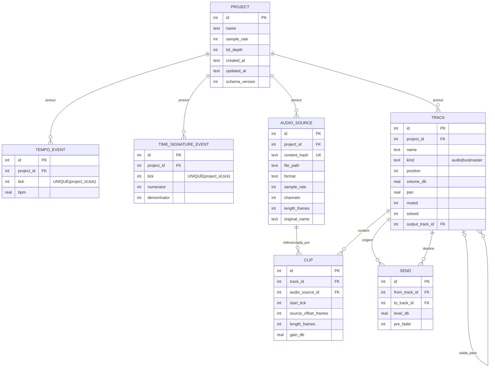

### 6.5 Tecnologia

| Item | Escolha |
|---|---|
| Driver | `rusqlite` |
| Migrações | `refinery` (versão por arquivo de projeto) |
| Padrão | Repository por agregado (trait no domínio, impl na infraestrutura) |
| Autosave | Transação + `VACUUM INTO` (backup rotativo) |
| Undo/Redo | Em memória (não persistido) |

---

## 7. UI, IPC e Undo/Redo

### 7.1 Canais IPC

| Canal | Direção | Uso | Formato |
|---|---|---|---|
| Commands | UI → Rust | Intenções do usuário | JSON tipado |
| Events | Rust → UI | Eventos de domínio | JSON tipado |
| Channels | Rust → UI | Posição, medidores, picos | Binário (`ArrayBuffer`) |

Tipos TS gerados do Rust via `tauri-specta`. O núcleo Rust é a **fonte da verdade**; a UI mantém uma projeção.

### 7.2 Fluxo de um Comando com Undo

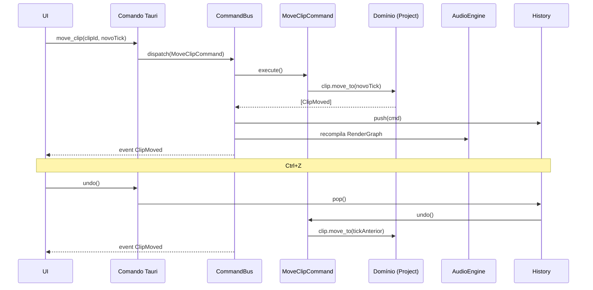

- Todo comando mutável passa pelo `CommandBus`.
- Gestos contínuos geram **um** item no histórico (comando composto).
- Ações sem alteração (play, zoom) não entram no histórico.

### 7.3 Componentes da UI

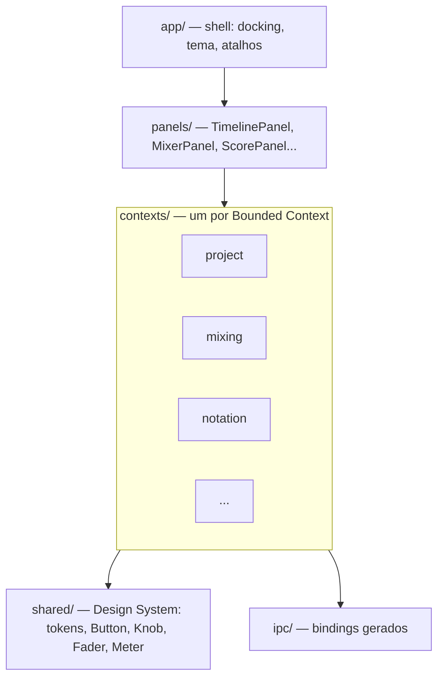

**Regra:** um contexto da UI nunca importa outro; composição apenas em `panels/`.

| Necessidade | Escolha |
|---|---|
| Estado | Zustand (store por contexto) |
| Docking | `dockview` |
| Timeline / waveform | Canvas 2D (WebGL se necessário) |
| Partitura / tablatura | alphaTab |
| Tema | CSS custom properties; escuro padrão |
| Atalhos | `KeymapService` persistido em `library.db` |

### 7.4 Tratamento de Erros

- Erros de domínio tipados (`thiserror`) → código no DTO → mensagem PT-BR.
- Dispositivo desconectado → transporte para, UI oferece reconexão.
- Crash → recuperação do último autosave.
- Audio Thread nunca entra em `panic`; nó com falha emite silêncio e telemetria.

### 7.5 Testes de UI

- Vitest + Testing Library (componentes isolados).
- Storybook (catálogo do design system e revisão de mockups).
- E2E com `tauri-driver` (Linux/Windows na CI).

---

## 8. Roteiro de Fases

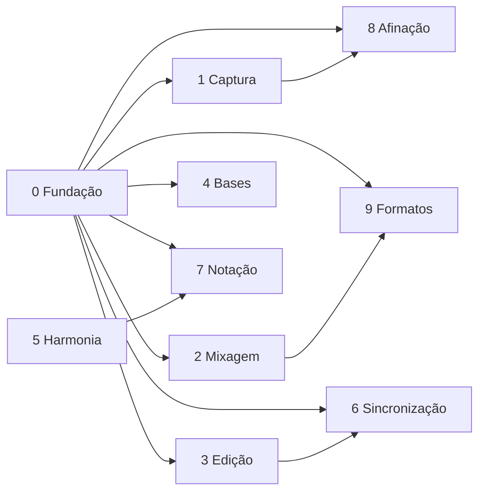
