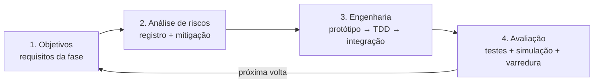

# Processo em Espiral com Arquitetura de Testes

O desenvolvimento segue o **modelo espiral (Boehm)**: cada fase do roteiro é uma volta da espiral com
quatro quadrantes. O objetivo é **atacar o maior risco primeiro** e **nunca ter código sem teste**.



## Quadrantes por volta

| Quadrante | Saída obrigatória |
|---|---|
| 1. Objetivos | Seção da spec da fase (`docs/specs/`) |
| 2. Riscos | Tabela de riscos na spec, com mitigação e teste que comprova a mitigação |
| 3. Engenharia | Código com TDD; protótipo descartável apenas quando o risco técnico for alto |
| 4. Avaliação | Suíte verde + **simulação** (render offline) + **varredura** (`varredura.md`) + relatório |

## Pirâmide de testes

```
              ┌────────────┐
              │  E2E UI    │  Playwright com transporte IPC simulado (MockTransport)
              ├────────────┤
              │ Simulação  │  render offline da engine: sessões completas → métricas (pico, RMS, LUFS, sincronia)
              ├────────────┤
              │ Integração │  SQLite real (arquivo temporário), codecs com arquivos gerados, IPC handlers
              ├────────────┤
              │  Unitários │  domínio puro, DSP, teoria musical, componentes React isolados
              └────────────┘
   Transversais: testes de propriedade (invariantes matemáticos), assert_no_alloc no callback de áudio,
   benchmarks de custo por bloco.
```

| Camada | Ferramenta | Onde |
|---|---|---|
| Unitários Rust | `cargo test` | `crates/*/src` (módulos `tests`) |
| Propriedade | `proptest` | conversões de tempo, ganho, DSP |
| Integração Rust | `cargo test` em `crates/*/tests/` | persistência, codecs, engine |
| Simulação | `crates/infra-adapters/tests/full_chain.rs`, `crates/app-core/tests/*` | cenários de sessão completos (importar → mixar → exportar → analisar) renderizados offline com asserções de áudio |
| Não-alocação | `assert_no_alloc` | testes da engine |
| UI unitários | Vitest + Testing Library | `ui/src/**/*.test.tsx` |
| E2E UI | Playwright + MockTransport | `ui/e2e/` |

## Regras

1. Nenhum código de produção sem teste que falhe antes (TDD).
2. Todo bug corrigido ganha um **teste de regressão**.
3. Toda correção dispara **varredura + simulação** antes do commit.
4. Testes fracos (que não verificam a função) são substituídos na varredura.
5. CI roda a pirâmide inteira nos três sistemas.
