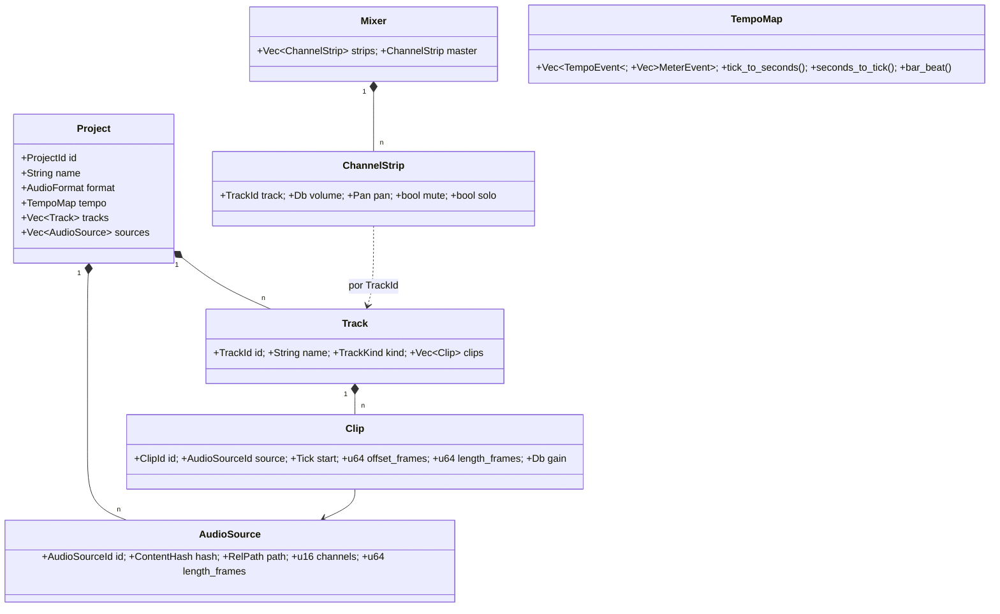
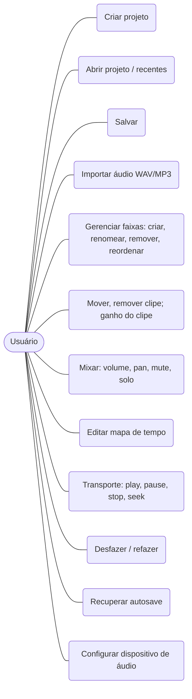
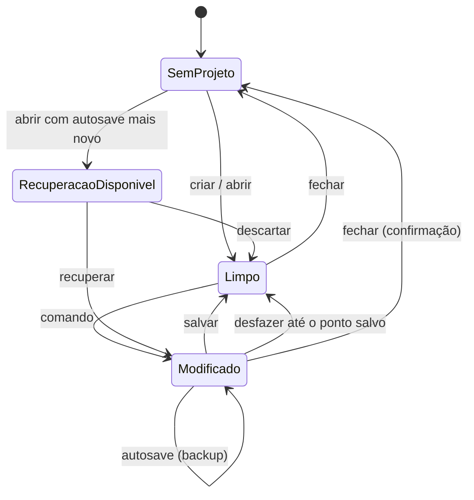

# Fase 0 — Fundação (Especificação)

- **Data:** 2026-11-05 · **Volta da espiral:** 1 · **Status:** Aprovada (modo autônomo)
- **Requisitos:** RF-0.1 a RF-0.7, RNF-01 a RNF-08

## 1. Objetivos

Criar a espinha dorsal: projeto em pasta, arranjo multitrilha com mapa de tempo variável, importação WAV/MP3,
reprodução sincronizada com volume/pan/mute/solo, desfazer/refazer ilimitado, autosave com recuperação.

## 2. Riscos (volta 1)

| ID | Risco | Prob. | Impacto | Mitigação | Teste que comprova |
|---|---|---|---|---|---|
| R1 | Estalos por alocação/lock na thread de áudio | Média | Alto | Grafo pré-compilado, troca por fila SPSC, `assert_no_alloc` | `engine::no_alloc_in_process` |
| R2 | Dessincronia entre faixas | Média | Alto | Posição única em amostras; conversão tick→amostra só no compilador do grafo | simulação `sync_two_tracks_sample_accurate` |
| R3 | Erro de conversão de tempo com BPM variável | Alta | Alto | `TempoMap` com segmentos acumulados + testes de propriedade (ida e volta) | `tempo_map::prop_roundtrip` |
| R4 | Corrupção do projeto em falha | Baixa | Alto | Gravação em transação; autosave em arquivo separado; recuperação | `persistence::autosave_and_recover` |
| R5 | Path traversal via banco adulterado | Baixa | Médio | Caminhos relativos validados contra a raiz do projeto | `paths::rejects_escape` |
| R6 | Ambiente de CI sem dispositivo de áudio | Alta | Médio | Engine testável offline; backend real atrás de feature | CI verde sem placa de som |
| R7 | Memória alta com muitas faixas (áudio decodificado em RAM) | Média | Médio | Fontes compartilhadas (`Arc`) por hash; streaming de disco planejado (ADR-0013) | `engine::shared_sources_not_duplicated` |

## 3. Modelo de Domínio

- **Contexto Project** possui o agregado `Project` (arranjo). **Contexto Mixing** possui o agregado `Mixer`
  (volume, pan, mute, solo e, a partir da Fase 2, efeitos, buses e sends). Ligação apenas por `TrackId`.
- Um **Session** na camada de aplicação (`app-core`) reúne os agregados abertos e é o alvo dos comandos.

### Invariantes

- Nome de faixa: 1–64 caracteres, sem caracteres de controle.
- Volume: −∞ (−144 dB) a +12 dB. Pan: −1,0 a +1,0 (lei de potência constante −3 dB).
- Clipe: `length_frames > 0`; `offset + length ≤ source.length`; `start ≥ 0`.
- TempoMap: evento de tempo e de compasso obrigatórios no tick 0; BPM 20–999; compasso numerador 1–32,
  denominador ∈ {1,2,4,8,16,32}; mudança de compasso apenas em início de compasso.
- Formato do projeto definido na criação (44,1/48/88,2/96 kHz; 16/24/32 bits).

## 4. Casos de Uso

## 5. Estados

### Ciclo de vida do projeto

Transporte: ver arquitetura geral, seção 5.5.

## 6. Persistência (`project.db`, versão de schema 1)

IDs são **UUID v7** em TEXT (gerados no domínio, estáveis em desfazer/refazer).

| Tabela | Colunas | Restrições |
|---|---|---|
| `project` | `id` PK, `name`, `sample_rate`, `bit_depth`, `created_at`, `updated_at` | linha única |
| `tempo_event` | `tick` PK, `bpm` | `bpm` 20–999 |
| `meter_event` | `tick` PK, `numerator`, `denominator` | |
| `audio_source` | `id` PK, `content_hash` UNIQUE, `rel_path` UNIQUE, `original_name`, `channels`, `length_frames` | |
| `track` | `id` PK, `name`, `kind`, `position` UNIQUE | |
| `clip` | `id` PK, `track_id` FK→track ON DELETE CASCADE, `source_id` FK→audio_source, `start_tick`, `offset_frames`, `length_frames`, `gain_db` | índice (`track_id`, `start_tick`) |
| `channel_strip` | `track_id` PK FK→track ON DELETE CASCADE, `volume_db`, `pan`, `mute`, `solo` | |
| `master_strip` | `id` PK CHECK(id=1), `volume_db` | |

- Um banco por projeto, então `project_id` seria redundante nas tabelas filhas (eliminado: FNBC).
- Versão do schema em `PRAGMA user_version`; migrações próprias em ordem (ADR-0013 substitui refinery).
- `library.db`: `recent_project(path PK, name, opened_at)` e `setting(key PK, value)`.

## 7. Contratos IPC

Comandos (UI → núcleo). Todos retornam `Result<T, ApiError { code, message }>`.

| Comando | Entrada | Saída |
|---|---|---|
| `project_create` | `{ dir, name, sampleRate, bitDepth }` | `SessionSnapshot` |
| `project_open` | `{ path }` | `SessionSnapshot` |
| `project_save` / `project_close` | — | `()` |
| `project_recent` | — | `RecentProject[]` |
| `project_recover` / `project_discard_recovery` | — | `SessionSnapshot` |
| `audio_import` | `{ paths[], trackId?, atTick }` | `SessionSnapshot` |
| `track_create` / `track_rename` / `track_delete` / `track_move` | … | `SessionSnapshot` |
| `clip_move` / `clip_delete` / `clip_set_gain` | … | `SessionSnapshot` |
| `strip_set_volume` / `strip_set_pan` / `strip_set_mute` / `strip_set_solo` | `{ trackId, value, gesture? }` | `SessionSnapshot` |
| `tempo_set` / `tempo_remove` / `meter_set` / `meter_remove` | … | `SessionSnapshot` |
| `history_undo` / `history_redo` | — | `SessionSnapshot` |
| `transport_play` / `pause` / `stop` / `seek` | `{ tick? }` | `()` |
| `audio_devices` / `audio_configure` | `{ device?, bufferSize }` | `AudioStatus` |
| `waveform_peaks` | `{ sourceId, framesPerPeak }` | bytes (`f32` min/max intercalados) |

Eventos (núcleo → UI): `transport` (estado + posição, ~30 Hz), `meters` (picos por faixa e master), `session-changed`, `recovery-available`, `audio-error`.

O `gesture` (opcional) agrupa comandos contínuos (arrastar fader) num único item de desfazer.

## 8. Interface (mockups em `docs/specs/2026-11-05-ui-workspace.md`)

Janela única com painéis encaixáveis: **Transporte** (topo), **Faixas + Timeline** (centro), **Mixer** (base),
**Mapa de tempo** (lateral). Tela inicial com novo projeto, abrir e recentes.

## 9. Critérios de Aceite

1. Criar projeto, importar 2 WAV e 1 MP3, tocar sincronizado; simulação confirma alinhamento por amostra.
2. Volume −6 dB reduz a amplitude para 0,501 (±0,001); pan total à esquerda zera o canal direito.
3. Mudança de BPM no meio do projeto mantém o início dos clipes posteriores no tempo musical correto.
4. Desfazer/refazer de todas as operações retorna o estado idêntico (teste de propriedade).
5. Salvar, fechar, abrir: estado idêntico. Autosave mais novo que o arquivo oferece recuperação.
6. Nenhuma alocação na thread de áudio nos testes da engine.
7. UI: todas as telas sem estouro horizontal em 1280×720 e operáveis por teclado nos atalhos principais.
