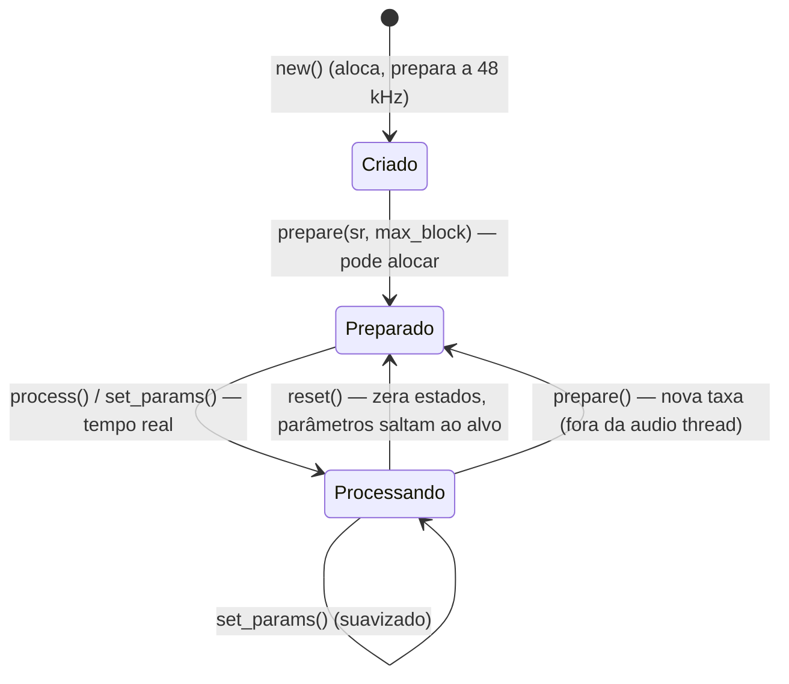
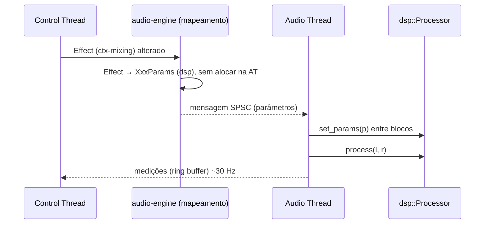
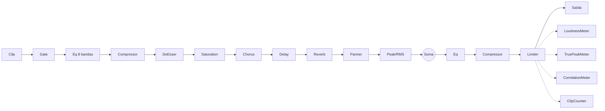
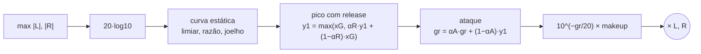

# Fase 2 — DSP e Mixagem: crate `dsp` (Especificação)

- **Data:** 2026-11-05 · **Volta da espiral:** 3 (parte técnica) · **Status:** Implementada (modo autônomo)
- **Crate:** `crates/dsp` (Pure Fabrication — sem domínio, sem I/O) · **Decisão:** [ADR-0014](../adr/0014-crate-dsp-independente.md)
- **Base:** arquitetura geral, seções 5 (engine) e 7.4 (erros); modelo de efeitos do contexto Mixing (`ctx-mixing/src/effects.rs`)

## 1. Objetivos

1. Prover os processadores de áudio da mixagem: **EQ paramétrico de 8 bandas** (biquads RBJ),
   **compressor**, **gate**, **limitador brickwall**, **reverb**, **delay**, **saturação**,
   **chorus** e **de-esser**, com os mesmos parâmetros e faixas do contexto Mixing.
2. Prover os **medidores**: pico amostral (hold/decaimento), RMS, **loudness BS.1770-4/EBU R128**
   (momentary, short-term, integrado com portas), **true peak** 4×, correlação e contador de clipping.
3. Prover o **metrônomo** com disparo sample-accurate e utilitários (`GainSmoother`, `PanLaw`, `Panner`).
4. Cumprir o **contrato de tempo real**: nada de alocação, lock, I/O ou panic em `process`/`set_params`;
   parâmetros suavizados; entradas inválidas não envenenam estados.
5. Caber no orçamento: **32 faixas × cadeia completa** num bloco de 128 amostras a 48 kHz com folga.

Fora do escopo desta volta: integração com a engine/grafo (`audio-engine`), automação, sends/buses
(domínio já existe em `ctx-mixing`), LRA (*loudness range*), oversampling na saturação.

## 2. Riscos

| ID | Risco | Prob. | Impacto | Mitigação | Teste que comprova |
|---|---|---|---|---|---|
| R1 | Alocação/lock na audio thread → xruns | Média | Alto | Buffers só em `prepare`; filas fixas (metrônomo); histograma pré-alocado (LUFS) | `tests/no_alloc.rs` (4 testes, inclui `guard_detects_allocation`) |
| R2 | NaN/∞ ou parâmetro absurdo explode filtros/realimentação | Média | Alto | `clamped` em todo `set_params` (NaN → padrão); `sanitize` da entrada; *flush* de desnormais e reset de estado não finito | `tests/properties.rs` (`eq_is_finite`, `dynamics_are_finite`, `time_based_effects_are_finite`), `invalid_index_and_nan_input_are_safe` |
| R3 | Limitador deixa passar pico acima do teto | Média | Alto | Mínimo deslizante + release só-subida + média móvel de W = L+1 amostras (prova na seção 4.3) + *clamp* final | `limiter_never_exceeds_ceiling` (proptest), `hot_signals_never_exceed_ceiling` |
| R4 | Ruído de zíper ao mexer em parâmetros | Alta | Médio | Suavização: EQ (log-freq, ganho, Q, 10 ms, recálculo a cada 16 amostras), *crossfade* ao ligar banda, rampas lineares em ganhos, delay com tempo suavizado | `parameter_change_is_smoothed_without_clicks`, `enabling_band_crossfades`, `panner_change_is_ramped`, `time_change_is_click_free_and_feedback_is_clamped` |
| R5 | Medição de loudness fora da norma | Média | Alto | K-weighting por fórmula analógica (vale para qualquer taxa) conferido contra a tabela da BS.1770-4; casos da EBU Tech 3341 | `k_weighting_matches_bs1770_table_at_48k`, `ebu_3341_case1_…`, `ebu_3341_case4_gating`, `mono_997hz_full_scale_reads_minus_3_01` |
| R6 | Picos entre amostras não detectados (clipping no conversor) | Média | Médio | True peak com interpolação polifásica 4× | `true_peak_detects_intersample_peak` |
| R7 | CPU insuficiente para 32 faixas | Média | Alto | Estados `f64` só onde necessário; detectores baratos (`ln`/`exp`); `sin_cos` único no chorus; atalhos quando não há redução | `thirty_two_tracks_full_chain_fit_in_block_budget` (< 50 % em release), `per_processor_cost_report` |
| R8 | Realimentação ≥ 1 no delay/reverb → sinal infinito | Baixa | Alto | Feedback do delay ≤ 0,95; pente do reverb ≤ 0,98 | `feedback_tail_decays_with_high_cut`, `max_room_with_loud_noise_stays_bounded` |
| R9 | Desnormais deixam a CPU lenta em caudas | Média | Médio | `flush` em estados de realimentação (pentes, envelopes) e por bloco nos biquads | `impulse_tail_decays_and_is_finite` + custo estável no relatório |
| R10 | Divergência de lei de pan entre domínio e DSP | Baixa | Médio | `PanLaw` delega a `shared_kernel::Pan::gains` | `pan_law_matches_shared_kernel` (proptest) |

## 3. Modelo (API pública)

```mermaid
classDiagram
    class Processor {
        <<trait>>
        +prepare(sample_rate, max_block)
        +reset()
        +process(left, right)
        +latency_samples() usize
    }
    class Eq { +set_band(i, EqBandParams) +set_bands(&[EqBandParams]) +magnitude_db(f) }
    class Biquad { +new(BiquadCoeffs) +set_coeffs() }
    class BiquadCoeffs { +design(FilterKind, f, q, gain, sr) +magnitude_db(f, sr) }
    class Compressor { +set_params(CompressorParams) +gain_reduction_db() }
    class Gate { +set_params(GateParams) +is_open() +current_gain() }
    class Limiter { +set_params(LimiterParams) +gain_reduction_db() }
    class Reverb { +set_params(ReverbParams) }
    class Delay { +set_params(DelayParams) }
    class Saturation { +set_params(SaturationParams) }
    class Chorus { +set_params(ChorusParams) }
    class DeEsser { +set_params(DeEsserParams) +gain_reduction_db() }
    class Metronome { +trigger(offset, accent) bool +set_volume_db(db) }
    class GainSmoother { +set_target(g) +next_value() +snap() }
    class Panner { +set_params(pan, gain) }
    class LoudnessMeter { +momentary_lufs() +short_term_lufs() +integrated_lufs() Option }
    class TruePeakMeter { +true_peak_db() +max_db() }
    class PeakMeter { +level_db() +hold_db() +max_db() }
    class RmsMeter { +rms_db() }
    class CorrelationMeter { +correlation() }
    class ClipCounter { +events() +clipped_samples() }
    Processor <|.. Eq
    Processor <|.. Biquad
    Processor <|.. Compressor
    Processor <|.. Gate
    Processor <|.. Limiter
    Processor <|.. Reverb
    Processor <|.. Delay
    Processor <|.. Saturation
    Processor <|.. Chorus
    Processor <|.. DeEsser
    Processor <|.. Metronome
    Processor <|.. GainSmoother
    Processor <|.. Panner
    Processor <|.. LoudnessMeter
    Processor <|.. TruePeakMeter
    Processor <|.. PeakMeter
    Processor <|.. RmsMeter
    Processor <|.. CorrelationMeter
    Processor <|.. ClipCounter
    Eq *-- "8" BiquadCoeffs
    DeEsser *-- BiquadCoeffs
```

- Parâmetros: structs `Copy` com `clamped()` e as **mesmas faixas** do contexto Mixing
  (ex.: compressor razão 1–20, ataque 0,1–200 ms; delay feedback 0–0,95; EQ 20 Hz–20 kHz, ±24 dB, Q 0,1–18).
- Medidores implementam `Processor` sem alterar o sinal e oferecem `analyze(&[f32], &[f32])`.
- `signals` (gera seno/impulso/ruído e mede pico/RMS) é público para a futura simulação offline.

### Ciclo de vida de um processador

### Integração prevista com a engine

## 4. Algoritmos escolhidos

| Processador | Algoritmo | Justificativa |
|---|---|---|
| Biquad / EQ | RBJ Audio EQ Cookbook, TDF-II, coeficientes e estados `f64`; suavização de log-freq/ganho/Q (10 ms) com recálculo a cada 16 amostras; *crossfade* de 10 ms ao ligar/desligar banda | Padrão da indústria; `f64` evita erro de quantização em graves (HPF 20 Hz a 48 kHz); recalcular a cada 16 amostras custa ~1/16 sem zíper audível |
| Compressor | Feed-forward, joelho suave quadrático, detector "smooth decoupled peak" no domínio do ganho em dB (Giannoulis, Massberg & Reiss, JAES 2012), vínculo estéreo pelo máximo | Comportamento previsível (ataque/release independentes, sem *pumping* artificial); vínculo preserva a imagem estéreo |
| Gate | Detector de pico (release 10 ms), histerese de 3 dB, Aberto → Hold → Fechando, ganho um polo até `range` | Histerese + hold evitam *chattering* em sinais próximos ao limiar |
| Limitador | Lookahead 1,5 ms; mínimo deslizante de `g_req`; release só-subida; média móvel retangular de W = L+1 | **Garantia matemática** de teto (4.3) com ataque suave em rampa; latência reportada para PDC |
| Reverb | Freeverb (8 pentes com amortecimento + 4 passa-tudo por canal, *spread* 23), escalado para a taxa; pré-delay ≤ 200 ms | Algoritmo de domínio público, barato, estável (feedback ≤ 0,98), som conhecido |
| Delay | Linha circular de 2 s pré-alocada, leitura linear fracionária, tempo suavizado (50 ms), passa-baixa de um polo no laço, ping-pong com realimentação cruzada | Eco exato em amostras inteiras; mudanças de tempo sem estalo |
| Saturação | `c·tanh(g·x)`, `c = 0,25 / tanh(0,25·g)` (mantém −12 dBFS), tom por passa-baixa 1,5–20 kHz | Saída processada limitada a ±1,03 para qualquer entrada; compensação perceptual simples |
| Chorus | Atraso 7 ms ± profundidade, LFO senoidal, L/R em quadratura (`sin_cos`) | Abertura estéreo com custo de uma chamada trigonométrica por amostra |
| De-esser | Detecção por passa-faixa (Q 1,5) na soma mono; redução por *shelf* agudo dinâmico (ponto médio 1 oitava abaixo), coeficientes atualizados a cada 16 amostras | A divisão complementar de 1 polo testada antes atenuava só ~4 dB dos 8 dB pedidos (rotação de fase); o *shelf* entrega −7,56 dB analíticos em 6,5 kHz e é identidade exata sem redução |
| Loudness | BS.1770-4: K-weighting (fórmulas de libebur128), sub-blocos de 100 ms, M = 400 ms, S = 3 s, I com porta −70 LUFS e −10 LU; histograma de 8000 classes (0,01 LU) com soma de energia por classe | Memória constante, sem alocação, precisão < 0,01 LU nas portas |
| True peak | Interpolador polifásico 4× (sinc + Hann, 48 taps, fases com ganho DC unitário) | Atende o Anexo 2 da BS.1770-4 com custo aceitável no master |
| Pico / RMS / correlação | Pico com hold/decaimento em dB/s; RMS em janela retangular com soma corrida `f64` (recalculada a cada janela); correlação com médias exponenciais de 300 ms | Balística de medidores usual; sem deriva numérica |
| Metrônomo | Seno com envelope exponencial (−60 dB em 40 ms) e ataque de 0,5 ms; acento 1,6 kHz/0 dB, normal 1 kHz/−4 dB; fila fixa de 8 disparos com adiamento entre blocos | Sample-accurate e sem alocação; o transporte só informa `trigger(offset, accent)` |

### 4.1 Cadeia típica de uma faixa e do master

### 4.2 Fluxo do compressor

### 4.3 Prova do teto do limitador

Seja `g_req[n] = min(1, teto/|x[n]|)`, `h[n] = min(g_req[n−L..n])`, `r[n] ≤ h[n]` (release só sobe
mais devagar que `h`) e `g[n] = média(r[n−L..n])`. A saída é `x[n−L]·g[n]`. Para todo `k ∈ [n−L, n]`
a janela de `h[k]` (`[k−L, k]`) contém `n−L`, logo `r[k] ≤ h[k] ≤ g_req[n−L]`; a média também,
então `|x[n−L]·g[n]| ≤ teto`. O *clamp* final cobre apenas arredondamento.

### 4.4 Valor esperado de loudness (teste EBU 3341 caso 1)

A BS.1770-4 fixa o offset −0,691 de modo que um seno de 997 Hz a 0 dBFS em **um** canal meça
−3,01 LKFS (energia média A²/2 = −3,01 dB; ganho K ≈ +0,691 dB em 1 kHz). Com o mesmo seno em L e R
(pesos 1,0) a energia dobra (+3,01 dB): 0 dBFS → 0 LUFS. Portanto seno de 1 kHz a −23 dBFS nos dois
canais ⇒ **−23,0 LUFS** (M, S e I), exatamente o caso 1 da EBU Tech 3341 (tolerância ±0,1 LU).

## 5. Desempenho medido (release, máquina Linux x86-64 de desenvolvimento)

| Processador | µs / bloco de 128 |
|---|---|
| Gate | 0,7 |
| Eq (4 bandas) | 3,0 |
| Compressor | 1,9 |
| DeEsser | 2,1 |
| Saturation | 5,3 |
| Chorus | 3,4 |
| Delay | 2,5 |
| Reverb | 9,6 |
| Limiter (master) | 7,2 |
| LoudnessMeter (master) | 1,1 |
| TruePeakMeter (master) | 10,3 |

**32 faixas × cadeia completa (inclusive reverb, delay e chorus em todas) + master: ≈ 700 µs de
2667 µs (≈ 26 % do orçamento).** Numa sessão real reverb/delay ficam em buses de efeito, reduzindo
o custo.

## 6. Critérios de Aceite

1. EQ *peak* +6 dB em 1 kHz mede +6 dB ± 0,5 com seno; HPF 120 Hz atenua 30 Hz em > 20 dB e passa 1 kHz (± 0,2 dB). ✅
2. Compressor 4:1, limiar −20 dBFS, seno a −4 dBFS → saída −16 dBFS ± 0,5 em regime. ✅
3. Limitador nunca excede o teto (ruído +12 dB, impulsos de 50× e propriedade com parâmetros arbitrários). ✅
4. Gate fecha abaixo do limiar (−60 dBFS com range −80 → < −130 dBFS) e respeita o hold. ✅
5. Delay: eco de 10 ms exatamente na amostra 480 a 48 kHz; ping-pong alterna canais. ✅
6. Reverb: cauda existe, decai > 40 dB em 4 s e é finita mesmo com sala máxima e ruído a 0 dBFS. ✅
7. Saturação: parte processada ≤ 1,03 para qualquer entrada; nível de referência mantido (± 0,3 dB). ✅
8. Loudness: EBU 3341 casos 1 e 4 = −23,0 ± 0,1 LUFS; 997 Hz mono 0 dBFS = −3,01 ± 0,05; coeficientes K = tabela BS.1770-4. ✅
9. True peak > pico amostral + 2,5 dB para seno em fs/4 com fase 45°. ✅
10. Correlação: idênticos = +1, invertidos = −1, independentes ≈ 0. ✅
11. Nenhuma alocação em `process`/`set_params`/leituras (assert_no_alloc). ✅
12. 32 faixas × cadeia completa < 50 % do bloco em release. ✅

## 7. Limitações conhecidas (próximas voltas)

- Saturação sem *oversampling* (aliasing com drive alto em agudos).
- Loudness sem LRA; canais surround não suportados (apenas L/R).
- Mudança de `FilterKind` numa banda do EQ troca coeficientes sem *crossfade* (pode estalar levemente).
- Teto do limitador é de pico amostral (não *true peak*); mudança brusca de teto é coberta só pelo *clamp*.
- Mínimo deslizante do limitador é O(L) por amostra (≈ 73 a 48 kHz); suficiente para o master.
- Detecção de desnormais por *flush* em software; a engine ainda deve ligar FTZ/DAZ na audio thread.
