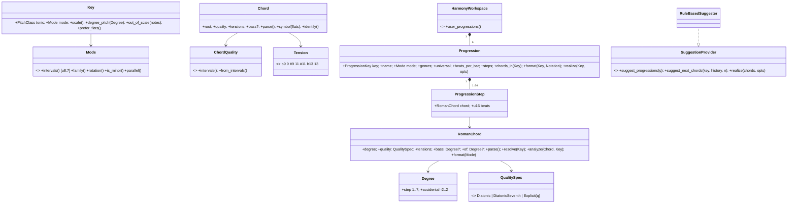
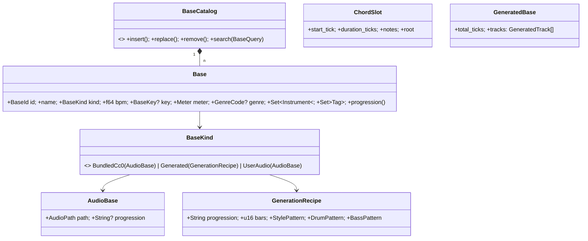
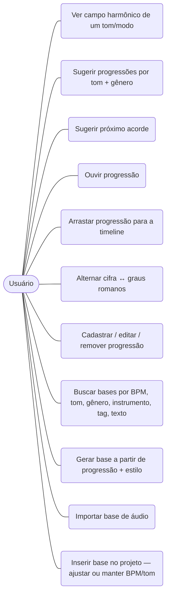
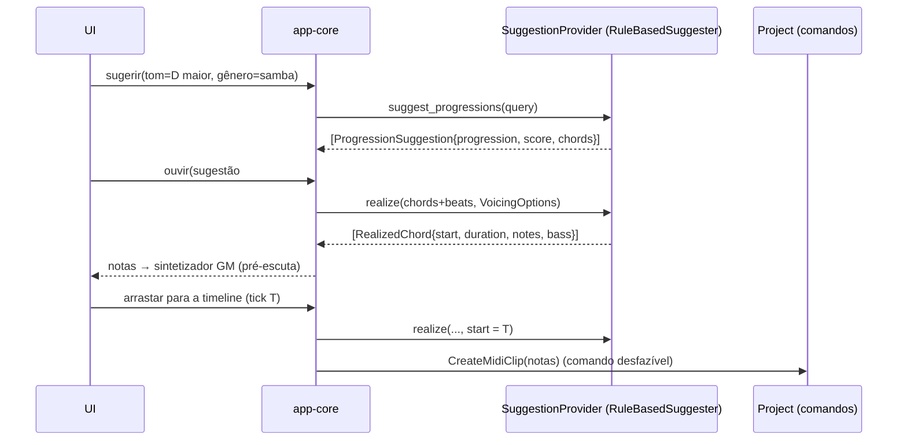
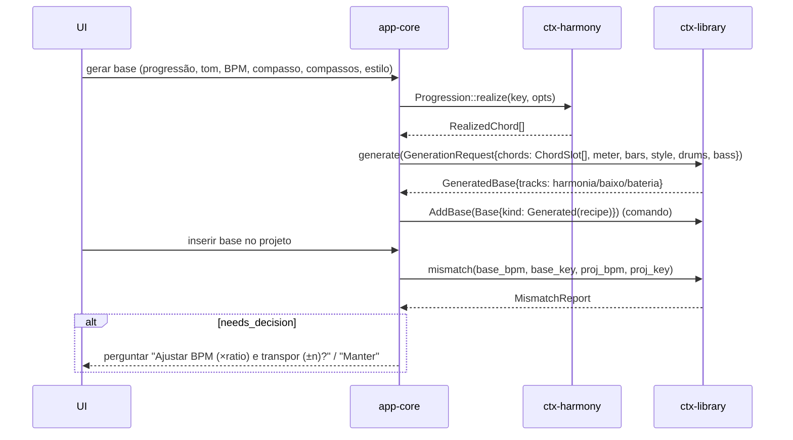
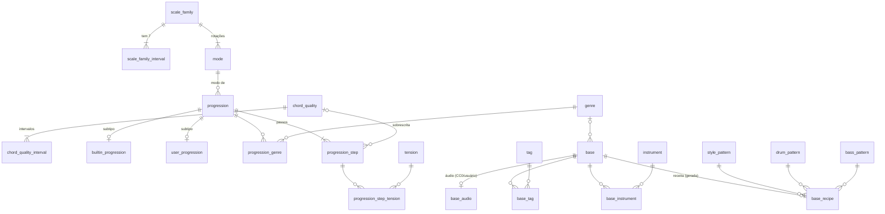
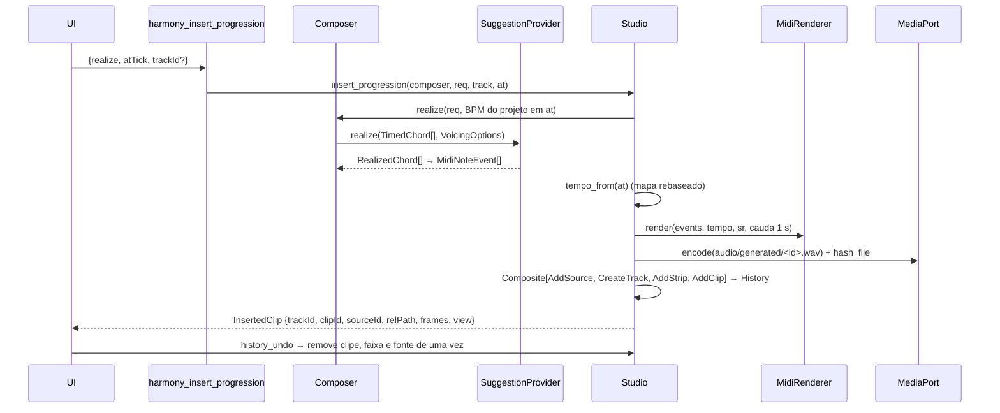
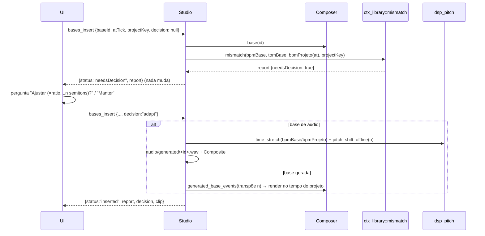

# Fase 5 — Harmonia & Composição + Fase 4 — Biblioteca de Bases (Especificação do domínio)

- **Data:** 2026-11-05 · **Voltas da espiral:** 5 (Harmonia) e 4 (Bases) — entrega de domínio
- **Status:** Aprovada (modo autônomo)
- **Requisitos:** RF-4.1 a RF-4.5, RF-5.1 a RF-5.7, RNF-08 (normalização + leitura eficiente)
- **Crates:** `crates/ctx-harmony`, `crates/ctx-library` (puros, dependem só de `shared-kernel`)
- **ADRs:** [0007](../adr/0007-progressoes-graus-relativos.md), [0018](../adr/0018-graus-romanos-relativos-ao-modo.md), [0019](../adr/0019-gerador-de-bases-sem-dependencia-de-harmony.md)
- **DDL:** [`crates/ctx-harmony/sql/library_v1.sql`](../../crates/ctx-harmony/sql/library_v1.sql)

## 1. Objetivos

| Requisito | Entrega nesta volta (domínio) |
|---|---|
| RF-5.1 Campos harmônicos | 21 modos (maior, menores natural/harmônica/melódica, 7 gregos, modos das menores) como **conjuntos de intervalos**; campo harmônico (tríades e tétrades) **derivado** por empilhamento de terças; detecção de qualidade por intervalos |
| RF-5.2 Progressões por gênero + do usuário | Catálogo embutido com **54 progressões** em 15 gêneros (13 universais); progressões do usuário validadas no agregado `HarmonyWorkspace` com comandos desfazíveis |
| RF-5.3 Tom + gênero → progressões | `SuggestionProvider::suggest_progressions` (ranking por gênero, compatibilidade de modo, universalidade, bônus do usuário) |
| RF-5.4 Próximo acorde | `SuggestionProvider::suggest_next_chords` (harmonia funcional + cadências + dominantes secundárias + empréstimo modal + estatística do catálogo) |
| RF-5.5 / RF-5.6 Ouvir e arrastar | `realize`: voicing fechado em faixa configurável, condução de vozes opcional, baixo separado, tempo em ticks (`PPQ`) |
| RF-5.7 Notação alternável | `Progression::format(key, Notation::Cifra \| Notation::Roman)`; parse/format de cifra popular e graus romanos |
| RF-7.3 (preparação) | `Key::out_of_scale` / `out_of_scale_indices` |
| RF-4.1–4.4 Bases | Entidade `Base` (CC0 incluída, gerada, do usuário) com metadados (BPM, tom, compasso, gênero, instrumentos, progressão, tags), agregado `BaseCatalog` com busca/filtros e comandos desfazíveis |
| RF-4.2 Bases geradas | `generate`: 9 estilos × 9 baterias × 8 linhas de baixo → eventos MIDI GM por canal |
| RF-4.5 BPM/tom diferente | `mismatch` → `MismatchReport { bpm_ratio, semitone_shift, mode_differs, needs_decision }` (a UI **sempre pergunta**) |

Fora desta volta: persistência (I/O SQLite), IPC/UI, síntese/soundfont, pacote de áudios CC0 (manifesto).

## 2. Riscos

| ID | Risco | Prob. | Impacto | Mitigação | Teste que comprova |
|---|---|---|---|---|---|
| R1 | Campo harmônico errado em algum modo | Média | Alto | Derivação única (família + rotação), sem tabelas por tom | `field::c_major_field`, `a_harmonic_minor_dominant_is_major`, `every_mode_degree_has_known_quality`, `field_is_transposition_invariant` |
| R2 | Cifra lida/escrita de forma inconsistente (perda de informação) | Alta | Alto | Forma canônica única + gramática de *tokens* compartilhada com graus romanos | `chord::prop_cifra_roundtrip` (todas as fundamentais × 18 qualidades × tensões × baixo) |
| R3 | Graus romanos ambíguos em tons menores/modais | Alta | Médio | ADR-0018 (relativos ao modo, caixa = terça) | `roman::resolves_minor_key_numerals`, `prop_roman_roundtrip` (21 modos) |
| R4 | Catálogo com progressão inválida quebra a semeadura | Média | Alto | Catálogo construído pelo próprio *parser*; validação + ida e volta do texto | `catalog::every_builtin_progression_is_valid` |
| R5 | Sugestões dependentes do tom (viés) | Média | Médio | Tudo calculado relativo à tônica; estatísticas por (intervalo, família da tríade) | `suggest::next_chord_suggestions_are_transposition_invariant`, `progression_suggestions_are_transposition_invariant` |
| R6 | Sugestão contraintuitiva (ex.: após G7 em Dó não sugerir Dó) | Média | Médio | Tabela funcional + bônus de cadência + preferência por tríade | `suggest::after_g7_in_c_the_tonic_comes_first`, `after_e7_in_a_minor_resolves_to_am`, `secondary_dominant_resolves_to_its_target` |
| R7 | Notas realizadas fora da tessitura ou com tempo errado | Média | Alto | Candidatos só dentro de `[low, high]`; redução (tensões → quinta); durações = beats × PPQ | `realize::whole_catalog_realizes_in_range_with_exact_timing`, `prop_notes_in_range_and_ascending` |
| R8 | Base gerada fora do compasso / atravessando troca de acorde | Média | Alto | Grade por compasso, recorte no fim do acorde e da base; validação de compasso por padrão | `generator::waltz_respects_three_four`, `harmony_events_never_cross_chord_changes`, `prop_every_style_generates_inside_range` |
| R9 | Transposição de base com salto grande (artefatos) | Média | Médio | Menor deslocamento −6…+5; mira a relativa quando os modos diferem; usuário decide | `mismatch::prop_shift_lands_on_target`, `mode_difference_targets_relative` |
| R10 | Dependência entre contextos | Baixa | Alto | Gerador recebe `ChordSlot` (ADR-0019) | `cargo tree -p ctx-library` sem `ctx-harmony` |
| R11 | Esquema desnormalizado ou com dados deriváveis | Média | Médio | Intervalos de modo por view; qualidade só quando não diatônica; subtipos sem colunas anuláveis | `tests::schema_declares_every_normalized_table_and_view`, `seed_vocabulary_fits_schema_constraints` + validação do DDL em SQLite real (ver §7.4) |
| R12 | Caminho de áudio malicioso (path traversal) | Baixa | Médio | `AudioPath` validado no domínio + CHECK no banco | `base::value_objects_validate` |

## 3. Modelo de domínio

### 3.1 Harmony

- **ProgressionKey:** `Builtin(slug)` (catálogo, imutável) ou `User(ProgressionId)` (UUID v7).
- **Invariantes da progressão:** nome 1–64; 1–64 passos; 1–64 tempos por passo; 1–16 tempos por compasso;
  grau alterado sem dominante secundária exige qualidade explícita; baixo e dominante secundária não coexistem.
- **Progressões do usuário:** nome único (sem diferenciar maiúsculas) dentro do `HarmonyWorkspace`.

### 3.2 Library

- **Invariantes da base:** nome 1–64; BPM 20–999 finito; compasso n ∈ 1–16, d ∈ {2,4,8,16}; base gerada
  exige tom e padrões compatíveis com o compasso; progressão ≤ 256 caracteres; caminho relativo seguro e
  único; bases CC0 incluídas são **somente leitura** (não editáveis, não removíveis, não adicionáveis por
  comando — entram só pela semeadura); o tipo de uma base não muda.

## 4. Casos de uso

## 5. Sequências principais

### 5.1 Sugestão e arraste para a timeline (RF-5.3, RF-5.5, RF-5.6)

### 5.2 Geração de base (RF-4.2) e inserção com divergência (RF-4.5)

## 6. Motor de sugestões (regras)

**Próximo acorde** — candidatos no tom: 7 tríades e 7 tétrades diatônicas; dominantes secundárias `V7/x`
para graus 2–6 com tríade maior/menor; empréstimos do modo paralelo (maior ↔ menor natural, exceto
diminutos); em tons menores, `V` e `V7` (menor harmônica). Pontuação:

| Componente | Valor |
|---|---|
| Transição funcional T/S/D (`FUNCTION_TABLE`) | T→S 0,8 · S→D 0,9 · D→T 1,0 · … |
| Multiplicador por tipo | diatônica 1,0 · tétrade 0,95 · secundária 0,6 · empréstimo 0,5 |
| Movimento de quinta descendente | +0,35 (motivo "Movimento por quintas") |
| Resolução de dominante (V/V7 → alvo) | +0,45 (cadência autêntica se alvo = I) |
| Substituto de trítono (dominante → meio-tom abaixo) | +0,3 |
| Cadência deceptiva (V → vi) | +0,25 |
| Cadência plagal (IV → I; iv emprestado → I) | +0,2 / +0,3 |
| Estatística do catálogo (bigramas por intervalo + família da tríade) | +0,6 × frequência |
| Voltar ao acorde anterior | −0,1 |

O resultado é normalizado (o primeiro = 1,0) e ordenado de forma determinística.
**Progressões:** `score = (0,6 × gênero + 0,4 × modo) × 0,95 + 0,05 (se do usuário)`, onde gênero = 1
(contém), 0,5 (universal de outro gênero), excluída (não contém e não universal); modo = 1 (igual), 0,5
(mesma terça), excluída (terça diferente).

A porta `SuggestionProvider` (ADR-0011) permite trocar a implementação (ex.: IA local) sem mudar UI/aplicação.

## 7. Banco `library.db` (esquema v1)

### 7.1 DER

### 7.2 Normalização (justificativa)

| Regra | Aplicação |
|---|---|
| 1FN | Nenhum campo multivalorado: intervalos, tensões, gêneros, instrumentos e tags em tabelas associativas |
| 2FN/3FN | Atributos dependem só da chave inteira: `progression_step(progression_id, position)` não guarda nome/modo; nomes de vocabulário só nas tabelas de vocabulário |
| BCNF | Todo determinante é chave candidata: `mode(family_id, rotation)` é `UNIQUE`; `tension.semitones` `UNIQUE`; `tag.name` `UNIQUE NOCASE` |
| 4FN | Fatos multivalorados independentes separados: `base_instrument` ⟂ `base_tag`; `progression_genre` ⟂ `progression_step` |
| Sem dados deriváveis | Intervalos de modo pela view `v_mode_interval`; campo harmônico e acordes absolutos calculados no domínio; `quality_id NULL` = qualidade diatônica (ADR-0018); progressão de base gerada só em `base_recipe` |
| Subtipos sem nulos | `builtin_progression`/`user_progression` e `base_audio`/`base_recipe` (exclusividade por *triggers*) |

### 7.3 Leitura eficiente

- Índices: `ix_base_bpm` (faixa de BPM — *covering*), `ix_base_key (tonic, key_mode)`, `ix_base_genre`,
  `ix_base_kind`, `ix_base_name NOCASE`, `ix_base_tag_tag (tag_id, base_id)`,
  `ix_base_instrument_instrument (instrument_id, base_id)`, `ix_progression_genre_genre (genre_id, progression_id)`,
  `ix_progression_mode`, `ix_base_recipe_style`.
- Views de leitura (projeções, sem desnormalizar tabelas): `v_mode_interval`, `v_progression_summary`
  (origem, modo, gêneros, nº de passos, total de tempos), `v_progression_step` (códigos resolvidos +
  tensões), `v_base_summary` (uma linha por base com tags/instrumentos agregados).
- Busca textual: hoje por `LIKE` na view + filtro no domínio (`fold` sem acentos). Se o volume crescer,
  adicionar FTS5 externa (`base_fts`) — desnormalização controlada a discutir.

### 7.4 Validação do DDL

O DDL foi executado em SQLite 3.53 real: as views retornam os intervalos esperados (dórico, lócrio,
alterada), as restrições rejeitam passos inconsistentes (grau alterado sem qualidade, qualidade +
`diatonic_seventh`, baixo + alvo, `beats = 0`), gêneros fora do padrão, tags duplicadas sem diferenciar
caixa, caminhos com `..`/absolutos/`\`/`:`, base gerada sem tom, `base_audio` em base gerada,
`base_recipe` em base de áudio e mudança de `kind`; `EXPLAIN QUERY PLAN` confirma uso de
`ix_base_bpm` e `ix_base_tag_tag`. A persistência (fase de infraestrutura) deve repetir isso como teste
de integração com arquivo temporário.

### 7.5 Semeadura a partir do catálogo Rust (fonte única, sem duplicação)

O SQL **não contém dados**. Na primeira execução (e em atualizações) a camada de persistência:

1. Abre `library.db`; se `PRAGMA user_version = 0`, executa `ctx_harmony::LIBRARY_SCHEMA_V1` numa
   transação e grava `user_version = 1`.
2. Faz *upsert* por `code` (`INSERT … ON CONFLICT(code) DO UPDATE`) do vocabulário a partir dos enums:
   `ScaleFamily::ALL` (+ `intervals()` → `scale_family_interval`), `Mode::ALL` (`code`, `name_pt`,
   `family`, `rotation`), `ChordQuality::ALL` (+ `intervals()`), `Tension::ALL`, `Genre::ALL`,
   `ctx_library::Instrument::ALL`, `StylePattern::ALL` (+ `meter_numerator`), `DrumPattern::ALL`,
   `BassPattern::ALL`.
3. Compara `seed_meta['harmony_catalog_version']` com `ctx_harmony::CATALOG_VERSION`. Se menor, numa
   transação: para cada `builtin_catalog()` faz *upsert* por `slug` em `progression`/`builtin_progression`,
   apaga e regrava `progression_genre`, `progression_step` e `progression_step_tension`; remove slugs que
   saíram do catálogo; grava a nova versão. **Progressões do usuário nunca são tocadas.**
4. Bases CC0: lidas de um manifesto empacotado com o app, validadas com `Base::validate` /
   `BaseCatalog::insert` e gravadas; versão em `seed_meta['bundled_bases_version']`.

Mapeamento `RomanChord` → `progression_step`:

| Domínio | Coluna |
|---|---|
| `degree.step()` / `degree.accidental()` | `degree` / `accidental` |
| `QualitySpec::Diatonic` | `quality_id NULL`, `diatonic_seventh = 0` |
| `QualitySpec::DiatonicSeventh` | `quality_id NULL`, `diatonic_seventh = 1` |
| `QualitySpec::Explicit(q)` | `quality_id = chord_quality(code = q.code())` |
| `tensions` | linhas em `progression_step_tension` |
| `bass` / `of` | `bass_degree`,`bass_accidental` / `target_degree`,`target_accidental` |
| `ProgressionStep.beats` | `beats` |

## 8. API pública (resumo)

**ctx-harmony:** `Mode`, `ScaleFamily`, `Key` (`scale`, `degree_pitch`, `degree_of`, `contains`,
`out_of_scale`, `out_of_scale_indices`, `prefer_flats`, `transpose`, `parse`); `ChordQuality`
(`intervals`, `from_intervals`, `code`); `Tension`; `Chord` (`parse`, `symbol`, `pitch_classes`,
`transpose`, `identify`, `with_bass`); `Degree`, `QualitySpec`, `RomanChord` (`parse`, `normalized`,
`resolve`, `analyze`, `format`, `spelling_flats`); `diatonic_quality`, `harmonic_field`, `FieldDegree`;
`Genre`, `Notation`, `Progression` (`parse_steps`, `new_user`, `validate`, `steps_text`, `chords_in`,
`format`, `realize`), `ProgressionKey`, `ProgressionStep`, `ProgressionId`; `builtin_catalog`,
`catalog::find_builtin`, `CATALOG_VERSION`; `SuggestionProvider`, `RuleBasedSuggester`,
`ProgressionQuery`, `ProgressionSuggestion`, `ChordSuggestion`, `SuggestionReason`; `realize`,
`TimedChord`, `VoicingOptions`, `RealizedChord`; `HarmonyWorkspace`; comandos `AddUserProgression`,
`EditUserProgression`, `RemoveUserProgression`; `HarmonyError`; `LIBRARY_SCHEMA_V1`.

**ctx-library:** `Base`, `BaseId`, `BaseKind`, `BaseKindTag`, `AudioBase`, `AudioPath`,
`GenerationRecipe`, `BaseKey`, `KeyMode`, `Meter`, `GenreCode`, `Instrument`, `Tag`; `BaseCatalog`
(`insert`, `replace`, `remove`, `search`), `BaseQuery`; `generate`, `GenerationRequest`, `ChordSlot`,
`StylePattern`, `DrumPattern`, `BassPattern`, `GeneratedBase`, `GeneratedTrack`, `NoteEvent`,
`TrackRole`; `mismatch`, `MismatchReport`; comandos `AddBase`, `UpdateBase`, `RemoveBase`; `LibraryError`.

## 9. Critérios de aceite

- [x] Campo de Dó maior = C Dm Em F G Am Bdim / Cmaj7 Dm7 Em7 Fmaj7 G7 Am7 Bm7(b5).
- [x] Lá menor harmônica: V = E / E7.
- [x] Ida e volta de cifra (proptest) e de graus romanos em todos os modos (proptest).
- [x] Graus romanos em tons menores (`i III VII V7 ii°`).
- [x] ≥ 40 progressões no catálogo, todas válidas, em 15 gêneros; universais marcadas.
- [x] Após G7 em Dó, Dó é a primeira sugestão; sugestões invariantes por transposição.
- [x] Realização dentro da faixa, durações exatas em ticks.
- [x] Valsa 3/4 gerada com bumbo no 1 e acompanhamento nos tempos 2 e 3, dentro dos compassos.
- [x] Validação de bases e filtros de busca; comandos com ida e volta (desfazer/refazer).
- [x] `cargo fmt`, `cargo clippy -D warnings` e `cargo test` verdes nos dois crates.

## 10. Limitações conhecidas

- Análise de acorde absoluto não detecta dominante secundária (`E7` em Dó → `III7`).
- Baixo arábico (`V/7`) é notação própria do app; inversões figuradas (`V6`) não são lidas.
- Tensões aceitas: b9, 9, #9, 11, #11, b13, 13; `7(b5)` dominante, `add#11` etc. não são modelados.
- O texto de progressão de uma base não é validado dentro de `ctx-library` (a aplicação valida com Harmony).
- Os padrões rítmicos têm 1 compasso (bossa real tem ciclo de 2) e não há humanização/variação.
- O gerador não toca transições (*fills*) nem finais; a dinâmica é fixa por padrão.

## 11. Integração (volta 2) — persistência, síntese, casos de uso e IPC

- **Status:** Implementada (backend; sem UI) · **ADRs:** [0025](../adr/0025-soundfont-rustysynth-e-audicao-wav-em-memoria.md), [0026](../adr/0026-biblioteca-de-composicao-persistencia-e-decisao-de-bases.md)
- **Código:** `infra-persistence/src/harmony_repo.rs` (migração 2 do `library.db` + repositórios),
  `synth/src/soundfont.rs` (`SoundFontSynth`), `infra-adapters/src/synth.rs`
  (`ConfigurableSynthRenderer`), `app-core/src/composition/` (`Composer` + `impl Studio`),
  `app-desktop/src/commands_composition.rs` (IPC), `assets/bases/manifest.json` (manifesto CC0, vazio).

### 11.1 Decisões principais

| Tema | Decisão |
|---|---|
| Esquema | `LIBRARY_SCHEMA_V1` = **migração 2** do `library.db` (a 1 tem recentes/preferências). `LibraryDb::open` semeia vocabulário (upsert por código) e progressões embutidas quando `harmony_catalog_version` < `CATALOG_VERSION` (apaga/regrava **só** as embutidas). |
| Bases CC0 | Manifesto `assets/bases/manifest.json` embutido no binário (`version`, `bases[]`, licença obrigatória `CC0-1.0`); áudio em `<recursos>/assets/bases/<file>`. Hoje vazio. |
| Bases iniciais | 8 receitas geradas (pop, balada, bossa, samba, rock, reggae, funk, valsa) com ids estáveis, semeadas uma vez (`starter_bases_version`); depois pertencem ao usuário. |
| Bases de áudio do usuário | **Copiadas** para `<dados do app>/bases/<id>.<ext>` (WAV/FLAC/MP3/OGG/AIFF). |
| Receita | Progressão em graus no modo maior/menor da base, com verificação de ida e volta exata. |
| Desfazer | Biblioteca tem histórico próprio (`library_undo`/`library_redo`); o projeto continua com `history_undo`. |
| Síntese | `ConfigurableSynthRenderer`: SoundFont (`rustysynth`) se `setting['synth.soundfont']` aponta para `.sf2` válido; senão `SimpleSynth`. |
| Audição | WAV PCM 16 bits estéreo **em memória**, taxa do projeto (48 kHz sem projeto), cauda 1 s, máx. 120 s. |
| Arrastar | Renderiza no mapa de tempo do projeto a partir do tick → `audio/generated/<id>.wav` → fonte + (faixa + canal) + clipe num **único** `Composite`; conteúdo idêntico reutiliza a fonte. |
| Divergência | Com `needsDecision` e sem `decision` → `{status:"needsDecision"}` sem alterar nada. `adapt`: áudio = WSOLA (`bpmBase/bpmProjeto`, 0,25–4×) + pitch shift; gerada = re-síntese no BPM/tom do projeto. |

### 11.2 Riscos

| ID | Risco | Mitigação | Teste que comprova |
|---|---|---|---|
| R13 | Semeadura apaga/duplica dados do usuário em atualização | Versões em `seed_meta`; só embutidas são regravadas; vocabulário por upsert | `harmony_repo::reseed_on_version_bump_keeps_user_progressions`, `open_seeds_vocabulary_and_catalog_and_is_idempotent`, `starter_bases_seed_once_and_never_overwrite_user_choice` |
| R14 | SQL injection por nomes/tags | Só consultas parametrizadas | `user_progressions_roundtrip_in_order_with_injection_text`, `bases_roundtrip_and_bundled_are_kept_apart`, `composition::composer_persists_in_real_library_db` |
| R15 | Perda de informação banco ↔ domínio | Ida e volta do catálogo inteiro pelo banco | `open_seeds_vocabulary_and_catalog_and_is_idempotent` (`builtin_progressions() == builtin_catalog()`), `library_store_roundtrip` |
| R16 | SoundFont ausente/corrompido derruba o app | Erro tipado + `catch_unwind`; fallback `SimpleSynth` | `soundfont::missing_or_invalid_files_are_typed_errors`, `falls_back_to_simple_synth_and_keeps_state_on_bad_file` |
| R17 | Áudio de audição/inserção fora de tempo | Mesmas conversões tick→quadro do `TempoMap`; mapa rebaseado no destino | `realization_timing_is_exact`, `audition_wav_header_is_valid_and_duration_correct`, `insert_progression_follows_project_tempo_changes`, `loads_generated_sf2_and_renders_note_in_time` |
| R18 | Inserção deixa lixo ao desfazer | Fonte + faixa + clipe num único `Composite`; dedupe por hash | `insert_progression_is_one_undoable_step` |
| R19 | Base inserida sem perguntar (viola RF-4.5) | API devolve `needsDecision` sem efeitos | `audio_base_mismatch_requires_decision_and_adapt_stretches` |
| R20 | Ajuste com duração errada | Razão = `bpmBase/bpmProjeto`; limite 0,25–4 | `adapt_changes_length_by_bpm_ratio`, `generated_base_save_audition_and_adapt_by_bpm_ratio` (±1%) |
| R21 | Falha de gravação deixa memória ≠ disco | `Composer::execute` desfaz se `save` falhar | `user_progressions_crud_with_undo_and_suggestions` |
| R22 | Manifesto malicioso (path traversal, licença) | `AudioPath` + licença `CC0-1.0` obrigatória | `manifest_parses_and_rejects_non_cc0` |
| R23 | Contrato IPC divergente da UI | Exemplos JSON desta seção desserializados em teste | `commands_composition::ipc_contract_examples_deserialize`, `outcome_serializes_with_status_tag` |

### 11.3 Sequência — arrastar progressão para a timeline

### 11.4 Sequência — inserir base com divergência

### 11.5 Contrato IPC (argumentos e campos em camelCase)

Tipos comuns: `Key = {tonic: 0..11, mode: "ionian"|"dorian"|…|"aeolian"|"harmonicMinor"|…}`;
`BaseKey = {tonic, mode: "major"|"minor"}`; `Meter = {numerator, denominator}`;
`ProgressionRef = {kind:"builtin", slug} | {kind:"user", id} | {kind:"roman", steps, mode, beatsPerBar?=4} | {kind:"cifra", chords, beatsPerBar?=4}`;
`VoicingRequest = {low?=52, high?=76, voiceLeading?=true, bass?=true, program?=0, bassProgram?=33, velocity?=90}`;
`RealizeRequest = {progression, key, bpm?: number|null, bars?: number|null, voicing?}`;
`MidiNoteEvent = {startTick, durationTicks, channel, program, key, velocity}`;
`LibraryHistoryView = {canUndo, canRedo, undoLabel, redoLabel}`; erros = `{code, message}` (PT-BR).

| Comando | Argumentos | Retorno |
|---|---|---|
| `harmony_keys` | — | `{tonics:[{value, sharp, flat}], modes:[{mode, code, namePt, isMinor}], genres:[{genre, code, namePt}]}` |
| `harmony_field` | `key: Key` | `{key, label, preferFlats, degrees:[{degree, triad:{symbol, roman}, seventh:{symbol, roman}}]}` |
| `harmony_progressions` | `req: {key, genre?: Genre, limit?=20}` | `[{progression: ProgressionView, score, cifra: string[]}]`; `ProgressionView = {ref, name, origin:"builtin"\|"user", mode, genres, universal, beatsPerBar, stepsText, roman[], beats[]}` |
| `harmony_user_progressions` | — | `ProgressionView[]` |
| `harmony_suggest_next` | `req: {key, history: string[] (cifras), limit?=8}` | `[{symbol, roman, score, reason, reasonLabel}]` |
| `harmony_realize` | `req: RealizeRequest` (bpm nulo = BPM do projeto ou 120) | `{name, key, bpm, beatsPerBar, totalTicks, chords:[{symbol, startTick, durationTicks, notes[], bass}], events: MidiNoteEvent[]}` |
| `harmony_audition` | `req: RealizeRequest` | `ArrayBuffer` (WAV PCM16 estéreo) |
| `harmony_insert_progression` | `req: {realize: RealizeRequest, atTick, trackId?}` | `InsertedClip = {trackId, clipId, sourceId, relPath, frames, view: SessionView}` (desfazer: `history_undo`) |
| `harmony_user_progression_add` | `input: {name, mode, genres?: Genre[], beatsPerBar?=4, steps}` | `ProgressionView` |
| `harmony_user_progression_edit` | `id, input` | `ProgressionView` |
| `harmony_user_progression_remove` | `id` | `LibraryHistoryView` |
| `library_history` / `library_undo` / `library_redo` | — | `LibraryHistoryView` |
| `bases_options` | — | `{styles, drums, basses, instruments}` (cada item `{value, code, namePt, meterNumerator}`) |
| `bases_search` | `query: {text?, bpmMin?, bpmMax?, key?: BaseKey, genre?, instrument?, tags?: string[], kind?: "bundledCc0"\|"generated"\|"userAudio"}` | `Base[]` = `{id, name, kind:{kind:"generated", progression, bars, style, drums, bass}\|{kind:"userAudio"\|"bundledCc0", path, progression}, bpm, key, meter, genre, instruments, tags}` |
| `bases_add_user` | `path` (absoluto), `meta: {name, bpm, key?, meter?, genre?, instruments?, tags?, progression?}` | `Base` |
| `bases_generate` | `req: {progression, key, bpm, bars, style, drums?, bass?}` | `{bpm, meter, totalTicks, recipeProgression, drums, bass, events}` |
| `bases_generated_audition` | `req` (igual a `bases_generate`) | `ArrayBuffer` WAV |
| `bases_save_generated` | `req: {name, generation, genre?, tags?}` | `Base` |
| `bases_remove` | `id` | `LibraryHistoryView` |
| `bases_audition` | `id` | `ArrayBuffer` WAV |
| `bases_mismatch` | `req: {baseId, atTick, projectKey?}` | `MismatchReport = {bpmRatio, semitoneShift, modeDiffers, needsDecision}` |
| `bases_insert` | `req: {baseId, atTick, trackId?, projectKey?, decision?: "keep"\|"adapt"}` | `{status:"needsDecision", report}` \| `{status:"inserted", report, decision, clip: InsertedClip}` |
| `synth_status` | — | `{engine:"soundfont"\|"simple", soundfontPath, bankName, presetCount}` |
| `synth_set_soundfont` | `path: string \| null` (null = simples) | `SynthStatus` (persistido em `synth.soundfont`) |

Exemplo (`harmony_insert_progression`):
`{"req":{"realize":{"progression":{"kind":"builtin","slug":"pop-axis"},"key":{"tonic":0,"mode":"ionian"}},"atTick":3840}}`.

### 11.6 Limitações conhecidas (volta 2)

- O clipe inserido é áudio renderizado (não MIDI editável); a engine ainda não tem faixas de instrumento.
- O projeto não guarda tom: a UI informa `projectKey` (sem ele só o BPM é comparado).
- Arquivos copiados de bases removidas e WAVs de inserções desfeitas ficam em disco (limpeza futura).
- Renderização síncrona dentro do comando (os pesados são `async` na IPC, sem cancelamento/progresso).
- Bases CC0: mecanismo pronto e manifesto vazio; para empacotar áudios, incluir `assets/bases/*` em
  `bundle.resources` do `tauri.conf.json`.
- Falha de gravação após `undo`/`redo` reverte a operação, mas o item permanece no histórico.
