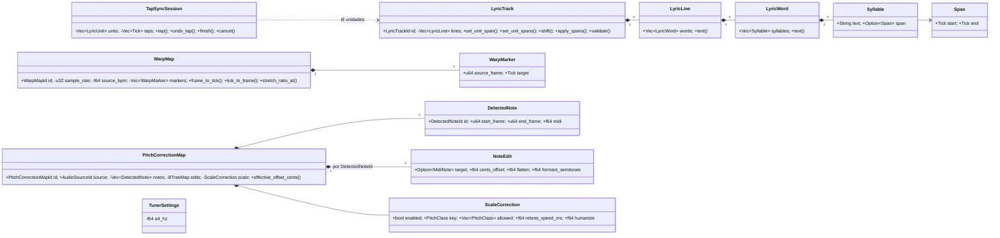
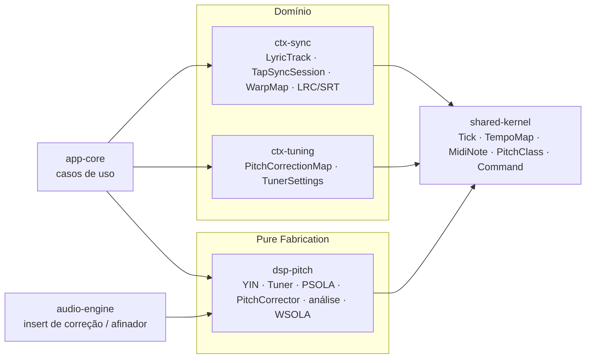
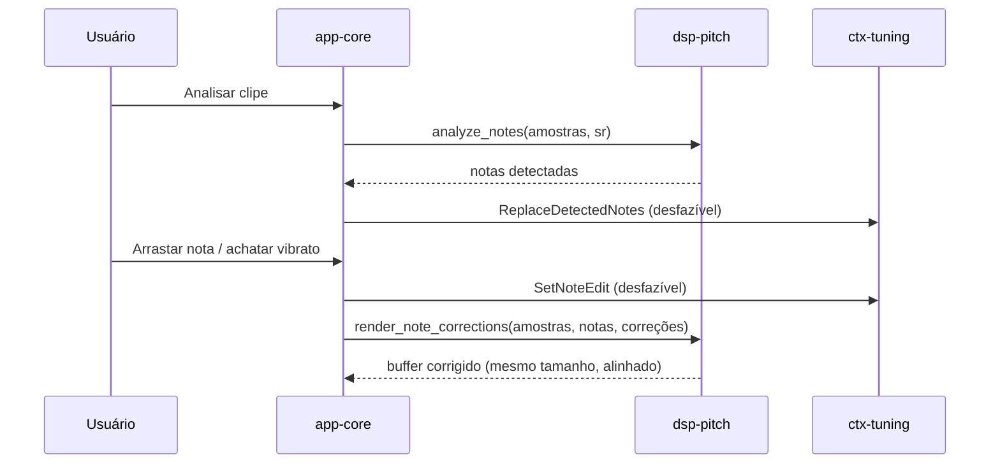
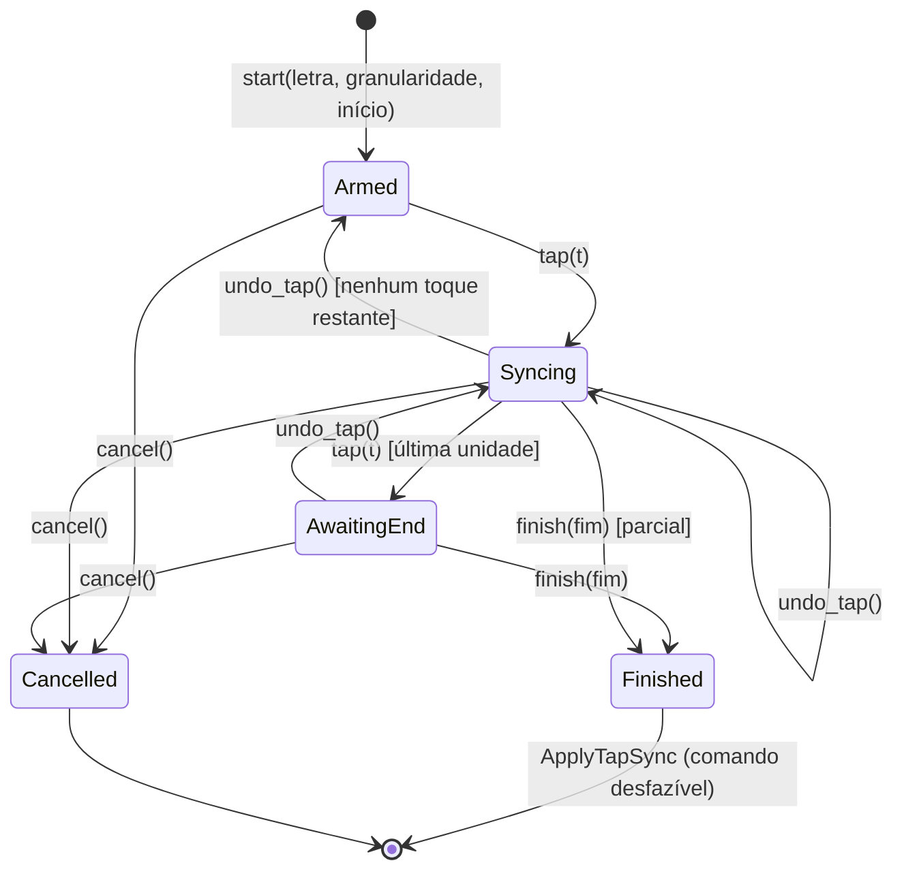
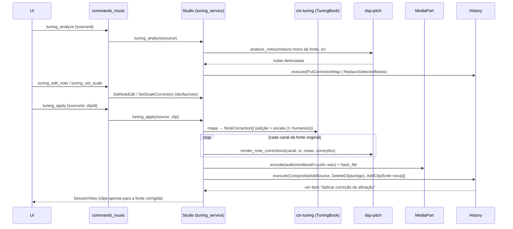
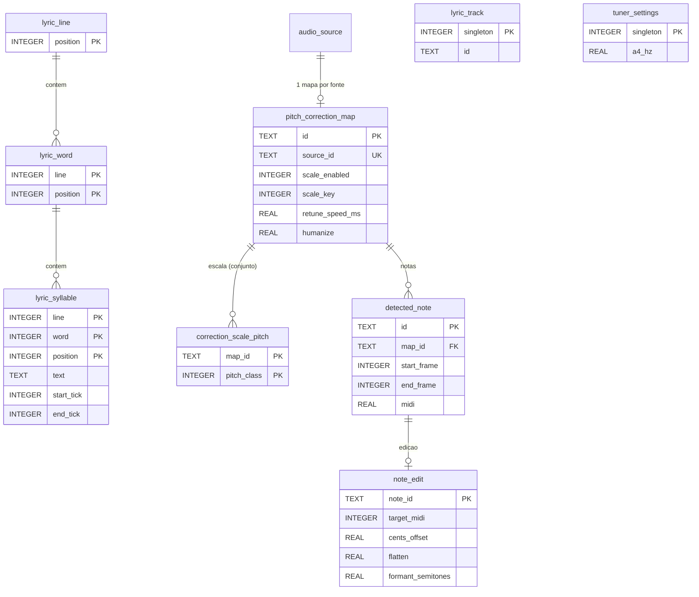

# Fases 6 e 8 — Sincronização e Afinação (Especificação)

- **Data:** 2026-11-05 · **Volta da espiral:** 6/8 (núcleo de domínio e DSP) · **Status:** Aprovada (modo autônomo)
- **Requisitos:** RF-6.1 a RF-6.4 (Sincronização), RF-8.1 a RF-8.4 (Afinação)
- **Decisões:** [ADR-0016](../adr/0016-dsp-altura-yin-psola-wsola.md) (DSP de altura), [ADR-0017](../adr/0017-letra-silabica-em-ticks.md) (letra por sílaba em ticks), ADR-0011 (portas AI-ready), ADR-0008 (undo)

## 1. Objetivos (quadrante 1)

| Requisito | Entrega desta volta | Crate |
|---|---|---|
| RF-6.1 Letra por palavra/sílaba | `LyricTrack` (linhas → palavras → sílabas com `Span` em ticks), importação de texto com separação silábica PT-BR, ajuste de tempo de sílaba/palavra/linha, deslocamento de faixas, sessão *tap-to-sync* | `ctx-sync` |
| RF-6.2 LRC e SRT | Exportação/importação LRC (linha, palavra, sílaba — *enhanced*) e SRT via `TempoMap` | `ctx-sync` |
| RF-6.3 Grade de BPM / sincronização | `WarpMap` (marcadores quadro ↔ tick), razão local de stretch, razão para encaixar BPM de origem no do projeto | `ctx-sync` |
| RF-6.4 Time-stretch | WSOLA multicanal coerente + pitch shift offline | `dsp-pitch` |
| RF-8.1 Afinador em tempo real | `Tuner` (nota + cents, Lá4 415–466 Hz) e `TunerProcessor` sem alocação | `dsp-pitch` |
| RF-8.2 Correção em tempo real | `PitchCorrector` (escala, tônica, velocidade, humanização) sobre `PsolaShifter` de latência constante | `dsp-pitch` |
| RF-8.3 Correção em pós-produção | `analyze_notes` + `render_note_corrections` | `dsp-pitch` |
| RF-8.4 Edição nota a nota | `PitchCorrectionMap` (notas detectadas, edições por nota, correção por escala) com comandos desfazíveis | `ctx-tuning` |

Fora desta volta: UI (painéis de letra/afinação), integração no grafo da engine (`audio-engine`), persistência
SQLite das novas tabelas, preservação de formantes e phase vocoder.

## 2. Riscos (quadrante 2)

| ID | Risco | Prob. | Impacto | Mitigação | Teste que comprova |
|---|---|---|---|---|---|
| R1 | Detecção de altura imprecisa (erro de oitava, graves) | Média | Alto | YIN com limiar absoluto + mínimo local + interpolação parabólica sobre a função diferença; janela = período máximo (60 Hz) | `detector::tests::detects_sines_within_5_cents`, `detects_sawtooth_fundamental` |
| R2 | Ruído interpretado como nota | Média | Médio | Confiança = 1 − CMND; quadro só é vozeado abaixo do limiar; silêncio por RMS | `detector::tests::noise_has_low_confidence_and_silence_is_unvoiced`, `analysis::tests::noise_and_silence_yield_no_notes` |
| R3 | Latência do corretor alta/variável (quebra o alinhamento) | Alta | Alto | PSOLA com latência **constante** e reportada (`latency_samples`) para PDC; razão 1 = atraso puro | `shifter::tests::unity_ratio_is_a_pure_delay_of_reported_latency` |
| R4 | Estalos por alocação na thread de áudio | Média | Alto | Buffers em `new/prepare`; `process` sem `Vec`/`Box`; binário de teste com `AllocDisabler` | `tests/no_alloc.rs` (4 testes) |
| R5 | Pitch shift produz altura errada / artefatos de fase | Média | Alto | Marca de análise = múltiplo inteiro do período do grão anterior (coerência de fase); normalização pela soma das janelas | `shifter::tests::octave_up_on_220_hz_sine_yields_440_hz`, `shifts_down_and_by_small_intervals` |
| R6 | Correção "robótica" ou instável na fronteira entre notas | Média | Médio | Histerese na nota-alvo, `retune_ms` (1ª ordem) e `humanize` | `corrector::tests::pulls_sharp_a_to_440_in_c_major`, `retune_speed_smooths_the_correction`, `humanize_and_disable_reduce_correction` |
| R7 | Segmentação quebra notas em vibrato ou funde notas vizinhas | Média | Médio | Mediana de 5 quadros, mudança confirmada por 3 quadros, limiar 0,6 semitom | `analysis::tests::segments_a_synthetic_melody`, `flatten_removes_vibrato` |
| R8 | Time-stretch altera a altura ou a duração | Baixa | Alto | WSOLA (só reposiciona quadros); duração exata `round(n·razão)` | `stretch::tests::stretch_1_5_changes_length_and_keeps_pitch`, `compress_keeps_pitch_of_sawtooth` |
| R9 | Imagem estéreo destruída pelo stretch | Média | Médio | Busca de alinhamento na soma mono e mesmo deslocamento em todos os canais | `stretch::tests::stereo_channels_stay_phase_coherent` |
| R10 | Letra dessincroniza ao mudar BPM / conversão errada com tempo variável | Alta | Alto | Tempos em ticks; conversão só na exportação via `TempoMap` | `formats::tests::line_level_lrc_uses_tempo_map`, `syllable_lrc_roundtrip_with_variable_tempo`, `srt_roundtrip_with_variable_tempo`, `lrc_export_is_stable` (proptest) |
| R11 | Tempos sobrepostos/fora de ordem após edições | Média | Alto | Operações atômicas que validam a trilha inteira e revertem em erro | `lyrics::tests::timings_stay_monotonic_after_shifts` (proptest) |
| R12 | Separação silábica errada em PT-BR | Alta | Baixo | Regras de dígrafos, encontros, ditongos/hiatos; sílabas editáveis; limites documentados | `hyphenation::tests::*` (4 testes) |
| R13 | Warp não inversível (marcadores cruzados) | Média | Alto | Invariante: marcadores estritamente crescentes em quadro e tick | `warp::tests::warp_map_stays_monotonic` (proptest) |
| R14 | Desfazer incompleto (edição de nota, tempos, warp) | Baixa | Alto | Command Pattern com estado anterior; testes de ida e volta | `commands::tests::*_roundtrip` (ctx-sync e ctx-tuning), `undo_all_restores_initial` (proptest) |
| R15 | Arquivos LRC/SRT malformados derrubam a importação | Média | Médio | Parser tolerante (metadados ignorados, `\r\n`, múltiplos tempos por linha) e erros com número de linha | `formats::tests::imports_handwritten_files`, `parse_errors_carry_line_numbers` |

## 3. Algoritmos (justificativa)

### 3.1 Detecção — YIN
`d(τ) = Σ (x[j] − x[j+τ])²`, `d'(τ) = d(τ)·τ / Σ_{k≤τ} d(k)`. Primeiro τ com `d' < 0,15`, descendo até o
mínimo local; senão o mínimo global (quadro não vozeado). Interpolação parabólica sobre `d` dá precisão
sub-amostra (< 1 cent para senos). Custo O(W·τmax) sem FFT (≈ 640 k MAC por quadro a 48 kHz/60 Hz) —
aceitável a cada 5 ms; um detector neural pode substituir via `PitchDetector`.

### 3.2 Pitch shift — TD-PSOLA com grãos reamostrados
Grãos Hann de meia largura `P/r` centrados nas marcas de síntese (espaçadas do novo período `P/r`), lidos
da entrada em `x(a + t·r)`. A marca de análise seguinte é `a + m·P` (m inteiro mais próximo), o que garante:
(i) coerência de fase entre grãos sobrepostos para sinais periódicos; (ii) preservação do tempo (|a − s| ≤ P/2);
(iii) identidade exata com r = 1. Latência constante `L = ⌈1,5·Pmax + Pmax/r_min⌉ + 4` (2804 amostras a 48 kHz
com piso de 60 Hz e r_min = 0,5). A razão pode variar por amostra; no render offline a curva é consultada
na posição de cada grão (`process_sample_with`).

### 3.3 Correção em tempo real
`midi = 69 + 12·log2(f/A4)` → nota permitida mais próxima (máscara de 12 bits a partir de tônica + intervalos),
mantendo a nota atual enquanto ela não estiver pior que a candidata por mais que a histerese (15 cents).
Correção desejada `(alvo − midi)·100·(1 − humanize)` cents, suavizada por `c = 1 − e^(−1/(retune·sr))`.

### 3.4 Pós-produção
Trilha YIN (5 ms) → mediana de 5 → segmentação (nova nota quando 3 quadros seguidos desviam ≥ 0,6 st da
média da nota; lacunas de 1 quadro toleradas; notas < 60 ms descartadas). Render: cents por quadro
(`offset + flatten·(média − instantâneo)`), interpolados por amostra, aplicados pelo PSOLA com a latência
compensada (saída alinhada e de mesmo tamanho).

### 3.5 Time-stretch — WSOLA
Quadros Hann de 2048 com salto de síntese 1024 (COLA = 1); a posição de análise nominal `k·Hs/razão` é
ajustada em ±512 amostras para maximizar a correlação normalizada com a continuação natural do quadro
anterior (busca grossa passo 4/subamostragem 2, refinamento ±4). Pitch shift offline = stretch por `2^(st/12)`
+ reamostragem sinc-Blackman (16 cruzamentos de zero, corte `min(1, 1/passo)`).

### 3.6 Letra e formatos
Ver ADR-0017. Separação silábica (regras): consoante única vai para a sílaba seguinte; dígrafos (`ch lh nh qu gu`)
e encontros consoante+`l/r` são inseparáveis; grupos de consoantes separam antes da última (ou das duas últimas
se inseparáveis); ditongo quando a 2ª vogal é `i/u` átona (exceto antes de `r l z m n` que fecham sílaba ou `nh`),
`ão/ãe/õe`; hiato com vogal acentuada ou vogais fortes. Limites: tonicidade sem acento gráfico
(`Coimbra`), estrangeirismos.

## 4. Modelo



### Invariantes
- `Span`: `0 ≤ start < end`. Sílabas com tempo, na ordem de leitura: `anterior.end ≤ próxima.start`.
- Sílaba com texto não vazio e sem espaço; palavra ≥ 1 sílaba; linha ≥ 1 palavra. Texto de palavra/linha é derivado.
- `WarpMap`: marcadores estritamente crescentes em `source_frame` e `target`; `target ≥ 0`; BPM 20–999; taxa > 0.
- `PitchCorrectionMap`: notas válidas (`start < end`, MIDI 0–127), ordenadas, sem sobreposição e ids únicos; edições só
  para notas existentes; cents ±1200; achatamento 0–1; formante ±12 st; escala não vazia contendo a tônica;
  `retune` 0–1000 ms; humanização 0–1. Edição neutra = sem edição.
- `TunerSettings`: Lá4 entre 415 e 466 Hz.

## 5. Componentes e fluxo



Os contextos não dependem do `dsp-pitch`: a camada de aplicação traduz `PitchCorrectionMap` →
`NoteCorrection`/`CorrectorSettings` (`ScaleCorrection::mask_bits()` ↔ `ScaleMask::from_bits`) e
`WarpMap::stretch_ratio_at`/`stretch_ratio_for_tempo` → `time_stretch`.

### Correção em tempo real (sequência por bloco)

```mermaid
sequenceDiagram
    participant E as Engine (callback)
    participant C as PitchCorrector
    participant S as PsolaShifter
    participant Y as YinDetector
    E->>C: process(entrada, saída)
    loop cada amostra
        C->>S: last_estimate()
        C->>C: nota-alvo (escala + histerese), cents·(1−humanize), suavização retune
        C->>S: process_sample(x, razão)
        S->>S: grava no anel; a cada 5 ms
        S->>Y: detect(último quadro)
        S->>S: posiciona grãos prontos; lê saída atrasada L
    end
    C-->>E: saída (latência constante L reportada para PDC)
```

### Pós-produção (edição nota a nota)



## 6. Sessão de sincronização por toque (estados)



Regras: cada toque deve ser estritamente posterior ao anterior (`sync.tap_out_of_order`); ações fora do estado
retornam `sync.invalid_session_state`; `finish` exige fim posterior ao último toque. O resultado é gravado
de forma atômica — se colidir com tempos já existentes fora do trecho, nada muda (`sync.overlap`).

## 7. API pública (resumo)

| Crate | Itens |
|---|---|
| `dsp-pitch` | `PitchDetector`, `YinDetector`, `YinConfig`, `PitchEstimate`, `cents_between`; `Tuner`, `TunerReading`, `TunerProcessor`; `PitchShifter`, `PsolaShifter`, `PsolaConfig`, `semitones_to_ratio`; `PitchCorrector`, `CorrectorSettings`, `ScaleMask`; `pitch_track`, `analyze_notes(_with)`, `DetectedNote`, `NoteCorrection`, `render_note_corrections`; `TimeStretcher`, `Wsola`, `time_stretch`, `resample`, `pitch_shift_offline`; `signal::*` |
| `ctx-tuning` | `PitchCorrectionMap`, `DetectedNote`, `NoteEdit`, `ScaleCorrection`, `TunerSettings`, `TuningError`; comandos `ReplaceDetectedNotes`, `SetNoteEdit`, `SetScaleCorrection`, `SetTunerReference` |
| `ctx-sync` | `LyricTrack`, `LyricLine`, `LyricWord`, `Syllable`, `Span`, `SyllableRef`, `WordRef`, `LyricUnit`, `Granularity`, `split_syllables_pt`, `TapSyncSession`, `TapState`, `export_lrc`/`import_lrc`, `export_srt`/`import_srt`, `WarpMap`, `WarpMarker`, `stretch_ratio_for_tempo`, `SyncError`; comandos `SetUnitSpan`, `ClearUnitSpan`, `ShiftLyrics`, `ApplyTapSync`, `ReplaceLyrics`, `AddWarpMarker`, `RemoveWarpMarker`, `MoveWarpMarker`, `SetSourceBpm` |

Códigos de erro: `tuning.*` e `sync.*` (mensagens PT-BR), convertidos em `CommandError`.

## 8. Critérios de aceite (quadrante 4)

- [x] YIN detecta 82,41 / 110 / 220 / 440 / 1000 / 1400 Hz (seno) e dente de serra dentro de ±5 cents; ruído com confiança < 0,5.
- [x] Afinador: 452 Hz → A4 +46,58 cents; Lá4 configurável (432 Hz) e limitado a 415–466 Hz.
- [x] PSOLA: +12 st em 220 Hz → 440 Hz ±5 cents, saída finita e amplitude preservada; −12, −3, +1, +5 st corretos; razão 1 = atraso puro de `latency_samples()`.
- [x] Corretor: 452 Hz em Dó maior → 440 Hz ±5 cents; humanize 0,5 preserva metade do desvio; retune 200 ms corrige parcialmente após 200 ms.
- [x] Segmentação de melodia sintética (A3, C4, pausa, E4 +20 cents, G4) encontra as 4 notas, inícios ±30 ms e desvio médio ±3 cents; vibrato não quebra a nota.
- [x] Render nota a nota: centraliza −30 cents e sobe +100 cents com ±5 cents; achatamento reduz a dispersão do vibrato a < 40 %.
- [x] Time-stretch 1,5×: duração 1,5 ± 1 %, altura ±10 cents; estéreo coerente; pitch shift offline +12 st → 440 Hz mantendo a duração.
- [x] `assert_no_alloc`: YIN, afinador, PSOLA e corretor não alocam em `process`.
- [x] LRC (linha, palavra, sílaba) e SRT: ida e volta estável com mapa de tempo variável (120→90→150 BPM) e proptest (60–240 BPM).
- [x] Proptest: tempos da letra monotônicos após deslocamentos; marcadores de warp monotônicos e mapeamento inversível.
- [x] Todos os comandos com teste de ida e volta (aplicar → desfazer → refazer).
- [x] `cargo fmt`, `cargo clippy -D warnings` e testes verdes nos três crates.

## 9. Limitações conhecidas / próximas voltas

- Formantes deslocam junto com a altura no PSOLA (efeito perceptível acima de ~±3 st); preservação de formantes
  (`NoteEdit::formant_semitones` já modelado) via envelope espectral numa volta futura.
- Latência do corretor ≈ 58 ms com os padrões (piso 60 Hz, razão mínima 0,5); configurável (`YinConfig::min_hz`,
  `PsolaConfig::min_ratio`) para ≈ 34 ms em voz. Uso em monitoração direta não é recomendado; em insert, a engine
  aplica PDC com `latency_samples()`.
- PSOLA e YIN assumem material **monofônico** (voz, instrumento solo). Polifonia: apenas time-stretch.
- WSOLA usa parâmetros fixos em amostras (2048/512), adequados a 44,1–96 kHz; não há modo "transiente" dedicado.
- Hifenização por regras (ver ADR-0017); LRC não representa pausas internas; precisão LRC 10 ms, SRT 1 ms.
- Sessão de toque não sobrescreve automaticamente tempos já existentes depois do trecho (falha atômica com `sync.overlap`).

## 10. Integração (volta 2)

- **Data:** 2026-11-05 · **Status:** Implementada (backend; UI fora desta volta)
- **ADRs:** [0028](../adr/0028-afinador-por-derivacao-lock-free-da-entrada.md) (afinador),
  [0029](../adr/0029-processamento-de-altura-e-tempo-gera-fonte-derivada.md) (fontes derivadas e insert
  de correção), [0027](../adr/0027-partitura-documento-versionado-com-cabecalho-normalizado.md) (migração v2)
- **Código:** `app_core::{lyrics_service, tuning_service, music_support}`, `ctx_tuning::book`
  (`TuningBook`, `PutCorrectionMap`, `OnCorrectionMap`, `OnTuner`), `ctx_mixing::PitchCorrectorParams`,
  `infra_adapters::dsp_factory::PitchCorrectorProcessor`, `audio_engine::input_tap`,
  `infra_persistence::music_tables`, `app-desktop/src/commands_music.rs`

> Correção da seção 9: a engine **ainda não** aplica PDC; o insert de correção reporta
> `latency_samples()`, mas a compensação fica para uma volta futura da engine (ADR-0029).

### 10.1 Objetivos

| Requisito | Entrega da volta 2 |
|---|---|
| RF-6.1/6.2 | `Session.lyrics: LyricTrack`; casos de uso texto → sílabas, tempo por unidade, limpar, deslocar, *tap-sync* (validado pela máquina de estados do domínio), LRC/SRT de/para arquivo — tudo desfazível |
| RF-6.3/6.4 | `clip_time_stretch`: trecho do clipe esticado por WSOLA para o andamento do projeto (fonte derivada, um desfazer) |
| RF-8.1 | Afinador da entrada: derivação lock-free na engine + `TunerProcessor` na thread de controle |
| RF-8.2 | Efeito `PitchCorrector` no mixer (insert de tempo real; latência reportada) |
| RF-8.3/8.4 | `Session.tuning: TuningBook` (mapa por fonte + Lá4); analisar, editar nota, escala, limpar, **aplicar** (render offline → fonte nova → troca do clipe, um desfazer) |
| Persistência | `project.db` v2 normalizado (letra e afinação) |

### 10.2 Riscos (volta 2)

| ID | Risco | Mitigação | Teste que comprova |
|---|---|---|---|
| J1 | Aplicar correção destrói o original / desfazer incompleto | Render para fonte **nova**; troca de clipe num `Composite`; mapa chaveado pela fonte original | `music::tuning_analyze_apply_corrects_pitch_and_undo_restores_original_clip` |
| J2 | Correção não atinge a altura pedida | Notas do mapa → `NoteCorrection` (edição manual > escala × (1 − humanize)); PSOLA alinhado | idem (452 Hz → 440 ± 2 Hz medido com o YIN), `music::scale_correction_applies_without_manual_edits` |
| J3 | Time-stretch muda a duração errada ou a altura | Razão `source/target` (`stretch_ratio_for_tempo`), limites 0,25–4, WSOLA | `music::time_stretch_to_project_tempo_has_expected_length_and_keeps_pitch` (±1 %, ±1,5 Hz) |
| J4 | Insert de correção aloca na thread de áudio | Buffers `MAX_BLOCK` pré-alocados; blocos maiores divididos; `set_settings` sem alocação | `infra-adapters/tests/no_alloc.rs::pitch_corrector_insert_does_not_allocate` |
| J5 | Insert não corrige no caminho real da engine | Teste pelo render offline da sessão completa (mesmo núcleo do tempo real) | `music::pitch_corrector_insert_pulls_452_hz_to_440_in_the_full_engine`, `dsp_factory::tests::pitch_corrector_insert_pulls_sharp_a_to_440` |
| J6 | Parâmetros inteiros do efeito (máscara) corrompem na persistência | `effect_param` devolve inteiros exatos como inteiro JSON | `music_tables::tests::pitch_corrector_effect_roundtrips_with_integer_params` |
| J7 | Afinador trava/aloca o callback | Derivação SPSC (`rtrb`) sem alocação, descarte quando cheia; análise fora do tempo real | `audio-engine/tests/no_alloc.rs::process_does_not_allocate` (tap ligado, drenado e removido), `input_tap::tests::copies_one_channel_and_drops_when_full` |
| J8 | Leitura do afinador errada/defasada | Só as últimas ~250 ms analisadas; Lá4 do projeto; troca de engine desliga o afinador | `music::tuner_reads_the_armed_input_through_the_engine_tap` (446 Hz → A4 +23 cents ±2) |
| J9 | LRC/SRT com andamento variável sai fora do tempo | Conversão pelo `TempoMap` do projeto no momento da exportação | `music::lyrics_lrc_export_follows_tempo_changes_and_reimports` |
| J10 | *Tap-sync* inválido grava estado parcial | Sessão do domínio reexecutada no backend; gravação atômica (`ApplyTapSync`) | `music::tap_sync_applies_atomically_and_undoes` |
| J11 | Projeto v1 não abre na versão nova | Migração v2 aditiva; agregados novos vazios | `music_tables::tests::v1_database_is_migrated_to_v2_and_loads_with_empty_music_aggregates` |
| J12 | Perda de dados ao salvar letra/afinação | Tabelas normalizadas, regravação transacional, validação na carga | `music_roundtrip::lyrics_tuning_and_scores_roundtrip`, `music::new_aggregates_survive_save_and_reopen` |
| J13 | Mapa de afinação órfão (fonte removida) quebra a FK ao salvar | Mapas de fontes inexistentes não são persistidos (inalcançáveis) | `music_roundtrip::removed_source_drops_its_unreachable_correction_map_on_save` |

### 10.3 Sequência — aplicar correção de afinação



### 10.4 Contrato IPC (JSON camelCase)

Erros: `{code, message}` (`sync.*`, `tuning.*`, `app.*`, `api.invalid_argument`). `SessionView` ganhou
`lyrics: LyricTrack` (`{id, lines: [{words: [{syllables: [{text, span: {start, end} | null}]}]}]}`) e
`tuning: {a4Hz, maps: [{mapId, sourceId, noteCount, editCount, scale}]}`.
Tipos: `LyricUnit` = `{kind: "syllable", line, word, syllable}` \| `{kind: "word", line, word}` \|
`{kind: "line", line}`; `SyllableRef` = `{line, word, syllable}`; `Granularity` = `"syllable"\|"word"\|"line"`;
`NoteEdit` = `{target: 0–127 | null, centsOffset (±1200), flatten (0–1), formantSemitones (±12)}`;
`ScaleCorrection` = `{enabled, key (0–11), allowed: number[] (crescente, contém key), retuneSpeedMs (0–1000), humanize (0–1)}`.

| Comando | Argumentos | Retorno |
|---|---|---|
| `lyrics_set_text` | `text` (vazio limpa) | `SessionView` |
| `lyrics_set_span` | `req: {unit: LyricUnit, start, end, gesture?}` (ticks) | `SessionView` |
| `lyrics_clear_span` | `unit: LyricUnit` | `SessionView` |
| `lyrics_shift` | `req: {from: SyllableRef, to: SyllableRef, delta, gesture?}` | `SessionView` |
| `lyrics_apply_tap_sync` | `req: {granularity, from?: number, taps: number[] (ticks crescentes), end}` | `SessionView` |
| `lyrics_export` | `req: {path, format: {format: "lrc", granularity} \| {format: "srt"}}` | `null` |
| `lyrics_import` | `path` (`.lrc`/`.srt`, ≤ 2 MiB) | `SessionView` |
| `tuning_analyze` | `sourceId` | `SessionView` |
| `tuning_get` | `sourceId` | `{id, source, notes: [{id, startFrame, endFrame, midi}], edits: {noteId: NoteEdit}, scale}` |
| `tuning_edit_note` | `req: {sourceId, noteId, edit: NoteEdit, gesture?}` (edição neutra remove) | `SessionView` |
| `tuning_set_scale` | `req: {sourceId, scale: ScaleCorrection}` | `SessionView` |
| `tuning_set_reference` | `a4Hz` (415–466) | `SessionView` |
| `tuning_apply` | `req: {sourceId, clipId}` | `SessionView` |
| `tuning_clear` | `sourceId` | `SessionView` |
| `tuner_start` | `inputChannel` (0 = 1º canal do dispositivo) | `null` |
| `tuner_read` | — (chamar ~20 Hz) | `{note, name, octave, cents, frequencyHz, confidence} \| null` (erro `app.tuner_off` se desligado) |
| `tuner_stop` | — | `null` |
| `clip_time_stretch` | `req: {clipId, sourceBpm, targetBpm?}` | `SessionView` |
| (mixer) `mixer_edit` com `addEffect` | `effect: {type: "pitchCorrector", params: {enabled, keyRoot, scaleMask, retuneMs, humanize, a4Hz}}` | `SessionView` |

### 10.5 Persistência (DER v2 — letra e afinação)



Leitura eficiente: índice parcial `lyric_syllable_by_start` (sílabas com tempo),
`detected_note_by_map_start`, projeção `v_lyric_words` (texto e intervalo da palavra derivados — não
armazenados). Texto de palavra/linha nunca é gravado (derivado das sílabas, ADR-0017).

### 10.6 Critérios de aceite (volta 2)

- [x] Letra: texto, tempos, deslocamento, *tap-sync* e importação desfazíveis; LRC/SRT com mudança de andamento corretos.
- [x] Afinação: analisar → editar/escala → aplicar corrige 452 Hz para 440 Hz (±2 Hz) e desfazer devolve o clipe original.
- [x] Time-stretch 100 → 120 BPM: duração ±1 %, altura preservada, desfazível.
- [x] Insert `PitchCorrector` corrige 452 → 440 Hz pela engine completa (render offline); sem alocação.
- [x] Afinador lê A4 +23 cents de uma entrada de 446 Hz pela derivação da engine; derivação sem alocação.
- [x] Persistência v2 (identidade + migração v1 → v2); fmt, clippy `-D warnings` e testes do workspace verdes.

### 10.7 Limitações (volta 2)

- A engine não tem PDC: o insert de correção atrasa a faixa em ≈ 58 ms (ver ADR-0029).
- O insert processa a soma mono (material monofônico) e devolve o mesmo sinal nos dois canais.
- `tuning_apply` processa cada canal com a mesma lista de notas (detecção do PSOLA por canal); para
  material estéreo muito diferente entre canais, prefira aplicar em fonte mono.
- Time-stretch pelo BPM de origem informado pelo usuário; *warp markers* (`WarpMap`) ainda não são
  persistidos nem usados pelo caso de uso (próxima volta).
- Fontes derivadas não referenciadas após desfazer permanecem em `audio/rendered/` (limpeza futura).
