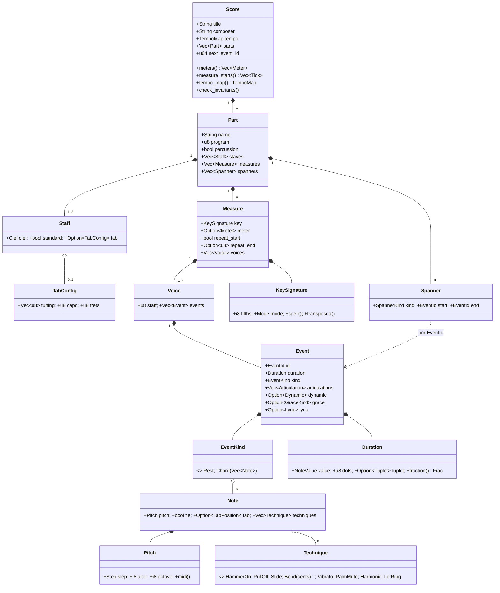
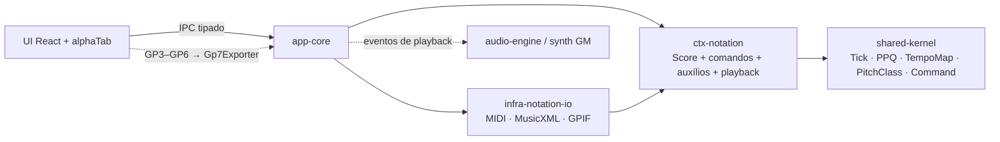

# Fase 7 — Notação: partitura e tablatura (Especificação)

- **Data:** 2026-11-05 · **Volta da espiral:** 7 · **Status:** Aprovada (modo autônomo)
- **Requisitos:** RF-7.1 a RF-7.4; parte de RF-9.1/RF-9.2 (MIDI, MusicXML, Guitar Pro)
- **ADRs:** 0008 (comandos), 0010 (alphaTab), 0020 (Guitar Pro), 0021 (modelo e I/O de notação)
- **Crates:** `crates/ctx-notation` (domínio), `crates/infra-notation-io` (Pure Fabrication)

## 1. Objetivos

1. Modelo de domínio **completo** de partitura e tablatura: partes, pautas (padrão e/ou tablatura com
   afinação e capotraste), compassos (armadura, fórmula, repetições), até 4 vozes, notas/acordes/pausas,
   figuras de semibreve a quartifusa (1/128) com pontos e quiálteras, ligaduras de valor, articulações,
   dinâmicas, crescendo/diminuendo, ligaduras de expressão, apojaturas, letra e técnicas de cordas.
2. **Editor completo** com operações desfazíveis (`Command<Score>`), todas com teste de ida e volta.
3. **Auxílios**: validar compasso, completar com pausas, transposição com grafia correta, destacar notas
   fora da escala, gerar partitura a partir de acordes, mapear tablatura ⇄ altura.
4. **Reprodução**: partitura → eventos MIDI temporizados (para soundfont GM e exportação).
5. **Formatos**: MIDI (importar/exportar), MusicXML `.musicxml`/`.mxl` (importar/exportar),
   Guitar Pro 7+ (importar; GP3–GP6 via alphaTab na UI — ADR-0020).

Fora desta volta: renderização/edição visual (UI com alphaTab), layout de página e PDF, cifras sobre a
pauta, quiálteras aninhadas, repetições aninhadas/casas de 1ª e 2ª vez, D.C./D.S./Coda.

## 2. Riscos (volta 7)

| ID | Risco | Prob. | Impacto | Mitigação | Teste que comprova |
|---|---|---|---|---|---|
| R1 | Erro acumulado de duração em quiálteras/pontos | Alta | Alto | Durações como fração exata (`Frac`, 128 bits na redução); ticks só na borda | `duration::decompose_sums_to_total`, `playback::tuplets_are_exact`, `frac::ticks_roundtrip` |
| R2 | Grafia enarmônica errada ao transpor | Alta | Médio | Armadura de destino com menos acidentes; diatônicas pela armadura, cromáticas pela direção | `pitch::spelling_preserves_midi`, `pitch::diatonic_notes_use_key_accidentals`, `transpose::transpose_roundtrip_preserves_midi` |
| R3 | Desfazer não restaura exatamente | Média | Alto | Comandos aplicam numa cópia do compasso, validam e trocam (atômico); inverso guarda snapshot mínimo + contador de ids | `commands::*_roundtrip`, `commands::works_with_history` |
| R4 | Partes com estruturas de compasso divergentes | Média | Alto | Invariante `check_invariants`; comandos estruturais aplicam em todas as partes; importadores normalizam | `model::push_part_assigns_ids_and_rejects_mismatch`, `musicxml::imported_partial_files_stay_consistent` |
| R5 | Perda de informação em MusicXML (ida e volta) | Média | Alto | Mapeamento explícito (seção 6) e teste de ida e volta de partitura rica | `musicxml::musicxml_roundtrip_preserves_rich_score`, `roundtrip_keeps_playback_identical` |
| R6 | MIDI com sobreposições/notas fora da grade gera partitura ilegível | Alta | Médio | Quantização configurável, acordes por (início, fim), vozes até 4, ligaduras nas barras | `arrange::overlapping_notes_go_to_new_voices_and_excess_is_dropped`, `midi::imports_format0_with_quantization_and_other_resolution` |
| R7 | Zip bomb / arquivo enorme | Baixa | Alto | Limites de tamanho; leitura descompactada com `take`; nº de entradas | `archive::rejects_bomb_entry`, `error::codes_are_stable` |
| R8 | XML malicioso (profundidade, entidades) | Baixa | Alto | DOM com limite de profundidade/nós; entidades externas não resolvidas | `xml::rejects_malformed_and_deep_documents`, `musicxml::malformed_inputs_are_errors_not_panics` |
| R9 | Pânico com entrada corrompida | Média | Alto | Toda leitura retorna `Result`; aritmética saturada; fuzz | `fuzz::random_bytes_never_panic`, `fuzz::corrupted_valid_files_never_panic`, `guitar_pro::mutated_gpif_never_panics`, `midi::garbage_and_truncated_midi_never_panics` |
| R10 | Formato Guitar Pro proprietário | Alta | Médio | Só GPIF (XML) no núcleo; GP3–GP6 → GP7 pelo alphaTab (ADR-0020) | `guitar_pro::imports_gp7_core_subset` |
| R11 | Tablatura incoerente com a altura | Média | Médio | `tab::pitch_of`/`best_position`; posição validada contra afinação/braço; ao mudar a altura a posição acompanha | `tab::every_position_maps_back`, `commands::tab_and_techniques`, `transpose::tab_follows_transposition` |

## 3. Modelo de domínio

### Invariantes
- Todas as partes têm o mesmo nº de compassos (≥ 1) e os mesmos atributos de compasso por índice.
- Fórmula de compasso: numerador 1–32, denominador ∈ {1,2,4,8,16,32}; `None` herda (o 1º compasso herda a
  fórmula inicial do `TempoMap`). Armadura −7…+7. Repetição final toca 2–16 vezes.
- ≤ 4 vozes por compasso; cada voz aponta para uma pauta da parte (≤ 2 pautas); ≤ 1.024 eventos por voz;
  ≤ 16 notas por acorde; altura em 0–127; acidente −2…+2; até 3 pontos; quiálteras 2–32 : 1–32.
- Tablatura: corda 1 = mais aguda; `altura = afinação[corda] + capotraste + traste`; traste + capo ≤ trastes.
- Ids de evento únicos, não nulos e menores que `next_event_id`; spanners apontam para eventos da parte.
- Apojaturas não ocupam tempo no compasso; pausas não podem ser apojaturas.

## 4. Comandos de edição (`ctx_notation::commands`)

| Comando | Variante | Inverso |
|---|---|---|
| `EditVoice` | `Insert {index, event}` (cria voz nova se índice = nº de vozes) | snapshot do compasso + spanners + contador de ids |
| | `Delete {index}` (remove spanners do evento) | idem |
| | `Replace {index, event}` (mantém id) | idem |
| | `SetDuration`, `SetPitch` (tablatura acompanha), `AddNote`, `RemoveNote` | idem |
| | `AddArticulation`, `RemoveArticulation`, `SetDynamic` (adicionar/remover) | idem |
| | `SetTie`, `SetTab` (altura acompanha), `AddTechnique`, `RemoveTechnique` | idem |
| | `SetLyric`, `SetGrace`, `FillRests` | idem |
| `EditScore` | `AddMeasure {index}` / `RemoveMeasure {index}` (fórmula migra ao seguinte) | remove/reinsere; restaura contador/spanners |
| | `SetKey {measure, key}` (até a próxima mudança) | lista de armaduras anteriores |
| | `SetMeter {measure, meter}` / `SetRepeat {measure, start, end}` | valor anterior |
| | `AddPart {index, part}` / `RemovePart {index}` | remove/reinsere |
| | `AddSpanner` / `RemoveSpanner` (ligadura, crescendo, diminuendo) | pop/insere |
| | `Transpose {scope: Score/Part/Events, semitones}` | partes anteriores |
| | `SetHeader {title, composer}`, `SetTempo {tick, bpm}` | valores anteriores |

Todos validam antes de alterar (atômicos) e retornam `CommandError` com código `notation.*` e mensagem
em PT-BR. Teste padrão: aplicar → desfazer = antes; refazer = depois; invariantes válidas.

## 5. Auxílios e serviços de domínio

| Função | Módulo | Descrição |
|---|---|---|
| `validate_measures(score)` | `analysis` | voz a voz: `Underfilled{missing}` / `Overfilled{excess}` (frações exatas) |
| `rests_to_fill`, `fill_rests` | `analysis` | completa a voz com pausas decompostas |
| `out_of_scale_notes(score, &[PitchClass])` | `analysis` | notas fora de um conjunto de classes (escala vinda da camada de aplicação, sem depender de Harmony) |
| `out_of_key_notes(score)` | `analysis` | fora da escala diatônica da armadura |
| `transpose(score, scope, semitones)` | `transpose` | grafia pela armadura de destino; armaduras transpostas no escopo `Score`; tablatura reposicionada |
| `chords_to_part` / `chords_to_score` | `arrange` | `ChordSlot {start_tick, duration_ticks, notes}` → piano em pauta dupla (divisão em Dó4) |
| `arrange_part`, `build_template` | `arrange` | notas temporizadas → compassos/vozes (quantização, acordes, vozes, ligaduras, pausas, dinâmicas por velocity, tablatura) |
| `pitch_of`, `positions_for`, `best_position`, `assign_chord` | `tab` | tablatura ⇄ altura; melhor posição perto da mão; acorde em cordas distintas com menor abertura |
| `render`, `performance_order`, `channels` | `playback` | eventos `{part, start_tick, duration_ticks, channel, program, key, velocity}` |

**Reprodução:** ligaduras fundem notas (inclusive entre compassos e repetições); quiálteras exatas;
dinâmica → velocity (ppp 16 … fff 127, padrão mf 80); crescendo/diminuendo interpolam até a próxima
dinâmica (ou ±24); acento +12, marcato +20; staccato toca metade; acciaccatura antes do tempo
(1/64), appoggiatura divide a duração; repetição simples expandida; percussão no canal 10.

## 6. Mapeamentos de I/O (`infra_notation_io`)

### 6.1 MIDI (SMF)

| SMF | Score |
|---|---|
| Cabeçalho formato 1, 960 PPQ (exportação) / qualquer PPQ métrico (importação) | ticks a 960 PPQ |
| Trilha 0: `TrackName`, `Tempo`, `TimeSignature`, `KeySignature` | `title`, `tempo`, `Measure.meter`, `Measure.key` |
| Uma trilha por parte: `TrackName`, `ProgramChange`, `NoteOn/NoteOff` | `Part.name`, `Part.program`, notas de `playback::render` |
| Canal 10 | `Part.percussion` |
| Importação: uma parte por (trilha, canal); formato 0 dividido por canal | `arrange_part` com grade (`MidiImportOptions.grid_ticks`, padrão semicolcheia) |
| Velocity | marca de dinâmica quando muda de faixa |
| Programa 24–31 / 32–39 / 0–7 | violão/guitarra com tab / baixo com tab / piano em pauta dupla |

Exportação expande repetições por padrão (`MidiExportOptions.expand_repeats`). SMPTE: não suportado.

### 6.2 MusicXML 4.0 (partwise)

| MusicXML | Score |
|---|---|
| `work/work-title`, `creator[@type=composer]` | `title`, `composer` |
| `score-part`, `part-name`, `midi-program` (1-based), `midi-channel` = 10 | `Part.name`, `program`, `percussion` |
| `divisions` (exporta 960) | durações por `<type>`, `<dot/>`, `<time-modification>`; sem `<type>`: deduzido de `<duration>` |
| `key/fifths`, `key/mode` | `Measure.key` |
| `time/beats` (aceita `3+2`), `time/beat-type` | `Measure.meter` / fórmula inicial |
| `staves`, `clef` (`G`, `G`+`clef-octave-change −1`, `F`, `C`, `percussion`, `TAB`) | `Part.staves[].clef`, `standard` |
| `staff-details/staff-tuning` (linha 1 = corda grave), `capo` | `TabConfig.tuning` (corda 1 = aguda), `capo` |
| `note/pitch` (`step`, `alter`, `octave`), `unpitched`, `rest`, `chord` | `Note.pitch`, `EventKind` |
| `voice`, `staff`, `backup`, `forward` | `Measure.voices[]` (até 4, por ordem de aparição), `Voice.staff` |
| `tie` + `tied` | `Note.tie` |
| `articulations` (`staccato`, `accent`, `tenuto`, `strong-accent`), `fermata` | `Event.articulations` |
| `direction/dynamics` (ppp…fff) | `Event.dynamic` (no próximo evento) |
| `direction/wedge` (`crescendo`/`diminuendo`/`stop`, `number`) | `Spanner` Crescendo/Diminuendo |
| `slur` (`start`/`stop`, `number`) | `Spanner` Slur |
| `technical/string`, `fret` | `Note.tab` |
| `hammer-on`, `pull-off`, `bend/bend-alter` (semitons), `harmonic` (`natural`/`artificial`), `other-technical` ("palm mute", "let ring") | `Technique::*` |
| `slide`/`glissando` start, `ornaments/wavy-line` start ou `vibrato` | `Slide`, `Vibrato` |
| `grace` (`slash="yes"` = acciaccatura) | `Event.grace` |
| `lyric` (`syllabic`, `text`) — 1ª estrofe | `Event.lyric` |
| `barline/repeat` forward / backward (`times`) | `repeat_start` / `repeat_end` |
| `sound/@tempo`, `metronome` | `TempoMap` (mudanças no início do compasso) |
| `.mxl`: `META-INF/container.xml` → `rootfile/@full-path` | idem |

### 6.3 Guitar Pro 7+ (GPIF) — ver ADR-0020

| GPIF | Score |
|---|---|
| `Score/Title`, `Score/Music` (ou `Artist`) | `title`, `composer` |
| `Track/Name`, `Sounds/Sound/MIDI/Program`, `MidiConnection/PrimaryChannel` = 9, `InstrumentSet/Type=drumKit` | `Part` |
| `Staves/Staff/Properties`: `Tuning/Pitches` (grave→aguda), `CapoFret/Fret` | `Staff.tab` |
| `MasterBar`: `Key/AccidentalCount`, `Key/Mode`, `Time` "n/d", `Repeat@start/@end/@count`, `Bars` (por faixa e pauta) | `Measure` |
| `Bar/Voices` (4 slots, −1 = vazio) → `Voice/Beats` | `Measure.voices` |
| `Beat`: `Rhythm@ref`, `Notes`, `Dynamic`, `GraceNotes` (OnBeat/BeforeBeat) | `Event` |
| `Rhythm`: `NoteValue`, `AugmentationDot@count`, `PrimaryTuplet@num/@den` | `Duration` |
| `Note`: `String` (0 = grave), `Fret`, `Midi`, `ConcertPitch`; `Tie@origin`; `Accent` (bits 1/4/8/16) | `Note`, `Event.articulations` |
| `HopoOrigin`, `Slide/Flags`, `Bended`+`BendDestinationValue` (100 = 1 tom), `Vibrato`, `PalmMuted`, `HarmonicType/HType`, `LetRing` | `Technique::*` (hammer vira pull-off se a próxima nota for mais grave) |
| `MasterTrack/Automations/Automation[Type=Tempo]` `Bar`, `Value` | `TempoMap` |

### 6.4 Segurança de entrada

Arquivo ≤ 32 MiB · entrada de zip ≤ 64 MiB descompactada (lida com `take`) · ≤ 2.000 entradas ·
XML profundidade ≤ 128 e ≤ 2 mi elementos · entidades externas não resolvidas · ≤ 500 mil notas MIDI ·
limites do domínio (64 partes, 10.000 compassos, 4 vozes, 1.024 eventos/voz, 16 notas/acorde) ·
aritmética de frações em 128 bits com saturação · avisos (PT-BR) no `Imported.warnings`.

## 7. Componentes

## 8. Critérios de aceite

- [x] Modelo cobre padrão + tablatura, 4 vozes, figuras 1–1/128, pontos, quiálteras, ligaduras,
      articulações, dinâmicas, crescendo/diminuendo, ligaduras de expressão, apojaturas, letra e técnicas.
- [x] Todos os comandos da seção 4 com teste de ida e volta (aplicar/desfazer/refazer) e integração com `History`.
- [x] Validação de compasso, preenchimento de pausas, notas fora da escala (conjunto de classes), transposição
      com grafia correta (propriedade: +n −n preserva alturas e grafia segue a armadura).
- [x] Acordes → partitura de piano válida (sem compassos incompletos).
- [x] Tablatura ⇄ altura com capotraste (propriedade: toda posição volta à mesma altura).
- [x] Reprodução honra ligaduras, quiálteras, dinâmicas/rampas e repetições.
- [x] MusicXML: ida e volta da partitura rica sem perda (modelo e reprodução idênticos); `.mxl`; amostra escrita à mão.
- [x] MIDI: ida e volta preserva reprodução, fórmulas, andamentos e armadura; importação formato 0 com
      quantização e outra resolução.
- [x] Guitar Pro 7: importação do subconjunto central (amostra GPIF), `.gp` e GPIF bruto.
- [x] Fuzz: bytes aleatórios e arquivos válidos corrompidos nunca causam pânico; zip bomb rejeitado.
- [x] `cargo fmt`, `cargo clippy -D warnings` e testes verdes nos dois crates.

## 9. Limitações conhecidas (próximas voltas)

- Repetições aninhadas, casas de 1ª/2ª vez, D.C./D.S./Coda não modelados; fermata não altera o tempo na reprodução.
- Mudanças de andamento no meio do compasso são exportadas em MusicXML no início do compasso.
- MusicXML: só a 1ª estrofe de letra; tie de "stop" é inferido (só `start` é guardado); quiálteras aninhadas,
  ornamentos além de vibrato, cifras (`harmony`), instrumentos transpositores e layout não são lidos.
- MIDI: velocities individuais viram marcas de dinâmica (perda de nuance); notas além de 4 vozes sobrepostas
  são descartadas com aviso; SMPTE não suportado.
- GPIF: bends com múltiplos pontos viram um único valor; slides sem distinção de tipo; letras, acordes,
  automação de volume e efeitos de batida (whammy, tapping, rasgueado) não importados.
- `SetKey` não regrafa as notas existentes (mantém as alturas escritas).
