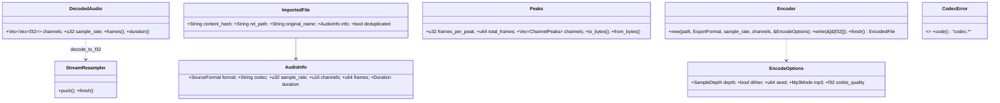

# Fase 9 — Formatos de Áudio (Especificação)

- **Data:** 2026-11-05 · **Volta da espiral:** 9 (antecipada: base de import/export usada desde a Fase 0)
  · **Status:** Aprovada (modo autônomo)
- **Requisitos:** RF-0.2, RF-0.7, RF-9.1 (áudio), RF-9.2 (áudio e stems), RNF de desempenho/memória
- **Crate:** `crates/infra-codecs` (GRASP Pure Fabrication; depende só de `shared-kernel` + externos)
- **ADRs:** [0022](../adr/0022-codificadores-exportacao-licencas.md) (codificadores e licenças),
  [0023](../adr/0023-exportacao-aac-adiada.md) (AAC)
- **Fora deste crate:** MIDI, MusicXML, Guitar Pro e PDF (RF-9.1/9.2 simbólicos) ficam com os
  contextos de notação/MIDI em voltas próprias.

## 1. Objetivos

1. **Probe e decodificação** de WAV, AIFF, FLAC, MP3, OGG Vorbis, AAC-LC/ALAC (M4A/MP4/ADTS) e CAF
   para `f32` não intercalado (ver arquitetura §5.4), na taxa do projeto, com conversão sinc de
   alta qualidade; mono continua mono e > 2 canais viram estéreo com coeficientes documentados.
2. **Importação** para `audio/imported/<sha256>.<ext>` (arquitetura §6.2): cópia (original
   preservado), hash SHA-256 em streaming, deduplicação, gravação atômica, confinamento à pasta do
   projeto, lista branca de extensões e limite de tamanho (padrão 2 GiB).
3. **Picos de waveform** mín./máx. por canal com cache binário regenerável
   `cache/peaks/<hash>-<fpp>.peaks` e multirresolução (256/1024/4096).
4. **Exportação** em fluxo para WAV (16/24 int, 32 float), AIFF (16/24, AIFF-C float), FLAC (16/24),
   MP3 (CBR 128–320, VBR V0), OGG Vorbis (qualidade) e stems; dither TPDF em 16/24 bits.
5. Nunca entrar em pânico com entrada malformada; erros com código `codec.*` e mensagem PT-BR.

## 2. Riscos (volta 9)

| ID | Risco | Prob. | Impacto | Mitigação | Teste que comprova |
|---|---|---|---|---|---|
| F1 | Arquivo malicioso/corrompido causa pânico ou trava | Média | Alto | `symphonia` (Rust seguro) + limite de erros consecutivos (64) + limites de tamanho/quadros; todo erro vira `CodecError` | `robustness::random_bytes_never_panic`, `random_bytes_after_valid_magic_never_panic` (proptest), `truncated_and_bit_flipped_files_never_panic` |
| F2 | Path traversal / escrita fora do projeto (links simbólicos, nomes) | Baixa | Alto | Nome do destino = hash + extensão canônica da lista branca; pastas canonizadas e checadas com `starts_with(root)`; destino existente que não é arquivo comum é rejeitado; hash do cache validado (64 hex) | `import::symlink_escaping_the_project_is_rejected`, `existing_symlink_at_destination_name_is_not_trusted`, `peaks_cache::invalid_hash_never_touches_the_filesystem`, `peaks::cache_path_rejects_bad_hash` |
| F3 | Arquivo parcial após falha (disco cheio, queda) | Média | Alto | Temporário oculto na mesma pasta + `sync_all` + rename atômico; `Drop` apaga o temporário; stems removidos em falha | `roundtrip::encoder_dropped_without_finish_leaves_nothing`, `encoder_rejects_bad_blocks_and_overwrites_atomically`, `stems_failure_removes_partial_outputs` |
| F4 | Memória alta em arquivos longos | Média | Médio | Decodificação pacote a pacote (buffer 64 KiB) com downmix e resampler em fluxo (fila ≤ 1024 quadros); hash/cópia em blocos de 1 MiB; exportação em blocos | `resample::chunked_push_equals_single_push`; revisão de código (sem `read_to_end` do arquivo comprimido) |
| F5 | Resampler altera afinação/duração ou desalinha | Média | Alto | Sinc 256 pontos (Blackman-Harris²); corte do atraso inicial; comprimento exato `ceil(n·to/from)` em aritmética inteira | `resample::length_is_exact_ceil_of_ratio`, `delay_is_compensated_within_one_sample`, `roundtrip::resampling_44k1_to_48k_preserves_frequency_and_length_ratio` |
| F6 | Perda de qualidade na exportação lossless | Baixa | Alto | Quantização com arredondamento e saturação; dither TPDF ±1 LSB opcional | `roundtrip::wav/aiff/flac_round_trip_is_exact…`, `dithered_16_bit_error_is_bounded`, `dither::*` |
| F7 | Atraso/preenchimento do MP3 muda duração e sincronia | Alta | Médio | Gravar tag LAME/Xing no primeiro quadro (atraso + preenchimento); decodificador gapless | `roundtrip::mp3_is_gapless_sample_exact_with_lame_tag`, `mp3_cbr_and_v0_preserve_duration_and_level` |
| F8 | Dependências C não compilam em algum SO / licença incompatível | Média | Alto | Só `cc` (sem `cmake`/`pkg-config`); MP3/Vorbis atrás de *features*; build 100% Rust possível; avaliação de licenças (ADR-0022/0023) | CI nos 3 SOs; `cargo test -p infra-codecs --no-default-features` verde |
| F9 | Downmix surround satura ou perde canais | Baixa | Médio | Coeficientes ITU-R BS.775 (−3 dB para centro/surround, LFE descartado), sem normalização (pipeline `f32` com folga) | `downmix::five_one_downmix_uses_documented_coefficients`, `roundtrip::surround_wav_is_downmixed_to_stereo` |
| F10 | Cache de picos corrompido mostra waveform errada | Baixa | Baixo | Cabeçalho com magic/versão/tamanhos + checksum FNV-1a; inválido ⇒ recalcula e regrava | `peaks::binary_round_trip_and_corruption_detection`, `peaks_cache::corrupted_cache_is_recomputed_and_rewritten` |
| F11 | AAC sem codificador viável | Alta | Médio | Adiado com erro claro (ADR-0023); `is_available()` para a UI | `roundtrip::aac_export_is_unsupported_with_clear_message` |

## 3. Matriz de formatos

| Formato | Importar (decodificar) | Exportar | Biblioteca | Licença |
|---|---|---|---|---|
| WAV (PCM 8–32 int, 32/64 float) | Sim | 16/24 int (dither), 32 float | `symphonia` / `hound` | MPL-2.0 / Apache-2.0 |
| AIFF / AIFF-C | Sim | 16/24 int, 32 float (`fl32`) | `symphonia` / escritor próprio | MPL-2.0 / MIT |
| FLAC | Sim | 16/24 | `symphonia` / `flacenc` | MPL-2.0 / Apache-2.0 |
| MP3 | Sim (gapless com tag LAME/Xing) | CBR 128/160/192/224/256/320, VBR V0; ≤ 48 kHz | `symphonia` / `mp3lame-encoder` (LAME) | MPL-2.0 / LGPL |
| OGG Vorbis | Sim | Qualidade −0,2…1,0 (padrão 0,6) | `symphonia` / `vorbis_rs` (libvorbis aoTuV) | MPL-2.0 / BSD-3 |
| AAC-LC (M4A/MP4/ADTS) | Sim (HE-AAC não) | **Não** (ADR-0023) | `symphonia` | MPL-2.0 |
| ALAC (M4A) | Sim | Não | `symphonia` | MPL-2.0 |
| CAF | Sim | Não | `symphonia` | MPL-2.0 |
| Stems | — | um arquivo por stem, qualquer formato acima | `export_stems` | — |
| Conversão de taxa | sinc assíncrono 256 pontos | — | `rubato` 5 | MIT/Apache-2.0 |

Lista branca de extensões de importação: `wav wave aif aiff aifc flac mp3 ogg oga m4a mp4 aac caf`
(canonizadas: `wave→wav`, `aif→aiff`, `oga→ogg`, `mp4→m4a`).

## 4. Modelo (API pública)



Funções: `probe`, `probe_with`, `decode_to_f32`, `decode_to_f32_with(DecodeLimits)`,
`import_into_project`, `import_into_project_with(ImportOptions)`, `sha256_file`, `compute_peaks`,
`compute_multi_resolution`, `load_or_compute`, `load_or_compute_multi`, `peaks_cache_path`,
`export_stems`, `sanitize_extension`, `sanitize_file_stem`, `resample::resample_planes`.

Códigos de erro: `codec.unsupported_format`, `codec.corrupt`, `codec.io`, `codec.too_large`,
`codec.disk_full`, `codec.permission_denied`, `codec.not_found`, `codec.invalid_path`,
`codec.invalid_parameter`, `codec.resample`, `codec.encoder` (`impl From<CodecError> for CommandError`).

### Downmix (> 2 canais → estéreo)

| Origem | Esq. | Dir. |
|---|---|---|
| FL / FR | 1 | 0 / 1 |
| Centrais (FC, RC, TC, TFC, TRC, BFC) | 0,7071 | 0,7071 |
| Laterais/traseiros/superiores de um lado | 0,7071 | 0 (ou espelhado) |
| LFE1/LFE2 | 0 | 0 |
| Desconhecido / layout discreto | 0,5 ou alternância 0,7071 | — |

### Formato do cache de picos (`.peaks`, little-endian)

`AMPK` · versão u16=1 · canais u16 · fpp u32 · reservado u32 · blocos u64 · quadros u64 ·
FNV-1a64(payload) u64 · payload (por canal: mínimos f32 × blocos, depois máximos). Inválido ⇒ recalcula.

## 5. Sequência — importação

```mermaid
sequenceDiagram
    actor U as Usuário
    participant APP as app-core (audio_import)
    participant IMP as infra-codecs::import
    participant DEC as infra-codecs::decode (symphonia)
    participant FS as Sistema de arquivos
    U->>APP: audio_import { paths[] }
    APP->>IMP: import_into_project(src, project_root)
    IMP->>FS: metadata(src) — arquivo? ≤ max_bytes?
    IMP->>IMP: sanitize_extension (lista branca → canônica)
    IMP->>DEC: probe_with(src) — conteúdo é áudio?
    DEC-->>IMP: AudioInfo
    IMP->>FS: canonicalize(root); create_dir_all(audio/imported); checa starts_with(root)
    IMP->>FS: temporário .appmusica-*.part na mesma pasta
    loop blocos de 1 MiB
        IMP->>FS: lê src → SHA-256.update → escreve temporário
    end
    alt <hash>.<ext> já existe (arquivo comum)
        IMP->>FS: apaga temporário (deduplicado)
    else novo
        IMP->>FS: sync_all + rename atômico → audio/imported/<hash>.<ext>
    end
    IMP-->>APP: ImportedFile { content_hash, rel_path, original_name, info, deduplicated }
    APP->>APP: AudioSource (hash UNIQUE, rel_path) + comando desfazível
    APP->>DEC: decode_to_f32(rel_path, taxa do projeto) → engine
    APP->>APP: load_or_compute_multi(peaks) → UI
```

## 6. Critérios de aceite

- [x] `probe`/`decode_to_f32` para WAV, AIFF, FLAC, MP3, OGG gerados nos testes; formato e
  quadros corretos.
- [x] Ida e volta **exata** WAV/AIFF (16/24/32f) e FLAC (16/24) sem dither; com dither erro ≤ 1,5 LSB.
- [x] MP3 (CBR 128/320, V0; mono/estéreo; 44,1/48 kHz) e OGG: comprimento **exato** (gapless),
  RMS dentro de ±10 %, frequência preservada, correlação > 0,99 sem atraso.
- [x] 44,1 → 48 kHz: 88 200 → 96 000 quadros; 1 kHz preservado (±0,05 Hz); deslocamento < 1 amostra.
- [x] Importação: hash = SHA-256 do original, `rel_path` canônico, deduplicação, original intocado,
  rejeição de extensão, conteúdo falso, tamanho, origem inexistente e links que escapam do projeto.
- [x] Picos corretos em sinal conhecido; multirresolução igual ao cálculo direto; cache corrompido
  recalculado e regravado; decodificação no máximo uma vez por chamada.
- [x] Bytes aleatórios/truncados/trocados nunca causam pânico.
- [x] AAC: `codec.unsupported_format` com mensagem PT-BR citando ADR-0023.
- [x] `cargo fmt`, `cargo clippy -p infra-codecs --all-targets -- -D warnings` e
  `cargo test -p infra-codecs` (com e sem *features* padrão) verdes.

## 7. Dependências de sistema (CI e desenvolvimento)

| SO | Necessário | Observação |
|---|---|---|
| Linux | `build-essential` (gcc/cc) | LAME e libvorbis/libogg compilados pelo crate `cc`; sem `cmake`/`pkg-config` |
| macOS | Xcode Command Line Tools (clang) | idem |
| Windows | MSVC Build Tools (já exigido pelo alvo `*-msvc` do Rust) | `clang-cl` também suportado pelo `mp3lame-sys` |

Build sem C: `cargo build -p infra-codecs --no-default-features` (MP3/OGG → `codec.unsupported_format`).

## 8. Limitações conhecidas

- AAC/M4A só importação (AAC-LC e ALAC; HE-AAC/HE-AACv2 não decodificam) — ADR-0023.
- MP3 exporta até 48 kHz (limite do formato); projetos a 88,2/96 kHz devem reamostrar antes
  (`resample_planes`) — a camada de aplicação fará isso no fluxo de exportação.
- MP3 de terceiros **sem** tag LAME/Xing mantém o atraso do codificador (~1105 amostras no início),
  como em qualquer decodificador.
- Downmix sem normalização: material surround muito alto pode passar de 0 dBFS em `f32`
  (sem clipping interno; o medidor/limiter do master alerta).
- Conversão de taxa: atraso fracionário residual < 1 amostra (o atraso inteiro é removido).
- O probe de MP3/ADTS sem contagem de quadros no cabeçalho decodifica o arquivo para contar.
- Não há fixture AAC/ALAC gerada nos testes (sem codificador livre); a decodificação é do `symphonia`.
