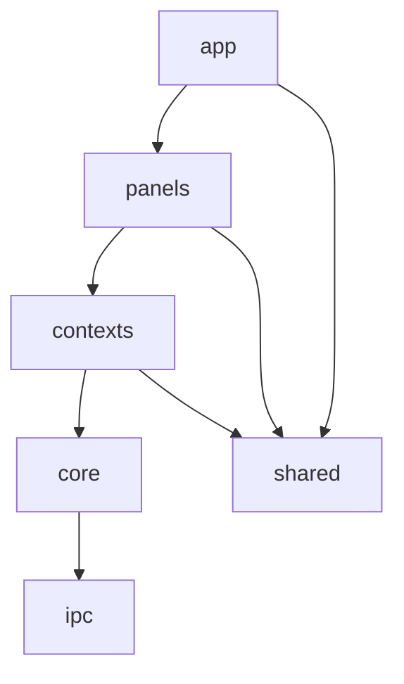

# Interface — Workspace e Componentes (Spec + Mockups)

- **Data:** 2026-11-05 · **Volta da espiral:** 2 (UI) · **Status:** Aprovada (modo autônomo)
- Mockups registrados aqui (wireframes) conforme `CLAUDE.md`; a UI rodando em modo simulado
  (`npm run dev:mock`) é o protótipo navegável.

## 1. Objetivos

Interface única com painéis encaixáveis, tema escuro padrão (claro alternável), atalhos de DAW,
sem estouro de layout em 1280×720 e operável por teclado nas ações principais.

## 2. Riscos

| ID | Risco | Mitigação | Teste que comprova |
|---|---|---|---|
| U1 | Contrato IPC divergir do Rust | Fixtures JSON geradas pelo Rust + esquema `zod` validado no Vitest | `ipc/contract.test.ts` |
| U2 | Timeline lenta com muitas faixas | Canvas 2D, desenho só da área visível, picos em cache | E2E `timeline com 32 faixas` |
| U3 | Estouro de componentes em telas pequenas | Painéis com rolagem própria, `min-width: 0`, testes em 1280×720 | E2E `sem rolagem horizontal` |
| U4 | Acoplamento entre contextos da UI | Regra: contexto não importa contexto; composição em `panels/` | `architecture.test.ts` (varre imports) |
| U5 | UI travar em operações longas | Comandos longos são `async` no Rust; UI mostra estado ocupado | teste de componente `ExportDialog` |
| U6 | Perda de trabalho | Indicador de alterações, confirmação ao fechar, recuperação de autosave | E2E `recuperação` |

## 3. Camadas da UI

```
src/
├── shared/      Design System (tokens, Button, Fader, Knob, Meter, Dialog, Toast…) — sem regra de negócio
├── ipc/         Contrato (types + zod), transportes (Tauri | simulado) e API tipada
├── core/        Estado de aplicação da UI (sessão, transporte, erros) — equivalente ao app-core
├── contexts/    Um módulo por bounded context (project, transport, mixing, recording, …)
├── panels/      Composição de contextos em painéis encaixáveis
└── app/         Shell: tela inicial, workspace, barra superior, atalhos, diálogos, tema
```



## 4. Mockups (wireframes)

### 4.1 Tela inicial

```
┌──────────────────────────────────────────────────────────────────────────┐
│  ◉ AppMusica                                                    ☾ / ☀    │
├───────────────────────────────┬──────────────────────────────────────────┤
│  Novo projeto                 │  Recentes                                │
│  Nome  [Minha música      ]   │  ▸ Demo voz e violão   ~/Música/…  ontem │
│  Pasta [~/Música      ][…]    │  ▸ Ensaio              ~/Projetos/… 3 dias│
│  Taxa  (44,1)(●48)(88,2)(96)  │                                          │
│  Bits  (16)(●24)(32f)         │  [Abrir projeto…]                        │
│  [ Criar projeto ]            │                                          │
└───────────────────────────────┴──────────────────────────────────────────┘
```

### 4.2 Workspace

```
┌ ◉ Demo ● │ ↶ ↷ │ ⏮ ▶ ⏸ ⏹ ⏺ │ 005.2.480  00:09.240 │ ♩ 120  4/4 │ 🕪 metr. ⟳ loop │ 💾 ┐
├──────────────┬────────────────────────────────────────────────────────────┤
│ Faixas       │ 1      2      3      4      5      6      7      8   régua │
│ ┌──────────┐ │ ┌────────────────┐                                         │
│ │Voz   M S●│ │ │▁▃▅▇▅▃▁ voz.wav │        ┌──────────────┐                 │
│ │ ▮▮▮▯ vol │ │ └────────────────┘        │▃▅▇▅▃ take 2  │                 │
│ └──────────┘ │      ┌─────────────────────────────┐                        │
│ │Violão M S│ │      │▂▃▄▅▄▃▂▁▂▃▄▅ violão.flac      │       ▏playhead       │
│ [+ Faixa]    │      └─────────────────────────────┘                        │
├──────────────┴───────────┬────────────────────────────────────────────────┤
│ Mixer │ Efeitos │ Gravação │ Mapa de tempo │ Análise                       │
│ ┌────┐┌────┐┌────┐ ┌─────┐                                                 │
│ │ Voz││Viol││Bus ││Master│  ← faders, pan, M/S, medidores, inserts        │
│ │ ▮  ││ ▮  ││ ▮  ││ ▮▮  │                                                 │
│ └────┘└────┘└────┘ └─────┘                                                 │
├───────────────────────────────────────────────────────────────────────────┤
│ Saída: Focusrite 2i2 · 48 kHz · buffer 128 · ~5,3 ms · salvo automaticamente │
└───────────────────────────────────────────────────────────────────────────┘
```

### 4.3 Canal do mixer

```
┌────────┐
│ Voz    │  nome (duplo clique renomeia)
│ [EQ  ]●│  inserts (clique abre editor; ● = bypass)
│ [Comp]●│
│ [+ fx ]│
│ →Bus 1 │  envios
│  ( ◜ ) │  pan (knob)
│ ┃ ▮ ┃  │  fader + medidor L/R
│ ┃ ▮ ┃  │
│ −6.0dB │
│ [M][S] │
│ ⏺ arm  │
└────────┘
```

## 5. Atalhos (padrão DAW, editáveis)

| Ação | Atalho |
|---|---|
| Play/Pausa | Espaço |
| Parar e voltar ao início | Enter |
| Gravar | R |
| Desfazer / Refazer | Ctrl+Z / Ctrl+Shift+Z (Ctrl+Y) |
| Salvar | Ctrl+S |
| Nova faixa | Ctrl+T |
| Importar áudio | Ctrl+I |
| Metrônomo | C |
| Loop | L |
| Zoom + / − | Ctrl+= / Ctrl+− |

## 6. Critérios de aceite

1. Todas as telas sem rolagem horizontal da página em 1280×720 (E2E).
2. Contrato IPC validado contra fixtures geradas pelo Rust (Vitest).
3. Nenhum contexto importa outro contexto (teste de arquitetura).
4. Fluxo E2E simulado: criar projeto → importar → mixar → desfazer → salvar.

<!-- ---- Harmonia e Bases ---- -->

## Mockups — Harmonia e Bases

Painéis inferiores "Harmonia" (`contexts/harmony`) e "Bases" (`contexts/library`), Fases 4–5.
Contrato IPC: `docs/specs/2026-11-05-fase-5-harmonia-e-4-bases.md` §11.5. Os dois contextos não se
importam: o tom escolhido na Harmonia chega às Bases por `core/composition.ts` (estado de UI
compartilhado), e a audição (WAV → WebAudio) é um serviço técnico em `core/audition.ts`.

### H.1 Painel Harmonia

```
┌ Harmonia ──────────────────────────────────────────────────────────────────────────────┐
│ Tom [Dó ▾] Modo [Jônio (maior) ▾]  (Cifra|Graus) (Tríades|Tétrades)      [■ Parar]     │
│ Campo: │ C  I │ Dm ii │ Em iii │ F IV │ G V │ Am vi │ Bdim vii° │   (clique = ouvir)    │
├─(Progressões)─(Próximo acorde)─(Minhas progressões)────────────────────────────────────┤
│ Gênero [Pop ▾]                                                                          │
│ ┌──────────────────────────────────────────────────────────────────────────────────┐   │
│ │ Eixo pop  · Pop  [universal]   C  G  Am  F           [▶ Ouvir] [Inserir no arranjo]│   │
│ │ Doo-wop   · Pop                C  Am F  G            [▶ Ouvir] [Inserir no arranjo]│   │
│ └──────────────────────────────────────────────────────────────────────────────────┘   │
│ Inserir em: (●) nova faixa ( ) faixa selecionada "Voz"     · no cursor (compasso 3)     │
└─────────────────────────────────────────────────────────────────────────────────────────┘
```

Aba **Próximo acorde** (sequência montada clicando nas sugestões):

```
│ Sequência: [Dm7] [G7] [C]   [↶ Remover último] [Limpar] [▶ Ouvir] [Inserir no arranjo] │
│ Sugestões após G7:                                                                    │
│  [ C  · I   — Cadência autêntica ▮▮▮▮▮ ]  [ Am · vi — Cadência deceptiva ▮▮▮ ] …        │
│ (sequência vazia → sugestões a partir da tônica)                                       │
```

Aba **Minhas progressões** (CRUD + histórico da biblioteca):

```
│ [+ Nova] [↶ Desfazer: Adicionar progressão] [↷ Refazer]                                 │
│ Minha samba · Samba   I VI7 ii7 V7        [▶] [Inserir] [Editar] [Remover]              │
│ ┌ Diálogo "Nova progressão" ─────────────────────┐                                      │
│ │ Nome [        ]  Modo [Jônio ▾] Tempos/comp. [4]│                                      │
│ │ Graus [I VI7 ii7 V7          ] Gêneros [☑ Samba]│                                      │
│ │                         [Cancelar] [Salvar]     │                                      │
│ └─────────────────────────────────────────────────┘                                     │
```

### H.2 Painel Bases

```
┌ Bases ─────────────────────────────────────────────────────────────────────────────────┐
│ [Buscar…      ] BPM [ 60]–[180] Tom [qualquer ▾] Gênero [▾] Instrumento [▾] Tipo [▾]   │
│ Tags [suave, loop]                     [Gerar base…] [Adicionar áudio…] [SoundFont…]   │
├─────────────────────────────────────────────────────────────────────────────────────────┤
│ Nome              Tipo      BPM   Tom   Compasso  Gênero                                │
│ Pop básico        gerada    100   C     4/4       pop       [▶] [Inserir] [Remover]    │
│ Loop bateria      áudio      96   Am    4/4       pop       [▶] [Inserir] [Remover]    │
│ …                                                       (rolagem própria)               │
│ [↶ Desfazer] [↷ Refazer] (histórico da biblioteca)                                     │
└─────────────────────────────────────────────────────────────────────────────────────────┘
```

Diálogo **Gerar base** (ouvir antes de salvar):

```
┌ Gerar base ──────────────────────────────────────────────┐
│ Progressão (cifra) [C:4 G:4 Am:4 F:4  ]  ou  graus [  ]  │
│ Tom [Dó ▾] [Maior|Menor]  BPM [100] Compassos [8]        │
│ Estilo [Pop (palhetada) ▾] Bateria [auto ▾] Baixo [auto ▾]│
│ Nome [Minha base] Gênero [pop] Tags [suave]              │
│ Resultado: 4/4 · 8 compassos · 312 eventos                │
│            [Gerar] [▶ Ouvir] [Cancelar] [Salvar na biblioteca]│
└──────────────────────────────────────────────────────────┘
```

Diálogo **Inserir base** (RF-4.5: sempre pergunta quando há divergência):

```
┌ Inserir "Loop bateria" ─────────────────────────────────┐
│ Tom do projeto [Dó ▾] [Maior|Menor]  (padrão: tom da Harmonia) │
│ Divergência:                                            │
│   BPM da base 96 → projeto 120  (×1,25)                 │
│   Tom: 3 semitons acima · modo diferente (vai à relativa)│
│ Como inserir?                                           │
│   [Manter original]   [Adaptar ao projeto]   [Cancelar]  │
└─────────────────────────────────────────────────────────┘
```

Diálogo **SoundFont**: estado do sintetizador (`simples` | `SoundFont: banco, n presets, caminho`),
[Escolher arquivo .sf2…] [Usar sintetizador simples].

### H.3 Critérios de aceite (UI)

1. Fixtures `ui/src/ipc/__fixtures__/composition-*.json` geradas pelo Rust e validadas pelo zod
   (`ipc/composition.contract.test.ts`).
2. E2E `e2e/composition.spec.ts` (simulado): tom/gênero → ouvir → inserir (faixa aparece, desfazer
   remove) → sequência de próximo acorde → gerar base → inserir base com divergência → "Adaptar" →
   clipe inserido; sem rolagem horizontal em 1280×720.
