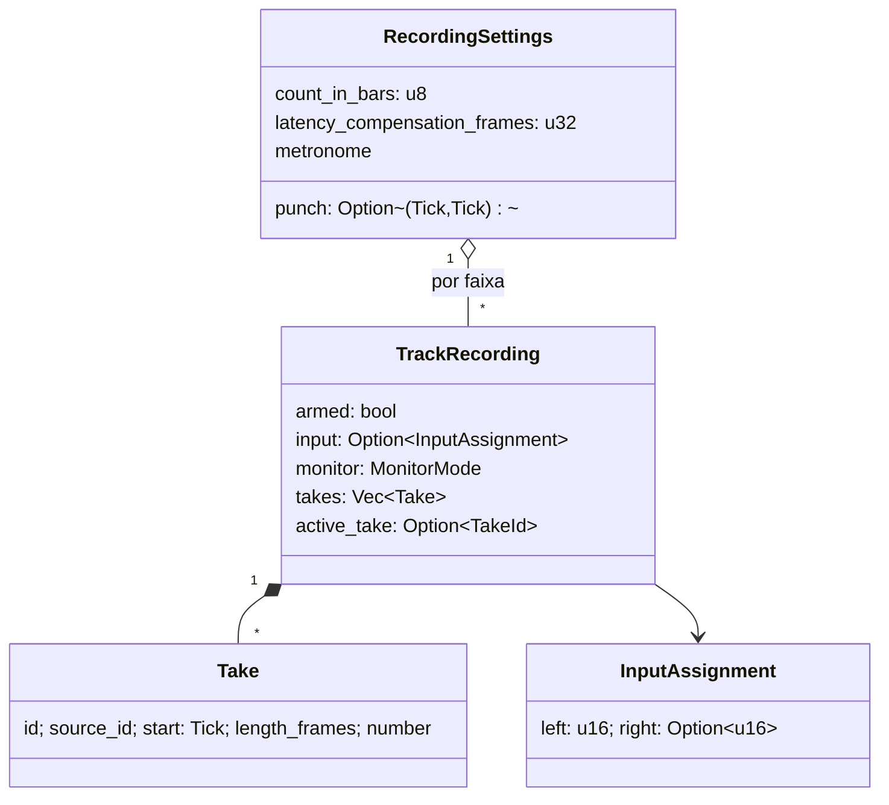
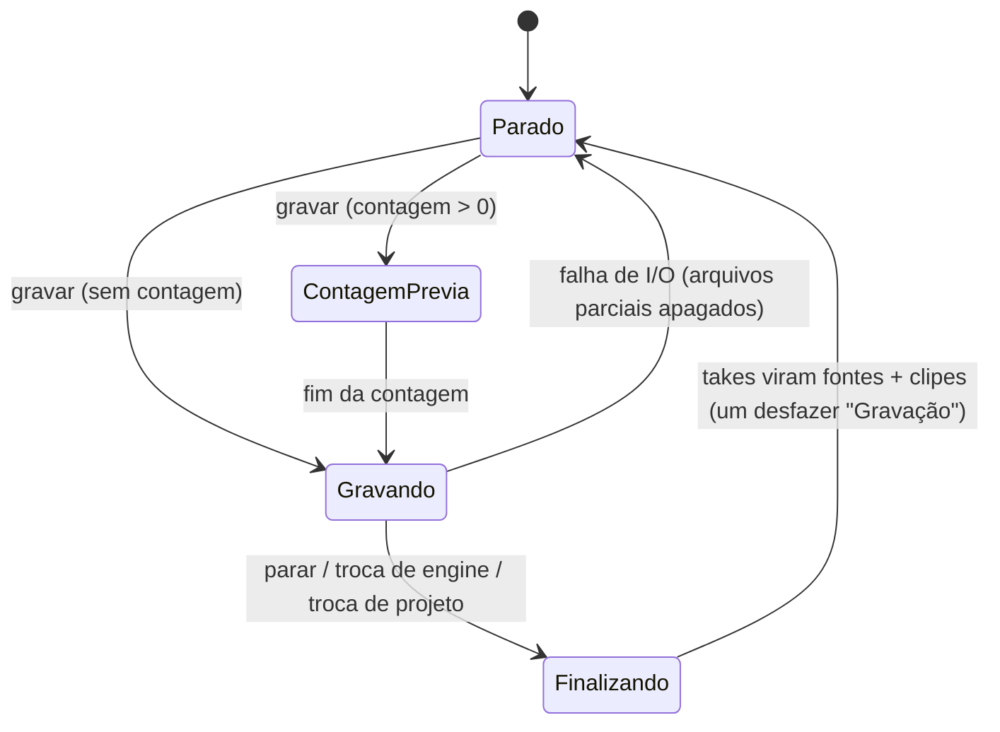

# Fase 1 — Captura (especificação)

- **Data:** 2026-11-06 (consolidada após a implementação; decisões em ADR-0010, ADR-0012 e ADR-0028)
- **Requisitos:** RF-1.1 … RF-1.6, RNF-01 … RNF-03, RNF-07
- **Contexto delimitado:** `ctx-recording` (domínio) · `audio-engine` (gravação em tempo real, Pure Fabrication) ·
  `app-core::Studio` (casos de uso) · `infra-adapters` (hash/decodificação dos takes)

## 1. Escopo

| RF | Entrega |
|---|---|
| RF-1.1 Mono e estéreo | `InputAssignment { left, right: Option }` por faixa; WAV float 32 por take |
| RF-1.2 Múltiplas entradas | Um *tap* por faixa armada, gravados em paralelo (uma thread de escrita por faixa) |
| RF-1.3 Punch-in/out | Intervalo `punch: Option<(Tick, Tick)>` validado (`recording.invalid_punch`); a engine grava só dentro da janela |
| RF-1.4 Takes | `Take { id, source_id, start, length_frames, number }`; take ativo por faixa; trocar take troca o clipe (um desfazer) |
| RF-1.5 Metrônomo | Volume, acento no 1º tempo, subdivisões, contagem prévia em compassos; segue o mapa de tempo variável |
| RF-1.6 Dispositivo e buffer | Diálogo "Áudio": entrada/saída, taxa e buffer; troca de engine a quente |

## 2. Modelo de domínio (`ctx-recording`)



`MonitorMode`: `Off` (padrão) · `WhenArmed` · `Always`. Comandos (todos desfazíveis): `SetTrackRecording`,
`SetPunch`, `SetLoop`, `SetLatencyCompensation`, `SetMetronome`.

## 3. Estados do transporte durante a gravação



## 4. Sequência: gravar e parar

```mermaid
sequenceDiagram
    participant UI
    participant Studio as app-core::Studio
    participant Rec as RecordingSession (threads de disco)
    participant RT as EngineCore (thread de áudio)
    UI->>Studio: start_recording(tick, contagem)
    Studio->>Rec: start(taps) — cria WAVs e threads
    Studio->>RT: attach_recorder(RecorderRt) + record(frame)
    loop cada bloco de áudio
      RT->>Rec: amostras via fila SPSC (sem alocar)
    end
    UI->>Studio: stop_recording()
    Studio->>RT: stop + detach_recorder
    Studio->>Rec: finish() → arquivos por faixa (falha isolada por faixa)
    Studio->>Studio: compensação de latência → offset; take + clipe; Composite "Gravação"
```

## 5. Regras e garantias

- **Tempo real (RNF-03):** a thread de áudio só empurra amostras numa fila SPSC pré-alocada; quadros
  são sempre inteiros (um corte no meio do quadro trocaria L/R). Transbordo → contador `record_overflow`.
- **Alinhamento por amostra:** o take começa no tick ≥ início real; a diferença + compensação de latência
  vira `offset_frames` do clipe.
- **Nada se perde, nada sobra:**
  - trocar engine/dispositivo ou projeto durante a gravação **finaliza** o take antes;
  - gravação abandonada (`Drop` de `RecordingSession`) encerra as threads e apaga os parciais;
  - takes descartados (curtos demais, fora da janela, erro de I/O) têm o WAV apagado (`OrphanFiles`);
  - takes substituídos permanecem até o projeto ser reaberto (o desfazer precisa deles); então a coleta
    de mídia órfã os remove.
- **Não destrutivo (RNF-07):** cada take é um arquivo novo em `audio/recorded/`; nada é sobrescrito.

## 6. Testes

| Nível | Onde | O quê |
|---|---|---|
| Unidade | `ctx-recording` | invariantes de punch, contagem, latência; desfazer/refazer |
| Engine | `audio-engine/tests/recording.rs` | janela de punch exata em amostras, contagem prévia, limpeza no `Drop`, falha de tap |
| Engine | `audio-engine/tests/engine.rs` | metrônomo nunca perde clique na borda do bloco (validado por mutação) |
| Aplicação | `app-core/tests/studio.rs` | gravar → take/clipe → desfazer; troca de engine no meio do take preserva o take |
