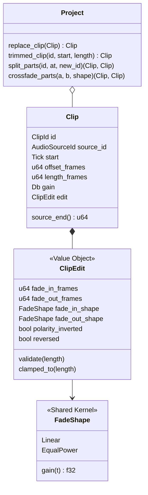
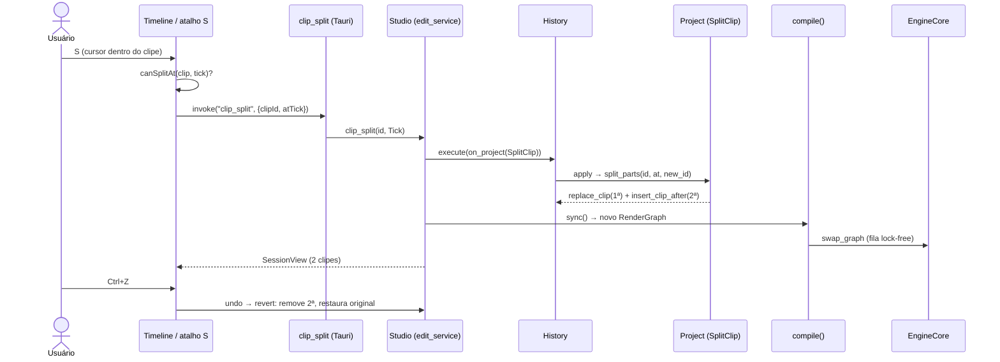
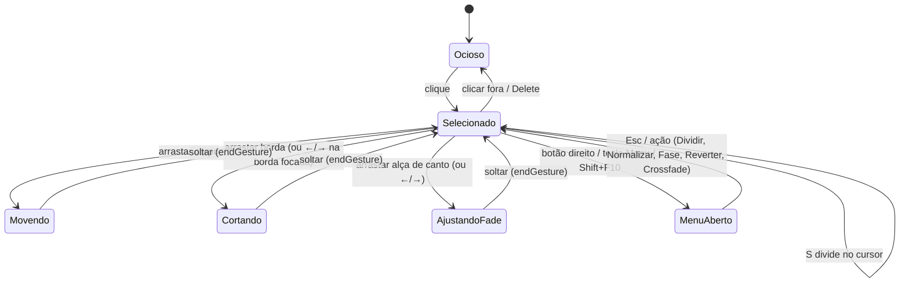
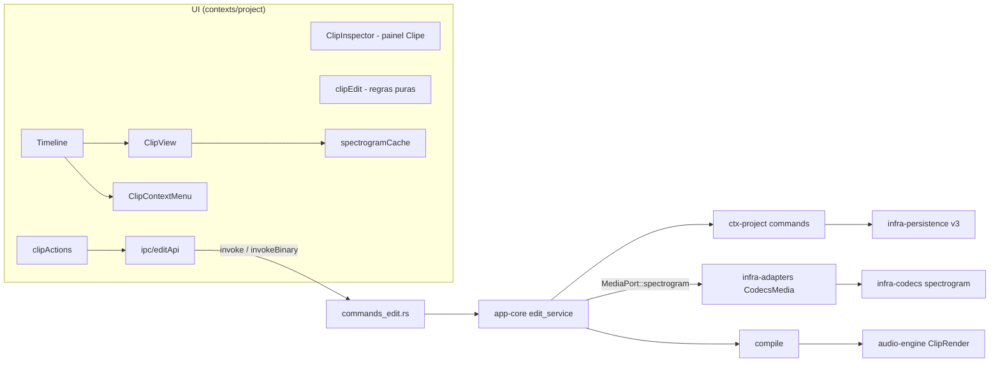
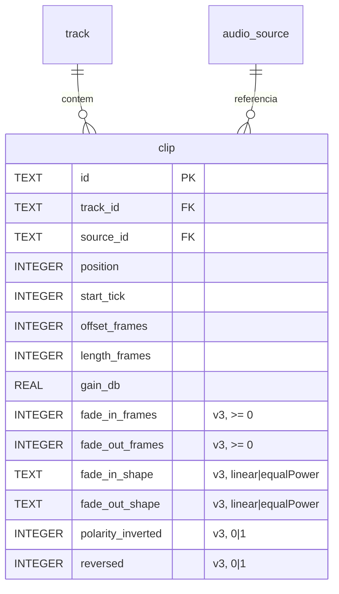

# Fase 3 — Edição / Pós-produção (especificação)

- **Data:** 2026-11-06 · **Requisitos:** RF-3.1 a RF-3.5, RNF-07 (não destrutivo)
- **Decisão arquitetural:** [ADR-0031](../adr/0031-edicao-nao-destrutiva-de-clipes.md)

## 1. Escopo

| Requisito | Entrega |
|---|---|
| RF-3.1 Cortar, dividir, mover | `TrimClip` (bordas), `SplitClip` (no cursor, atalho **S**), `MoveClip` (já existia) |
| RF-3.2 Fades e crossfades | `SetClipFades` (linear / equal power), `Crossfade` (sobreposição parcial na mesma faixa) |
| RF-3.3 Normalizar, ganho, fase, reverter | `clip_normalize` (pico → −1 dBFS via `SetClipGain`), slider de ganho, `SetClipPolarity`, `SetClipReversed` |
| RF-3.4 Efeitos por clipe/faixa | Por faixa: já entregue na Fase 2 (inserts). Por clipe: fora desta entrega (ver §8) |
| RF-3.5 Waveform + espectrograma selecionável | Alternância por faixa (≋); STFT com cache em disco; binário `AMSG` |

RNF-07: nenhuma operação desta fase escreve em `audio/`. Cortar/dividir mudam só a janela do clipe;
fades, polaridade e reverso são aplicados pela engine na reprodução/exportação.

## 2. Modelo de domínio (contexto Project)



Invariantes: `length > 0`; `offset + length ≤ source.length` (sem overflow); `fade_in + fade_out ≤ length`;
`start ≥ 0`. Comandos: `TrimClip`, `SplitClip`, `SetClipFades`, `SetClipPolarity`, `SetClipReversed`,
`Crossfade` — todos com `apply`/`revert` exatos e falha atômica (estado intacto).

### Semântica do reverso
A amostra `k` do clipe (0 ≤ k < length) lê a fonte em `offset + length − 1 − k`. Logo a borda
esquerda da timeline corresponde ao **fim** da região na fonte: cortar à esquerda reduz o fim da
região; dividir um clipe reverso dá à 1ª parte a região final da fonte.

### Curvas
`t ∈ [0,1]`: linear `g = t`; equal power `g = sin(t·π/2)`. Fade de entrada usa `t = k/fade_in`;
saída `t = (length − k)/fade_out`. Num crossfade linear a soma de amplitudes é 1; em equal power, a soma
de potências é 1 (testado).

## 3. Sequência — dividir no cursor



## 4. Estados — edição de um clipe na UI



Cada arraste usa um `gesture` → **um único item de desfazer**.

## 5. Componentes e serviços



## 6. Contratos IPC

| Comando | Argumentos (camelCase) | Resposta |
|---|---|---|
| `clip_trim` | `clipId, start (tick), lengthFrames, gesture?` | `SessionView` |
| `clip_split` | `clipId, atTick` | `SessionView` |
| `clip_set_fades` | `clipId, fades {fadeInFrames, fadeOutFrames, fadeInShape, fadeOutShape}, gesture?` | `SessionView` |
| `clip_set_polarity` | `clipId, inverted` | `SessionView` |
| `clip_set_reversed` | `clipId, reversed` | `SessionView` |
| `clip_crossfade` | `aId, bId, shape` | `SessionView` |
| `clip_normalize` | `clipId, targetDbfs?` (−60..0; padrão −1) | `SessionView` |
| `source_spectrogram` | `sourceId, params? {fftSize, hop, bins}` | binário `AMSG` |

`ClipView` ganhou `sourceFrames` e os campos de `ClipEdit`. Erros novos: `project.invalid_fade`,
`project.invalid_split`, `project.clips_do_not_overlap`, `edit.silent_clip`, `media.unsupported`.

### Formato `AMSG` (little-endian)
Cabeçalho de 40 bytes: magic, versão (1), bins (u16), FFT (u32), hop (u32), taxa (u32), colunas (u32),
quadros totais (u64), FNV-1a 64 do payload; depois `colunas × bins` bytes (grave → agudo).
Padrão: FFT 2048, hop 512, 128 faixas log de 20 Hz a Nyquist; −100..0 dBFS → 0..255.

## 7. Persistência (DER — tabela `clip`, schema 3)



Migração `project_v3.sql` (`ALTER TABLE … ADD COLUMN … DEFAULT`): projetos antigos abrem sem
processamento (padrões = comportamento anterior). Fades incoerentes vindos do banco são recusados
pela restauração do domínio (`persistence.corrupt`).

## 8. Modelo visual (wireframe registrado — modo autônomo)

```
┌ voz ─ M S ⏺ ≋ ─┐┌───────────────────────── clipe selecionado ────────────────────────┐
│                 │▌▪╲                         ∿∿∿ forma de onda ∿∿∿               ╱▪▐ │
│                 │▌  ╲__ curva fade-in                         curva fade-out __╱   ▐ │
└─────────────────┘└▲ borda: cortar início   ▪ alças de fade (cantos)   borda: cortar fim ▲┘
 ≋ = alterna forma de onda / espectrograma da faixa · botão direito = menu do clipe
 Painel "Clipe": [Ganho ────●──] [Normalizar] [Inverter fase] [Reverter]
                 Fade entrada (ms) [ 250 ] (Linear|Equal power) · Fade saída …
                 [Dividir no cursor] [Crossfade]
```

## 9. Fora desta entrega / próximos passos
- **Efeitos por clipe** (RF-3.4 parte "por clipe"): exigiria cadeia de inserts por clipe na engine;
  hoje efeitos são por faixa/bus. Proposta: renderizar como fonte derivada (ADR-0029) ou criar
  `ClipFx` com processadores pré-alocados — a decidir em ADR próprio.
- Espectrograma usa a fonte inteira (cache por conteúdo); zoom vertical/linear não exposto na UI.
- Crossfade automático ao soltar um clipe sobre outro (hoje é ação explícita).
