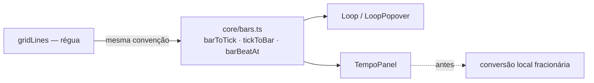

# VER-2026-11-10-06 — Mapa de tempo com a mesma numeração de compassos da régua

| Campo | Valor |
|---|---|
| Id | VER-2026-11-10-06 |
| Título | Mapa de tempo usa `barToTick`/`tickToBar` de `core/bars.ts` (numeração da régua e do loop) |
| Gravidade | baixa (número de compasso divergente entre painéis; no app real só aparece em eventos fora do início do compasso) |
| Tipo | correção · refatoração (remove duplicação) |
| Data | 2026-11-10 |
| Usuário responsável | TokumoH (pedido "trocar as funções locais do TempoPanel pelas de `core/bars.ts`", tarefa registrada em VER-2026-11-10-04) |
| Status | implementado |
| Commits | este commit |
| Arquivos | `ui/src/contexts/project/TempoPanel.tsx`, `ui/src/core/bars.ts`, `ui/src/contexts/project/TempoPanel.test.tsx` (novo), `ui/src/contexts/project/loopRanges.test.ts`, `docs/verificacoes/README.md`, `CHANGELOG.md`, este registro |

## Problema

O painel **Mapa de tempo** tinha `barToTick`/`tickToBar` locais que contavam **compassos fracionários**
quando uma mudança de fórmula caía no meio de um compasso. A régua (`gridLines`) e o loop
(`core/bars.ts`) usam outra convenção: **cada mudança de fórmula inicia um compasso novo** (o compasso
cortado conta inteiro). Efeitos:

- a tabela mostrava a fórmula de 3/4 no compasso **"2.50"** enquanto a régua mostrava **3**;
- digitar "compasso 4" gravava o andamento no tick 10080, que **não é linha de compasso** na régua (o
  compasso 4 da régua começa no tick 8640);
- duas implementações da mesma aritmética (componente repetido).

## Era proposital?

Não.

- **Histórico:** as funções vêm do primeiro commit do painel (merge `f472121`, 2026-11-05), mantidas
  sem mudança de lógica em `30ffc82`, `c970528` (só extraiu a tabela) e `1b0367f` (só legendas). O
  comentário original diz apenas "tick do início do compasso N considerando mudanças de fórmula", sem
  citar a convenção fracionária como escolha.
- **ADRs:** nenhum ADR em `docs/adr/` define numeração fracionária (busca por "fórmula de compasso",
  "fracion", "meio do compasso"; o ADR-0021 só trata da origem da fórmula na notação).
- **Registro anterior:** [VER-2026-11-10-04](VER-2026-11-10-04-loop-configuravel.md) já apontou a
  divergência ("usa compassos fracionários e diverge da régua; registrada tarefa separada para unificar").
- **Domínio Rust:** `TempoMap::validate` (`crates/shared-kernel/src/tempo.rs`) **rejeita** fórmula fora
  da linha de compasso (`MeterNotOnBarLine`). Então, no app real, compasso cortado não existe e a
  conversão antiga concorda com a régua nos inícios de compasso; a divergência aparece (a) no modo
  mock (desenvolvimento/E2E), cujo `meter_set` não valida a linha de compasso, e (b) na **exibição** de
  eventos fora do início do compasso — por exemplo andamentos importados de MIDI/GP/MusicXML
  (`infra-notation-io`), que o painel mostrava como "3.25".

## Solução

1. `TempoPanel` passa a usar `barToTick(tempo, n)` e `tickToBar(tempo, t)` de `core/bars.ts`; as
   funções locais saem.
2. Para não perder a posição de eventos fora do início do compasso (o decimal antigo), criada
   `barBeatAt(tempo, tick)` em `core/bars.ts` (compasso na numeração da régua + tempo + tique) e a
   tabela mostra esses eventos com `formatBarBeat` (o mesmo formato do transporte, `003.2.010`).
   Eventos no início do compasso continuam mostrando só o número ("3").

## Por que esta solução

- Uma única fonte de verdade para compasso ↔ tick (régua, loop e Mapa de tempo), já testada contra
  `gridLines`.
- `barBeatAt` fica na mesma camada pura (`core/bars.ts`, sem dependência de apresentação) e reutiliza
  `segments`/`barStartAt`/`tickToBar`; a formatação reutiliza `formatBarBeat` (componentes e funções
  independentes, sem novo formato de texto).

## Por que não outras soluções

| Opção | Motivo de descarte |
|---|---|
| Mudar a régua/loop para a convenção fracionária | A régua mostra números inteiros e o loop já depende da convenção atual (testes de VER-04); o pedido é alinhar o painel |
| Só trocar as funções e mostrar `tickToBar` inteiro em todos os eventos | Andamento importado no meio do compasso apareceria como "3", igual a um no início; perderia a informação que o decimal dava e geraria rótulos de remoção repetidos |
| Mostrar "compasso + fração" (ex.: "3.25") | Fração do compasso não é notação musical e se confunde com decimal de BPM; o transporte já usa compasso.tempo.tique |
| Calcular o tempo (beat) a partir de `gridLines` | Gera todas as linhas até o tick (custo linear na posição); `barBeatAt` é direto por segmento |

## Onde

| Arquivo | Linhas | O que mudou |
|---|---|---|
| [ui/src/contexts/project/TempoPanel.tsx](../../ui/src/contexts/project/TempoPanel.tsx#L5) | 5–6, 48–51, 67, 92 | Importa de `core/bars.ts`/`core/format.ts`; remove as conversões locais; `fmtBar` com numeração da régua; formulários usam `barToTick(tempo, n)` |
| [ui/src/core/bars.ts](../../ui/src/core/bars.ts#L74) | 14, 24, 74–80 | `Segment.beatTicks`; nova `barBeatAt` |
| [ui/src/contexts/project/TempoPanel.test.tsx](../../ui/src/contexts/project/TempoPanel.test.tsx) | novo | Painel com fórmula no meio do compasso 2: tabela, campo "Compasso" de andamento e de fórmula e evento fora do início do compasso conferidos contra `gridLines` |
| [ui/src/contexts/project/loopRanges.test.ts](../../ui/src/contexts/project/loopRanges.test.ts#L20) | 2, 20–25 | `barBeatAt` bate com compasso e tempo de cada linha da régua (4/4, troca, compasso cortado) |
| [docs/verificacoes/README.md](README.md) | "Onde" | Lista este registro |
| [CHANGELOG.md](../../CHANGELOG.md) | "Não lançado › Corrigido" | Entrada da correção |

## Lógica

Mapa: 4/4 no tick 0 e 3/4 no tick 5760 (meio do compasso 2; PPQ 960, compasso 4/4 = 3840, 3/4 = 2880).

| Passo | Antes (fracionário) | Depois (régua) |
|---|---|---|
| Segmentos | 4/4 dura 5760/3840 = **1,5** compasso | 4/4 dura ⌈1,5⌉ = **2** compassos (o 2 é cortado) |
| `tickToBar(5760)` | 1 + 1,5 = **2.50** | 1 + 2 = **3** |
| `barToTick(4)` | 5760 + (4 − 2,5) × 2880 = **10080** | 5760 + (4 − 3) × 2880 = **8640** |
| Rótulo de evento em 5760 + 960 + 10 | "2.84" | **003.2.010** (compasso 3, tempo 2, tique 10) |

## Exemplo

Projeto no modo mock com 3/4 a partir do tick 5760:

- **Antes:** tabela "Fórmula de compasso" → `1`, `2.50`; digitar compasso 4 / 90 BPM → andamento no tick
  10080 (meio do compasso 4 da régua).
- **Depois:** tabela → `1`, `3` (igual à régua); compasso 4 / 90 BPM → tick 8640 (linha do compasso 4
  da régua); compasso 5 em "Fórmula" → tick 11520 (linha do compasso 5).

## Verificação

- **Verificação 1 (testes do projeto):**
  - TDD: `TempoPanel.test.tsx` escrito antes da correção — **falhou** (3/3) com `2.50` × `3`,
    tick 10080 × 8640 e 12960 × 11520.
  - Após a correção: `npx vitest run` → **41 arquivos, 248 testes passaram**; `npx tsc -b --noEmit` sem
    erros; `npx vite build` ok; `npx playwright test --trace off` → **51 passaram** (Chromium
    pré-instalado do ambiente via config temporária fora do commit, porque a versão do Playwright do
    projeto procura outro binário); `npm audit` → 0 vulnerabilidades.
- **Verificação 2 (outra abordagem — simulação aleatória):** teste temporário (não commitado) com
  500 mapas de tempo aleatórios (250 alinhados, como o Rust exige, e 250 com compasso cortado; 2–7
  tempos, figuras 2/4/8, até 5 mudanças): `barToTick`, `tickToBar`, `barStartAt` e `barBeatAt`
  conferidos contra **93.251 linhas da régua** — todas iguais. A conversão antiga divergiu da régua em
  **250/250** mapas cortados e em **0/250** mapas alinhados (confirma que, no backend real, os inícios
  de compasso não mudam). Segunda execução da suíte inteira (vitest + tsc) também limpa.
- **Rebase sobre `4ac4550`** (commit novo na `branchTrabalho` durante o trabalho; o registro passou de
  VER-05 para VER-06 e o conflito no README foi resolvido mantendo as duas linhas). Verificações
  refeitas do zero: `npx vitest run` → **41 arquivos, 249 testes** (duas execuções seguidas), `tsc`
  sem erros, `vite build` ok, `npx playwright test --trace off` → **53 passaram**; sabotagem do
  `TempoPanel` antigo → 4/4 testes do painel falham.
- **Sabotagens:**
  - `TempoPanel.tsx` antigo restaurado → os 4 testes do painel falham.
  - `barBeatAt` usando o tamanho do compasso no lugar do tempo → 4 testes de `loopRanges.test.ts` falham.
  - `fmtBar` sempre inteiro → falha o teste do evento fora do início do compasso.
- Nit corrigido durante a revisão: asserções dos testes trocadas de `toContain("4")` por igualdade na
  célula "Compasso" (o `toContain` aceitaria "4" dentro de outro texto); reconferência pontual:
  `npx vitest run src/contexts/project` → 38 passaram.

## Riscos

- **Mock × Rust:** o `meter_set` do mock aceita fórmula fora da linha de compasso, o Rust recusa
  (`MeterNotOnBarLine`). Pelo painel isso não acontece mais (ele sempre envia início de compasso), mas o
  mock continua permissivo — pendência sugerida: validar no mock como no domínio.
- **Transporte (`bar_beat` no Rust)** usa divisão inteira por segmento; coincide com a régua porque o
  domínio proíbe compasso cortado. Se essa regra mudar, o Rust precisa da mesma convenção (`ceil`).
- Rótulos de eventos fora do início do compasso mudam de decimal ("3.25") para `003.2.000`; não há E2E
  com MIDI importado conferindo esse texto (coberto por teste de componente).
- Não verificado em Windows/macOS (só Linux/Chromium); mudança é só TypeScript puro de UI.
