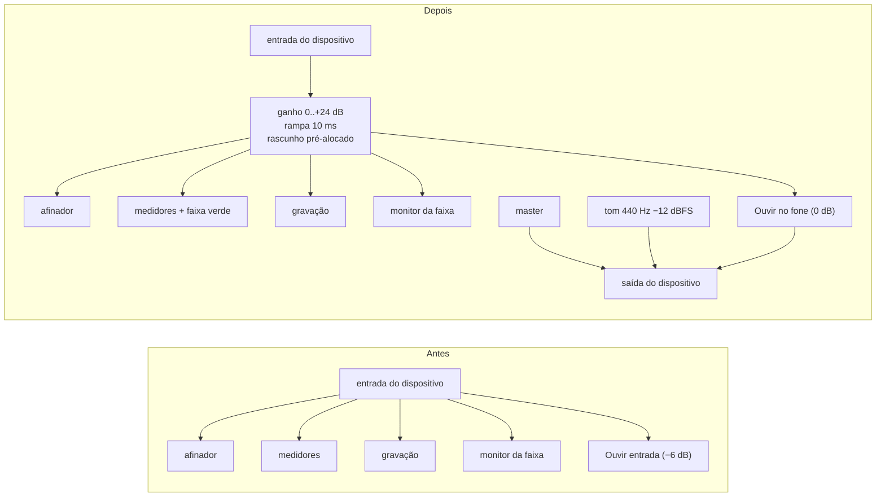

# VER-2026-11-16-02 — Áudio: microfone × fone, ganho de entrada e "Testar som" (S1)

| Campo | Valor |
|---|---|
| Id | VER-2026-11-16-02 |
| Título | Configurações de áudio separadas em "Fone / alto-falantes" × "Microfone / interface", ganho de entrada 0..+24 dB, tom de teste e retorno em 0 dB |
| Gravidade | alta (UX: "o áudio está baixo" e rótulos ambíguos — UX-01/UX-02 da varredura 5) |
| Tipo | funcionalidade |
| Data | 2026-11-16 |
| Usuário responsável | TokumoH (aprovou S1 e o mockup 11, prancheta 1) |
| Status | implementado |
| Commits | este commit (branch do worktree; integrado pela sessão principal) |
| Arquivos | engine: `crates/audio-engine/src/{core,handle,lib,input_gain,test_tone}.rs`, `crates/audio-engine/tests/{input_gain,no_alloc}.rs`; aplicação: `crates/app-core/src/{input_gain,lib,studio}.rs`, `crates/app-core/tests/input_gain.rs`; IPC: `crates/app-desktop/src/{audio,commands,main,ipc_tests}.rs`; UI: `ui/src/app/{AudioSettingsDialog.tsx,AudioSettingsDialog.test.tsx,audioSettings.css,Workspace.tsx,helpTopics.ts}`, `ui/src/contexts/recording/{InputSection.tsx,InputSection.test.tsx,InputMeters.tsx,inputRoutes.ts,inputRoutes.test.ts,RecordingPanel.tsx,recording.css}`, `ui/src/core/{audio,glossary}.ts`, `ui/src/ipc/{api,mock,schema}.ts`; E2E: `ui/e2e/{audio-settings,recording-input,tooltips}.spec.ts`; docs: `docs/manual/{README,guia-instalacao-local}.md`, READMEs de módulo (`crates/audio-engine`, `crates/app-core`, `ui/src/app`, `ui/src/contexts`, `ui/src/core`), este registro e `docs/verificacoes/README.md` |

## Problema

Relato do usuário (diagnóstico em [`docs/relatorios/2026-11-16-varredura-5-ux.md`](../relatorios/2026-11-16-varredura-5-ux.md),
seções 1.1, 1.3 e S1): "o áudio está baixo" e não fica claro o que é microfone e o que é fone.

- A reprodução **não perde ganho** (medido na varredura), mas não havia como o usuário provar isso: faltava um teste de
  saída com nível conhecido.
- Não existia **ganho de entrada**: um microfone fraco (−40 dBFS) gravava fraco, sem como subir no app.
- O "Ouvir entrada" começava em **−6 dB**, então o retorno no fone soava mais baixo que o sinal real.
- Rótulos ambíguos: "Saída", "Entrada (gravação)", "Driver"; o microfone podia ser escolhido em **dois lugares**
  (diálogo e painel Gravação, "Entrada de áudio").
- A latência do diálogo usava **48 kHz fixo** (`AudioSettingsDialog.tsx:46` antes) mesmo com projeto a 44,1/96 kHz.

## Era proposital?

- **Monitor a −6 dB:** escolha da 0.2.1 contra microfonia; sem registro de que deveria soar baixo (VER-2026-11-16-01). O
  retorno continua **desligado** ao abrir o app (essa é a proteção real); só o volume padrão passa a 0 dB.
- **48 kHz fixo:** sem comentário/ADR; o status já trazia `sampleRate` real. Erro, não decisão.
- **Microfone em dois lugares:** o seletor do painel veio do mockup 7 (atalho para gravar sem abrir o diálogo); o S1
  aprovado decide um lugar só e deixa no painel o resumo só leitura + botão para o diálogo.
- **Ganho/tom:** nunca existiram (nenhuma spec, task ou tentativa anterior no histórico).

## Solução

1. **Engine (Pure Fabrication de tempo real):**
   - [`input_gain.rs`](../../crates/audio-engine/src/input_gain.rs): ganho 0..+24 dB (`input_gain_linear`, clamp, NaN → 0 dB)
     com rampa linear por quadro de ~10 ms; amostras não finitas viram silêncio.
   - [`core.rs`](../../crates/audio-engine/src/core.rs) `process`: a entrada é copiada com ganho para um **rascunho
     pré-alocado** (`INPUT_SCRATCH_SAMPLES = MAX_BLOCK × 64`) **antes** da derivação do afinador, dos medidores, da
     gravação, do monitor de faixa e do monitor de dispositivo. O callback agora é processado em blocos de até
     `MAX_BLOCK` quadros (menos com > 64 canais). Sem alocação, sem trava, sem pânico; se o rascunho faltar (pânico
     capturado pelo backend), a entrada passa sem ganho em vez de quebrar todo callback seguinte.
   - [`test_tone.rs`](../../crates/audio-engine/src/test_tone.rs): senoide 440 Hz com rampas de 10 ms, somada à saída do
     dispositivo **depois do master** (como o monitor). Não é gravado (a gravação lê a entrada) nem exportado (a
     exportação usa outro núcleo offline).
   - Mensagens `SetInputGain(f32)` e `PlayTestTone { frames, amplitude }`; `EngineHandle::set_input_gain_db` e
     `play_test_tone(segundos, dBFS)` (clamp 0,05–5 s, −60–0 dBFS).
2. **Aplicação** ([`app-core/src/input_gain.rs`](../../crates/app-core/src/input_gain.rs)): `Studio::set_input_gain_db`
   (recusa NaN, limita 0..+24, guarda mesmo sem engine), reaplicado em `attach_engine`; `play_test_tone` (1 s, −12 dBFS).
3. **IPC/persistência** (app-desktop): `AudioStatus.inputGainDb`; comandos `audio_input_gain_set { gainDb }` (persiste em
   `audio.inputGainDb` nas configurações da biblioteca, ao lado de `audio.request`) e `audio_test_tone`; o valor salvo é
   aplicado ao abrir o app antes de iniciar o dispositivo.
4. **UI:**
   - Diálogo "Configurações de áudio" conforme o mockup aprovado: "Sistema de áudio: host · taxa"; seção **Fone /
     alto-falantes — o que você ouve** (saída, *Testar som* com indicador, dica de volume do SO); seção **Microfone /
     interface — o que você grava** (entrada, medidores com faixa verde −18 a −6 dB, aviso "Sinal baixo" < −30 dB,
     "Muito alto" > −1 dB, *Ganho* 0..+24 dB, "Ouvir o microfone no fone enquanto grava" + volume, padrão 0 dB);
     **Desempenho** recolhido (buffer) com latência pela taxa real; Cancelar/Aplicar.
   - Painel Gravação: bloco **Microfone (entrada)** com microfone e ganho só leitura, botão **Configurar microfone e
     fone…** (abre o mesmo diálogo pela store `useAudioSettingsUi` em `core/audio.ts`, respeitando as regras de camadas),
     os mesmos medidores ([`InputMeters.tsx`](../../ui/src/contexts/recording/InputMeters.tsx)) e "Ouvir no fone" em 0 dB.
   - Glossário, central de ajuda e manual com os nomes "Microfone (entrada)" e "Fone / alto-falantes (saída)".

## Por que esta solução

- O ganho antes de **todos** os consumidores da entrada garante que o que se vê no medidor é o que se grava e se ouve.
- O tom de teste a −12 dBFS dá uma referência objetiva: se soar baixo, o problema está no SO/fone (o app prova que não
  reduz o volume).
- Rascunho pré-alocado + `mem::take` (o `Vec::new` vazio não aloca) mantém a regra R1 (sem alocação no RT), coberta pelo
  teste `no_alloc` com ganho e tom ligados.
- Store em `core/` para abrir o diálogo: contextos não importam `app` (teste de arquitetura U4); o menu e o painel usam o
  mesmo mecanismo e o `Workspace` mudou só 3 linhas.

## Por que não outras soluções

| Opção | Motivo de descarte |
|---|---|
| Aplicar o ganho dentro de cada consumidor (tap, recorder, medidores, monitores) | Cinco caminhos para manter em sincronia; rampa duplicada; fácil esquecer um (ex.: afinador) |
| Alocar o buffer com ganho no callback | Viola R1 (sem alocação no RT) |
| Rascunho do tamanho do maior callback possível (16 384 × canais) | Canais só são conhecidos ao abrir o dispositivo; o processamento em blocos resolve com memória fixa (256 KiB) |
| Tom de teste como clipe/faixa na mixagem | Entraria no master, na exportação e no medidor do master; o usuário testaria a mixagem, não a saída |
| Tom gerado no WebView (AudioContext) | Testaria a saída do navegador/SO, não o dispositivo escolhido no Ebiki |
| Guardar o ganho no projeto | É configuração do dispositivo/usuário, como o "Ouvir entrada"; trocar de projeto não deve mudar o microfone |
| Guardar o ganho dentro do JSON `audio.request` | Exigiria reescrever o JSON em dois comandos; chave própria ao lado é mais simples e independente |
| Manter o seletor de microfone no painel Gravação | O S1 aprovado pede um lugar só (evita estados divergentes); o painel abre o diálogo |

## Onde

| Arquivo | Linhas | O que mudou |
|---|---|---|
| [crates/audio-engine/src/input_gain.rs](../../crates/audio-engine/src/input_gain.rs#L1) | todo | novo: faixa, conversão dB, rampa, testes unitários |
| [crates/audio-engine/src/test_tone.rs](../../crates/audio-engine/src/test_tone.rs#L1) | todo | novo: oscilador do tom com rampas, testes unitários |
| [crates/audio-engine/src/core.rs](../../crates/audio-engine/src/core.rs#L299) | 13–45, 58–68, 262–266, 293–360, fim | mensagens, estado, `process` em blocos com ganho antes de tudo, tom após o master, teste sem rascunho |
| [crates/audio-engine/src/handle.rs](../../crates/audio-engine/src/handle.rs#L131) | 131–160 | `set_input_gain_db`, `play_test_tone` |
| [crates/audio-engine/src/lib.rs](../../crates/audio-engine/src/lib.rs#L1) | 13–35 | módulos e reexports |
| [crates/audio-engine/tests/input_gain.rs](../../crates/audio-engine/tests/input_gain.rs#L1) | todo | ganho em medidor/afinador/monitores/take/80 canais; rampa, clamp, NaN; tom (nível, duração, fora do master e da gravação) |
| [crates/audio-engine/tests/no_alloc.rs](../../crates/audio-engine/tests/no_alloc.rs#L80) | 80–110 | ganho e tom ligados no teste de não alocação |
| [crates/app-core/src/input_gain.rs](../../crates/app-core/src/input_gain.rs#L1) | todo | casos de uso do ganho e do tom |
| [crates/app-core/src/studio.rs](../../crates/app-core/src/studio.rs#L106) | 106–108, 147, 162 | campo `input_gain_db`, reaplicar ao trocar a engine |
| [crates/app-core/tests/input_gain.rs](../../crates/app-core/tests/input_gain.rs#L1) | todo | validação, sem engine, troca de engine, tom fora da exportação |
| [crates/app-desktop/src/audio.rs](../../crates/app-desktop/src/audio.rs#L26) | 26, 71, 90 | `inputGainDb` no status |
| [crates/app-desktop/src/commands.rs](../../crates/app-desktop/src/commands.rs#L76) | 75–96 | `audio_input_gain_set` (persiste), `audio_test_tone` |
| [crates/app-desktop/src/main.rs](../../crates/app-desktop/src/main.rs#L47) | 47–58, 90–91 | carrega o ganho salvo; registra os comandos |
| [crates/app-desktop/src/ipc_tests.rs](../../crates/app-desktop/src/ipc_tests.rs#L357) | 357–373 | payloads da UI, clamp, erro sem engine |
| [ui/src/app/AudioSettingsDialog.tsx](../../ui/src/app/AudioSettingsDialog.tsx#L1) | todo | diálogo reescrito conforme o mockup |
| [ui/src/app/AudioSettingsDialog.test.tsx](../../ui/src/app/AudioSettingsDialog.test.tsx#L1) | todo | 7 testes |
| [ui/src/app/audioSettings.css](../../ui/src/app/audioSettings.css#L1) | todo | estilos do diálogo |
| [ui/src/app/Workspace.tsx](../../ui/src/app/Workspace.tsx#L4) | 4, 125, 298 | abre o diálogo pela store (mudança mínima) |
| [ui/src/contexts/recording/InputSection.tsx](../../ui/src/contexts/recording/InputSection.tsx#L1) | todo | "Microfone (entrada)", só leitura, botão, 0 dB, relê o retorno ao fechar o diálogo |
| [ui/src/contexts/recording/InputMeters.tsx](../../ui/src/contexts/recording/InputMeters.tsx#L1) | todo | medidores com faixa verde e avisos (compartilhado) |
| [ui/src/contexts/recording/inputRoutes.ts](../../ui/src/contexts/recording/inputRoutes.ts#L50) | 50–72 | `levelZone`, `dbFraction`, limites |
| [ui/src/core/audio.ts](../../ui/src/core/audio.ts#L38) | 38–60 | `setInputGain`, `useAudioSettingsUi`, `openAudioSettings` |
| [ui/src/core/glossary.ts](../../ui/src/core/glossary.ts#L123) | 20, 123–130, 139–142 | legendas com os novos nomes, ganho, testar som |
| [ui/src/ipc/api.ts](../../ui/src/ipc/api.ts#L44) · [schema.ts](../../ui/src/ipc/schema.ts#L203) · [mock.ts](../../ui/src/ipc/mock.ts#L196) | — | contrato e mock (ganho escala os medidores simulados) |
| [ui/e2e/audio-settings.spec.ts](../../ui/e2e/audio-settings.spec.ts#L1) · [recording-input.spec.ts](../../ui/e2e/recording-input.spec.ts#L1) · [tooltips.spec.ts](../../ui/e2e/tooltips.spec.ts#L17) | — | E2E atualizados e novo cenário fone × microfone |
| [docs/manual/README.md](../manual/README.md) · [guia-instalacao-local.md](../manual/guia-instalacao-local.md) · [ui/src/app/helpTopics.ts](../../ui/src/app/helpTopics.ts#L24) | — | manual e central de ajuda |

## Lógica

1. Callback: mensagens → para cada bloco (≤ 1024 quadros): ganho → derivação → medidores → `process_block` (faixas,
   gravação, master) → saída → monitor do dispositivo → tom de teste.
2. Mudar o ganho na UI: `api.audioInputGainSet` → `Studio::set_input_gain_db` → mensagem à engine → rampa; status e
   configuração salva atualizados; os medidores reagem na hora.

## Exemplo

- Microfone a 0,1 (−20 dBFS) com **+12 dB**: medidor, afinador, monitor e take gravado = **0,398** (−8 dBFS, dentro da faixa
  verde). Testado em `gain_reaches_*` e no take WAV.
- Microfone simulado do canal 2 a 0,01 (**−40 dB**, aviso "Sinal baixo"); com **+24 dB** vai a 0,158 (**−16 dB**, verde) —
  E2E `audio-settings.spec.ts`.
- Tom de teste: pico **0,251** (−12 dBFS), último quadro não nulo em 47 9xx de 48 000 (1 s), rampas < 0,01 nas pontas;
  exportação do mesmo projeto com o tom tocando: **todas as amostras = 0**.
- Latência para buffer 256: **10,7 ms** a 48 kHz, **11,6 ms** a 44,1 kHz (antes mostrava 10,7 ms nos dois casos).

## Verificação

Primeira rodada completa achou dois pontos na revisão do diff (abaixo); depois de corrigidos, as verificações foram
refeitas do zero.

- **Achados da revisão (rodada inicial):** (1) se um pânico capturado pelo backend ocorresse com o rascunho fora do
  `self`, todo callback seguinte entraria em pânico → `use_gain` passou a depender do tamanho real do rascunho (teste
  `without_scratch_the_input_passes_without_gain_instead_of_panicking`); (2) o painel Gravação não relia o retorno
  ligado/desligado no diálogo → relê ao fechar o diálogo (teste novo no `InputSection.test.tsx`). Também na rodada
  inicial: a lista de medidores herdava `flex: 1 1 300px` do painel e abria um vão de 240 px no diálogo (visto em captura
  1024×640) → `flex: none` no diálogo.
- **Verificação 1:** `cargo fmt --all -- --check` ok; `cargo clippy -p audio-engine -p app-core -p app-desktop
  --all-targets -- -D warnings` ok; `cargo test -p audio-engine -p app-core -p app-desktop -p infra-adapters` **149
  passaram, 0 falhas** (inclui `no_alloc` com ganho e tom, simulação e cadeia completa de exportação);
  `python3 scripts/check_readmes.py` ok (48); UI: `npx tsc --noEmit` ok, `npx vitest run` **268/268**, `npx vite build`
  ok, `npx playwright test --trace off` **56/56**.
- **Verificação 2 (outra abordagem/parâmetro):** `cargo test --release -p audio-engine` (otimizado, outro arredondamento
  de ponto flutuante) **53/53**; `npx tsc -b --noEmit` (modo projeto, como a CI) ok; Playwright com `--workers 1
  --repeat-each 2` nas specs de áudio, gravação, legendas, cobertura de legendas e identidade **30/30**; varredura por
  rótulos antigos ("Entrada de áudio", "Entrada (gravação)", "Driver:", "Dispositivo de entrada da gravação") sem
  ocorrências na UI/E2E/manual; capturas 1280×720 e 1024×640 nos temas escuro e claro (sem estouro horizontal; a
  1024×640 o diálogo rola 76 px dentro do próprio corpo).
- **Sabotagens (o teste falha sem a correção?):** derivação/medidores lendo a entrada crua → 3 testes de
  `input_gain.rs` falham; gravação/monitor de faixa lendo a entrada crua e tom removido → 5 falham; latência com 48 kHz
  fixo → teste do diálogo falha; retorno padrão −6 dB → teste do painel falha; sem `reapply_input_gain` na troca de
  engine → teste de app-core falha; sem reler o retorno ao fechar o diálogo → teste do painel falha.
- `cargo test --workspace` completo não foi rodado nesta máquina (disco cheio durante a tentativa; a sessão principal
  limpou o `target/`). Rodaram os crates tocados e o consumidor `infra-adapters`; os demais crates não mudaram.

## Riscos

- **Hardware real não testado** (ambiente sem placa de som): o ganho e o tom foram verificados por simulação offline do
  mesmo núcleo, pelo teste de não alocação e por E2E com o mock. Vale ouvir o *Testar som* e conferir o ganho num
  Windows/macOS reais.
- O ganho é **digital** (+24 dB também sobe o ruído do microfone); interfaces com ganho analógico devem ser ajustadas
  primeiro nelas — a dica de "Sinal baixo" não distingue os casos.
- O processamento em blocos mudou a ordem interna do callback (tap/medidores por bloco de 1024 em vez do callback
  inteiro); resultados idênticos nos testes existentes, mas é a parte mais sensível do diff.
- Ganho e retorno aplicam na hora; **Cancelar** desfaz só dispositivo e buffer (comportamento já existente do retorno).
- Comentários internos de código ainda chamam a função de "Ouvir entrada" (`schema.ts`, `inputRoutes.ts`,
  `device_monitor.rs`); nomes da UI já seguem o novo padrão.
- Se a gravação da configuração falhar (biblioteca indisponível), o ganho vale só na sessão (erro ignorado como no
  `audio.request`).
